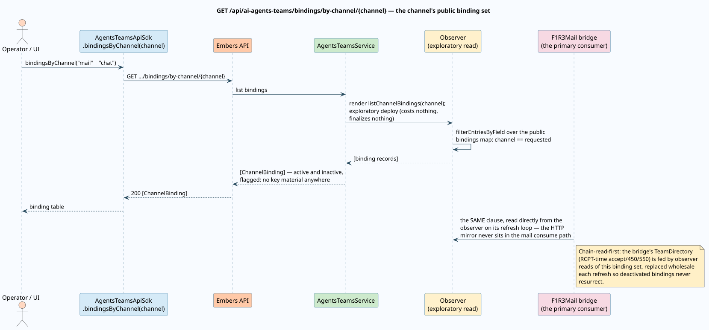

# List channel bindings

Reads every binding for a channel — the HTTP mirror of the observer-readable
chain clause channel services consume directly.

| | |
| --- | --- |
| Operation | `GET /api/ai-agents-teams/bindings/by-channel/{channel}` (tag: AIAgentsTeams) |
| Generated client | `AIAgentsTeamsApi.agentsTeamsBindingsByChannel` |
| SDK wrapper | `AgentsTeamsApiSdk.bindingsByChannel` (`sdk.agentsTeams.bindingsByChannel(channel)`) |
| Backend | `packages/embers/src/api/agents_teams/endpoints.rs:877` → `domain/agents_teams/publish_to_mail.rs` |
| Schema pin | `packages/client/schema.json` @ `69012a4` (Embers API 0.1.0) |

## Semantics

A binding is a team's public reachability record for one channel:
`{channel, address, agents_team, team_id, owner, active, created_at}` — and
nothing else. **No key material exists here or anywhere in embers for the mail
channel**: mailbox content keys are minted and custodied by the mail bridge.

The read renders an observer exploratory deploy over the env's
`listChannelBindings` clause, filtering the public bindings map by channel —
costing nothing and finalizing nothing. Inactive bindings are included with
`active: false` (unpublishing deactivates, reversibly; it never deletes).

**The primary consumer never calls this endpoint.** The mail bridge's directory
refresh reads the same clause straight from the observer (**chain-read-first**),
building the bound-address set the SMTP frontend answers RCPT from — replaced
wholesale each refresh so deactivated bindings never resurrect. This HTTP
mirror serves the UI and operations: auditing which addresses exist, which team
holds each, and which are dormant. The `channel` path parameter takes the grant
channel vocabulary (`chat` or `mail`); today only mail publishes bindings here
(chat aliases live workspace-scoped in the gateway's own store), so `chat`
answers an empty array.

## Request

| Parameter | In | Type | Required | Meaning |
| --- | --- | --- | --- | --- |
| `channel` | path | `GrantChannel` (`chat` or `mail`) | yes | The channel whose bindings to list. |

## Responses

| Status | Body | Meaning |
| --- | --- | --- |
| 200 | `ChannelBinding[]` | Every binding for the channel, active and inactive; empty array when none. |
| 400 | none | The path value is outside the channel vocabulary. |
| 500 | `InternalError` | Observer read failure. |

`ChannelBinding` — documented on the declaration below.

### Response types (TypeScript)

Generated declarations from `packages/client/src/api-client/models/`, doc comments included — the comments are generated from the backend models' Rust `///` doc comments (property names are the SDK's camelCase; the wire JSON uses snake_case where they differ):

```typescript
/**
 * A team's public reachability record for one channel. Carries no key
 * material: channel-side secrets are minted and custodied by the channel
 * service, never by embers.
 */
export interface ChannelBinding {
  /**
   * Whether the binding is in force; unpublishing flips this off, reversibly.
   */
  active: boolean;
  /** The channel-native address (for mail, `local@domain`). */
  address: string;
  /** The bound team deployment's registry URI. */
  agentsTeam: Uri;
  /** The channel the binding serves. */
  channel: string;
  /** Binding creation instant. */
  createdAt: TimestampMillis;
  /** The team owner's wallet address. */
  owner: string;
  /** The bound team's identity (`UUIDv4`). */
  teamId: string;
}
```

`GrantChannel` is documented in
[grants create](grants-create.md#request-types-typescript).

## Retry semantics

Idempotent read; safe to poll. The mail bridge's refresh loop is exactly such a
poll against the underlying clause.

## Sequence



## Worked example

```bash
curl -s http://localhost:8080/api/ai-agents-teams/bindings/by-channel/mail
```

```json
[
  {
    "channel": "mail",
    "address": "research-crew@agents.example",
    "agents_team": "rho:id:o6c4x1zbdqjqzqzr8cgpgqf3zc9dsqn86wjc1xj8kuyxwbxwe8xn1p",
    "team_id": "6a1c9c2e-8f3d-4b5a-9c7e-1d2f3a4b5c6d",
    "owner": "1111AtahZ...",
    "active": true,
    "created_at": "1754900010000"
  }
]
```

## SDK usage

```typescript
const bindings = await sdk.agentsTeams.bindingsByChannel("mail");
const dormant = bindings.filter((binding) => !binding.active);
```

## Related

- [Publish to mail](publish-to-mail.md) / [unpublish mail](unpublish-mail.md)
  — the mutations behind these records.
- [Published channels](published-channels.md) — the per-team aggregation.
- [F1R3Mail integration](../../../integrations/f1r3mail.md) — the chain-first
  consumer and the RCPT states it feeds.
