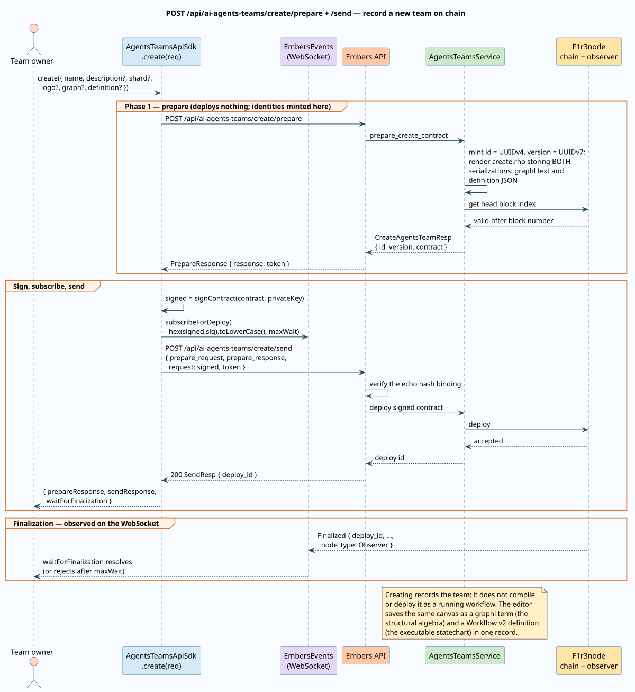

# Create a team

Records a new agent team on chain, minting its identity and first version.

| | |
| --- | --- |
| Operation | `POST /api/ai-agents-teams/create/prepare` + `POST /api/ai-agents-teams/create/send` (tag: AIAgentsTeams) |
| Generated client | `AIAgentsTeamsApi.agentsTeamsPrepareCreate`, `AIAgentsTeamsApi.agentsTeamsSendCreate` |
| SDK wrapper | `AgentsTeamsApiSdk.create` (`sdk.agentsTeams.create(req)`) |
| Backend | `packages/embers/src/api/agents_teams/endpoints.rs:77` → `domain/agents_teams/create.rs` |
| Schema pin | `packages/client/schema.json` @ `01e8ea0` (Embers API 0.1.0) |

## Semantics

The standard token-bound create with **identity minting at prepare** (`id` UUIDv4, first
`version` UUIDv7), structurally as specified for [agents](../ai-agents/create.md). What is
team-specific is the payload: the record stores **both serializations of one canvas** —
`graph` (graphl text; the SDK's typed `Graph` AST serializes to it) and `definition`
(Workflow v2 JSON). The editor's save path sends both together, which is what keeps the
structural term and the executable statechart describing the same drawing.

Creating records the team. It does not validate it strictly (that is
[deploy](deploy.md)'s publishable validation), does not compile it, and does not run it.

## Request

### `POST /api/ai-agents-teams/create/prepare`

Body `CreateAgentsTeamReq` — fields documented on the declaration below.

### `POST /api/ai-agents-teams/create/send`

Body `SendRequestBody_SignedContract_CreateAgentsTeamReq_CreateAgentsTeamResp` — the
standard echo envelope.

### Request types (TypeScript)

Generated declarations from `packages/client/src/api-client/models/`, doc comments included — the comments are generated from the backend models' Rust `///` doc comments (property names are the SDK's camelCase; the wire JSON uses snake_case where they differ):

```typescript
export interface CreateAgentsTeamReq {
  /**
   * The Workflow v2 definition document; validated permissively at save
   * time, strictly at deploy.
   */
  definition?: any | null;
  /** Team description. */
  description?: string;
  /** The graphl serialization of the canvas. */
  graph?: Graph;
  /** Logo reference. */
  logo?: string;
  /** Team name. */
  name: string;
  /** Declared shard label. */
  shard?: string;
}
```

## Responses

| Phase | Status | Body | Meaning |
| --- | --- | --- | --- |
| prepare | 200 | `PrepareResponse_CreateAgentsTeamResp` | `{ response: { id, version, contract }, token }`. |
| send | 200 | `SendResp` | `{ deploy_id }` — accepted; finalization pending. |
| send | 500 | `InternalError` | Token/echo mismatch, or deploy submission failure. |

### Response types (TypeScript)

Generated declarations from `packages/client/src/api-client/models/`, doc comments included — the comments are generated from the backend models' Rust `///` doc comments (property names are the SDK's camelCase; the wire JSON uses snake_case where they differ):

```typescript
export interface PrepareResponseCreateAgentsTeamResp {
  /**
   * The operation-specific prepare payload, carrying the unsigned
   * contract(s) to sign.
   */
  response: CreateAgentsTeamResp;
  /**
   * JWT binding the send to exactly this prepare exchange; expires after
   * one day.
   */
  token: string;
}

export interface CreateAgentsTeamResp {
  /** The unsigned creation contract bytes to sign. */
  contract: Base64;
  /** The minted team identity (`UUIDv4`). */
  id: string;
  /** The first version's identifier (`UUIDv7`). */
  version: string;
}

export interface SendResp {
  /**
   * The accepted deploy's identifier (lowercase hex of its signature);
   * finalization is still pending when this returns.
   */
  deployId: string;
}
```

## Signing and binding

| Property | Value |
| --- | --- |
| Token | Present — standard hash-bound exchange. |
| Signing key | The caller's wallet key. |
| Contracts signed | One: the creation contract. |
| Deploy identifier | `hex(sig).toLowerCase()` — subscribed before send. |

## Retry semantics

Prepare is always safe to retry. After a finalization timeout, verify before re-creating —
a re-run mints a second team with a different `id`; check [list](list.md) first.

## Sequence



## Worked example

Prepare request (abbreviated serializations):

```json
{
  "name": "review-loop",
  "description": "Draft, critique, decide",
  "graph": "0 * {context ...TRUNCATED...}",
  "definition": { "schema": "2.0", "entryScopeId": "scope:root", "nodes": ["...TRUNCATED..."] }
}
```

Response shapes follow the [agent create example](../ai-agents/create.md#worked-example)
with team models substituted.

## SDK usage

```typescript
const { prepareResponse, waitForFinalization } = await sdk.agentsTeams.create({
  name: "review-loop",
  graph: canvasGraphAst,
  definition: workflowDefinition,
});
await waitForFinalization;
```

## Related

- [Save](save.md) — appending versions; [Deploy](deploy.md) — compiling and running.
- [Workflow Definition v2](../../../../../embers-frontend/docs/agent-teams/specification/workflow-definition-v2.md) —
  what a well-formed `definition` is.
