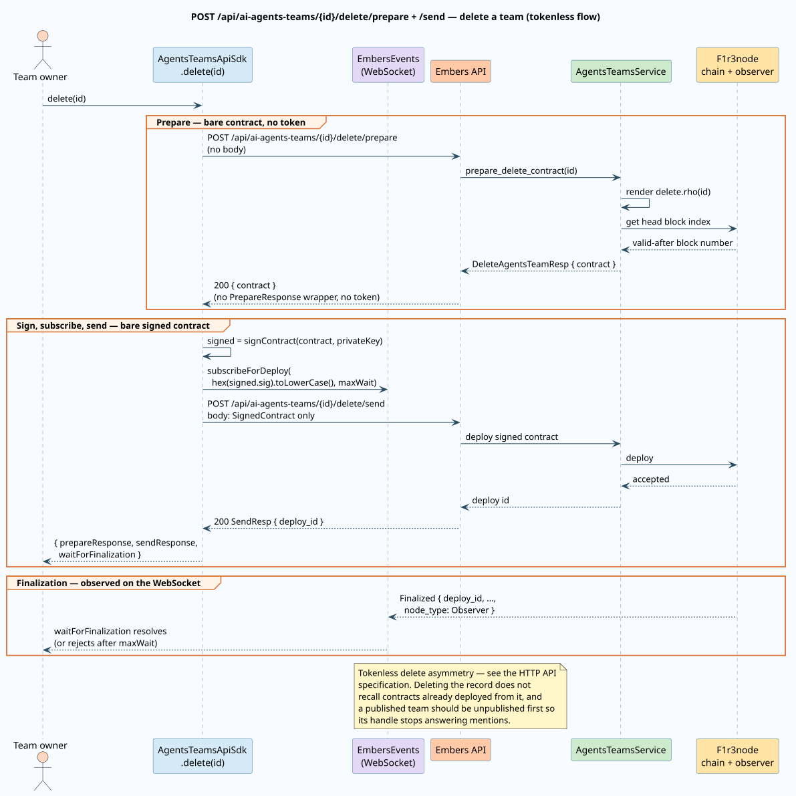

# Delete a team

Deletes a team from the caller's collection.

| | |
| --- | --- |
| Operation | `POST /api/ai-agents-teams/{id}/delete/prepare` + `POST /api/ai-agents-teams/{id}/delete/send` (tag: AIAgentsTeams) |
| Generated client | `AIAgentsTeamsApi.agentsTeamsPrepareDelete`, `AIAgentsTeamsApi.agentsTeamsSendDelete` |
| SDK wrapper | `AgentsTeamsApiSdk.delete` (`sdk.agentsTeams.delete(id)`) |
| Backend | `packages/embers/src/api/agents_teams/endpoints.rs:291` → `domain/agents_teams/delete.rs` |
| Schema pin | `packages/client/schema.json` @ `01e8ea0` (Embers API 0.1.0) |

## Semantics

The **tokenless delete flow** — bodyless prepare returning the bare
`DeleteAgentsTeamResp { contract }`, send taking the bare `SignedContract` — fully
analyzed at [OSLF delete](../oslfs/delete.md#semantics) and in
[the protocol specification](../../http-api.md#the-two-phase-prepare-sign-send-protocol).

Team-specific blast radius, in checklist form:

- **Published teams**: deletion removes the record; it does not by itself stop a
  [published](published.md) team's social presence. [Unpublish](unpublish.md) first so the
  handle stops answering mentions.
- **Deployed contracts**: contracts already [deployed](deploy.md) from the record are on
  chain; deleting the record does not recall them.
- **Referencing**: teams reference agents, not other teams, so no
  referencing check exists for team deletion (contrast
  [agent delete](../ai-agents/delete.md), which should consult
  [referencing](referencing.md)).

## Request

### `POST /api/ai-agents-teams/{id}/delete/prepare`

| Parameter | In | Type | Required | Meaning |
| --- | --- | --- | --- | --- |
| `id` | path | `string` (UUIDv4) | yes | The team to delete. |

No body.

### `POST /api/ai-agents-teams/{id}/delete/send`

Path `id` as above. Body: `SignedContract` only.

### Request types (TypeScript)

Generated declarations from `packages/client/src/api-client/models/`, doc comments included — the comments are generated from the backend models' Rust `///` doc comments (property names are the SDK's camelCase; the wire JSON uses snake_case where they differ):

```typescript
/**
 * A client-signed contract, ready to deploy: the send phase of the two-phase
 * protocol carries it, and the chain is the verifier of record.
 */
export interface SignedContract {
  /** The exact prepared contract bytes that were signed. */
  contract: Base64;
  /** The signing wallet's public key. */
  deployer: Base64;
  /** Signature over the contract's blake2b digest, per `sig_algorithm`. */
  sig: Base64;
  /** The signature algorithm; the platform signs with `secp256k1`. */
  sigAlgorithm: string;
}
```

## Responses

| Phase | Status | Body | Meaning |
| --- | --- | --- | --- |
| prepare | 200 | `DeleteAgentsTeamResp` | `{ contract }` — bare unsigned contract bytes. |
| send | 200 | `SendResp` | `{ deploy_id }` — accepted; finalization pending. |
| send | 500 | `InternalError` | Deploy submission failure. |

### Response types (TypeScript)

Generated declarations from `packages/client/src/api-client/models/`, doc comments included — the comments are generated from the backend models' Rust `///` doc comments (property names are the SDK's camelCase; the wire JSON uses snake_case where they differ):

```typescript
export interface DeleteAgentsTeamResp {
  /** The unsigned deletion contract bytes to sign. */
  contract: Base64;
}

export interface SendResp {
  /**
   * The accepted deploy's identifier (lowercase hex of its signature);
   * finalization is still pending when this returns.
   */
  deployId: string;
}
```

## Signing and binding

| Property | Value |
| --- | --- |
| Token | **Absent** — the delete asymmetry. |
| Signing key | The owner's wallet key. |
| Contracts signed | One: the deletion contract. |
| Deploy identifier | `hex(sig).toLowerCase()` — subscribed before send. |

## Retry semantics

Domain-idempotent; after a finalization timeout a [list](list.md) read shows whether the
removal landed.

## Sequence



## Worked example

Shapes are identical to the [OSLF delete example](../oslfs/delete.md#worked-example) with
team paths substituted.

## SDK usage

```typescript
// For a published team, retire the handle first (generated client only —
// see unpublish.md; there is no SDK wrapper for it).
const { waitForFinalization } = await sdk.agentsTeams.delete(teamId);
await waitForFinalization;
```

## Related

- [Unpublish](unpublish.md) — retire the social handle first.
- [OSLF delete](../oslfs/delete.md) — the tokenless flow analyzed in full.
