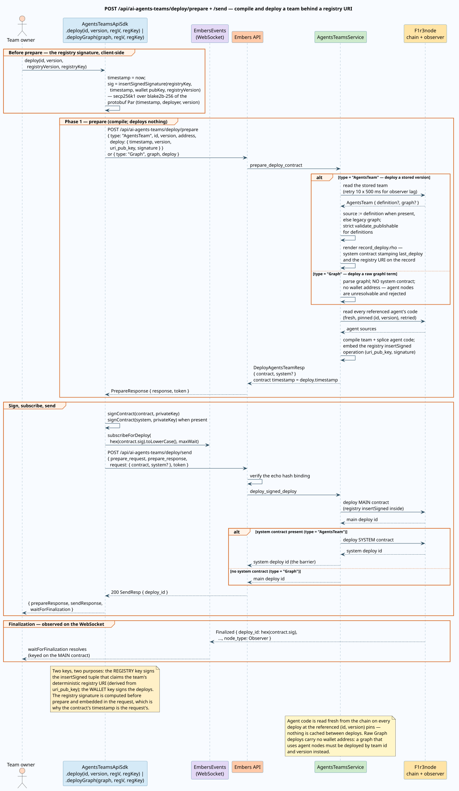

# Deploy a team

Compiles a team — a stored version or a raw graphl term — into a Rholang contract, splices
in every referenced agent's code, and deploys it behind a deterministic registry URI.

| | |
| --- | --- |
| Operation | `POST /api/ai-agents-teams/deploy/prepare` + `POST /api/ai-agents-teams/deploy/send` (tag: AIAgentsTeams) |
| Generated client | `AIAgentsTeamsApi.agentsTeamsPrepareDeploy`, `AIAgentsTeamsApi.agentsTeamsSendDeploy` |
| SDK wrappers | `AgentsTeamsApiSdk.deploy(id, version, registryVersion, registryKey)` (type `AgentsTeam`) and `AgentsTeamsApiSdk.deployGraph(graph, registryVersion, registryKey)` (type `Graph`) |
| Backend | `packages/embers/src/api/agents_teams/endpoints.rs:106` → `domain/agents_teams/deploy.rs` |
| Schema pin | `packages/client/schema.json` @ `01e8ea0` (Embers API 0.1.0) |

## Semantics

Team deployment is the compilation boundary of the platform: it turns the authored
workflow into the running on-chain contract that [run](run.md) invokes. Three things
distinguish it from every other pair.

**1. Two keys, two authorities.** The wallet key signs the deploys, as everywhere. But the
deployed team must be *reachable*, and reachability on chain is a registry entry: the
contract performs a registry `insertSigned`, whose URI is **derived deterministically from
the registry public key** (`uri_pub_key`). The client therefore computes, **before
prepare**, the registry signature with a **separate registry key**:
`insertSignedSignature(registryKey, timestamp, walletPublicKey, registryVersion)` —
secp256k1 over the blake2b-256 digest of the protobuf-encoded Rholang tuple
`(timestamp-millis, deployer public key, version)` (`packages/client/src/functions.ts:64-92`).
The signature travels in the request's `deploy` block, and the prepared contract's
`DeployData` timestamp is set to the *request's* timestamp so the embedded registry
operation and the signed bytes stay mutually consistent. Holding the registry key is what
lets a team be *re*-deployed at the same URI with a bumped `version`.

**2. Compilation with fresh agent resolution.** Prepare selects the team source and
compiles it:

- `type: "AgentsTeam"` — reads the stored version (retry 10 × 500 ms for observer lag;
  `agents team not found` otherwise). The **Workflow v2 `definition` is preferred**; the
  legacy graphl `graph` is the fallback; a version with neither fails with
  `agents team has neither a Workflow v2 definition nor a legacy graph`. Definitions pass
  **strict publishable validation** first (`agents team workflow is not publishable`; rule
  catalog: [validation phases](../../../../../embers-frontend/docs/agent-teams/specification/workflow-definition-v2.md#validation-phases)).
  A system contract (`record_deploy.rho`) is prepared alongside, stamping `last_deploy`
  **and the registry URI** onto the stored record — which is how [list](list.md) knows
  where the team answers.
- `type: "Graph"` — compiles a raw graphl term directly; no stored record, no system
  contract. **A raw graph that uses agent nodes is rejected**: the request carries no
  wallet address to resolve agents against ("this workflow uses agent nodes, so it must be
  deployed by team id and version").

In both paths, the compiler resolves every referenced agent at its pinned `(id, version)`
and reads its Rholang **fresh from the chain on every deploy** (nothing cached), splicing
the source into the rendered team contract.

**3. Two deploy identifiers (type `AgentsTeam`).** Send deploys the main contract, then
the system contract, and returns the **system** deploy's identifier — deliberately the
last submitted write, so a client that waits on the returned id cannot observe the stale
record ("the barrier is always the last submitted deploy", `deploy.rs:355-359`). The SDK's
`waitForFinalization` is keyed on the **main** contract's signature. Both finalize; they
are different deploys. For `type: "Graph"` the single main identifier plays both roles.

## Request

### `POST /api/ai-agents-teams/deploy/prepare`

Body `DeployAgentsTeamReq` — a discriminated union on `type`; each variant's
fields, including the registry claim `deploy` both variants carry, are
documented on the declarations below (`RegistryDeploy` among them).

### `POST /api/ai-agents-teams/deploy/send`

Body
`SendRequestBody_DeploySignedAgentsTeamReq_DeployAgentsTeamReq_DeployAgentsTeamResp` —
the standard echo envelope whose `request` is `DeploySignedAgentsTeamReq`,
documented on the declaration below.

### Request types (TypeScript)

Generated declarations from `packages/client/src/api-client/models/`, doc comments included — the comments are generated from the backend models' Rust `///` doc comments (property names are the SDK's camelCase; the wire JSON uses snake_case where they differ):

```typescript
export type DeployAgentsTeamReq =
  | ({ type: "AgentsTeam" } & DeployAgentsTeamReqDeployAgentsTeam)
  | ({ type: "Graph" } & DeployAgentsTeamReqDeployGraph);

export interface DeployAgentsTeamReqDeployAgentsTeam {
  /** Owning wallet address; record and agent reads resolve against it. */
  address: Address;
  /** The registry claim authorizing publication under the target URI. */
  deploy: RegistryDeploy;
  /** Stored team identity (`UUIDv4`). */
  id: string;
  type: DeployAgentsTeamReqDeployAgentsTeamTypeEnum;
  /** Exact version to deploy (`UUIDv7`). */
  version: string;
}

export interface DeployAgentsTeamReqDeployGraph {
  /** The registry claim authorizing publication under the target URI. */
  deploy: RegistryDeploy;
  /** Raw graphl term to compile. */
  graph: Graph;
  type: DeployAgentsTeamReqDeployGraphTypeEnum;
}

/**
 * The signed registry claim that authorizes publishing a deployment under a
 * `rho:id:` URI.
 */
export interface RegistryDeploy {
  /**
   * The `insertSignedSignature` over `(timestamp, wallet public key,
   * version)`.
   */
  signature: Base64;
  /**
   * Client-chosen instant the registry signature covers; also becomes the
   * contract's `DeployData` timestamp.
   */
  timestamp: TimestampMillis;
  /** The registry key's public key; the URI derives from it. */
  uriPubKey: PublicKey;
  /** Registry entry version; bump to re-deploy at the same URI. */
  version: Int64;
}

export interface DeploySignedAgentsTeamReq {
  /** The signed compiled team contract. */
  contract: SignedContract;
  /**
   * The signed record-update contract; present exactly when prepare
   * returned one.
   */
  system?: SignedContract;
}
```

## Responses

| Phase | Status | Body | Meaning |
| --- | --- | --- | --- |
| prepare | 200 | `PrepareResponse_DeployAgentsTeamResp` | `{ response: { contract, system? }, token }`. |
| prepare | 500 | `InternalError` | Team missing; neither serialization present; not publishable; agent resolution failure; head-block read failure. |
| send | 200 | `SendResp` | `{ deploy_id }` — the system deploy's id when present, else the main deploy's. |
| send | 500 | `InternalError` | Token/echo mismatch, or a deploy submission failure. |

### Response types (TypeScript)

Generated declarations from `packages/client/src/api-client/models/`, doc comments included — the comments are generated from the backend models' Rust `///` doc comments (property names are the SDK's camelCase; the wire JSON uses snake_case where they differ):

```typescript
export interface PrepareResponseDeployAgentsTeamResp {
  /**
   * The operation-specific prepare payload, carrying the unsigned
   * contract(s) to sign.
   */
  response: DeployAgentsTeamResp;
  /**
   * JWT binding the send to exactly this prepare exchange; expires after
   * one day.
   */
  token: string;
}

export interface DeployAgentsTeamResp {
  /** The unsigned compiled team contract bytes to sign. */
  contract: Base64;
  /**
   * The unsigned record-update contract bytes; present only when the
   * deployment needs one.
   */
  system?: Base64;
}

export interface SendResp {
  /**
   * The accepted deploy's identifier (lowercase hex of its signature);
   * finalization is still pending when this returns.
   */
  deployId: string;
}
```

## Signing and binding

| Property | Value |
| --- | --- |
| Token | Present — standard hash-bound exchange. |
| Registry key | Signs the `insertSigned` tuple **before prepare**; its public key determines the team's URI. |
| Wallet key | Signs the main contract and (when present) the system contract. |
| Deploy identifiers | Finalization wait: `hex(contract.sig).toLowerCase()` (main). Response `deploy_id`: the final ordered write (system when present). |

## Retry semantics

Prepare is always safe to retry. Re-deploying the same team at the same URI is the
designed upgrade path — bump `registryVersion` and re-sign; the registry accepts the
higher version at the same `uri_pub_key`-derived URI. After a finalization timeout, verify
via [list](list.md) (`last_deploy`, `uri`) before retrying; a re-prepare with a fresh
timestamp is the clean path, as everywhere.

## Sequence



## Worked example

Prepare request (stored version; signatures truncated):

```json
{
  "type": "AgentsTeam",
  "id": "7b2e4f8a-1c9d-4a3b-8e5f-6d0a2c4b8f13",
  "version": "0198e4b1-77aa-7c02-bd31-5f8a9c2e6d47",
  "address": "1111LAdaDDGGVKgwBRPGeR2v9uHvsxFcqogtC2Xbmbo81zpxV1U9M",
  "deploy": {
    "timestamp": "1754329001523",
    "version": "1",
    "uri_pub_key": "04a1b2c3...TRUNCATED...",
    "signature": "3045022100...TRUNCATED..."
  }
}
```

Prepare response: `{ "response": { "contract": "...TRUNCATED...", "system": "...TRUNCATED..." }, "token": "...TRUNCATED..." }`.

## SDK usage

```typescript
// Stored version — the normal path:
const { prepareResponse, waitForFinalization } = await sdk.agentsTeams.deploy(
  teamId,
  versionId,
  1n,            // registryVersion
  registryKey,   // PrivateKey — determines and re-claims the team URI
);
await waitForFinalization;

// Raw graphl term (no agent nodes) — the editor's scratch path:
await sdk.agentsTeams.deployGraph(graphAst, 1n, registryKey);
```

## Related

- [Run](run.md) — invoking the deployed team at its URI.
- [Agent deploy](../ai-agents/deploy.md) — the standalone-agent counterpart and the
  dual-identifier pattern.
- [Workflow Definition v2 validation phases](../../../../../embers-frontend/docs/agent-teams/specification/workflow-definition-v2.md#validation-phases) —
  the strict gate this pair enforces.
- [TOGL correspondence](../../../../../embers-frontend/docs/agent-teams/design/togl-correspondence.md) — the graphl
  term algebra this pair compiles.
