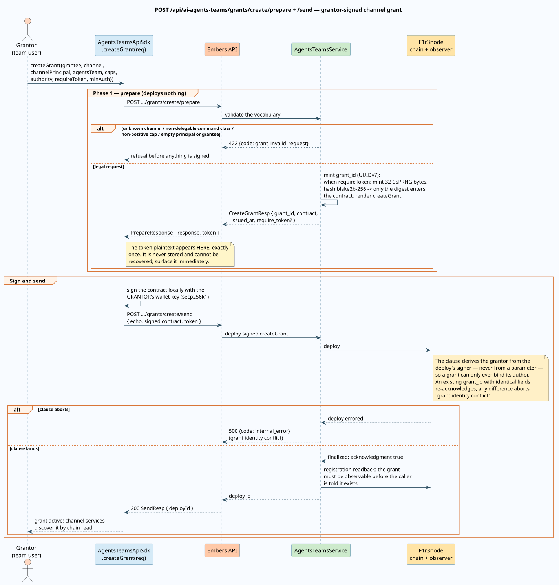

# Create a channel grant

Creates a standing, revocable, on-chain delegation: "channel wallet `grantee` may
initiate runs of team `agents_team` owned by me, within caps, with the delegated
authority". The grantor signs; the chain derives the grantor from the deploy's
signer, so a grant can only ever bind its author.

| | |
| --- | --- |
| Operation | `POST /api/ai-agents-teams/grants/create/prepare` + `POST /api/ai-agents-teams/grants/create/send` (tag: AIAgentsTeams) |
| Generated client | `AIAgentsTeamsApi.agentsTeamsPrepareCreateGrant`, `AIAgentsTeamsApi.agentsTeamsSendCreateGrant` |
| SDK wrapper | `AgentsTeamsApiSdk.createGrant` (`sdk.agentsTeams.createGrant(req)`) |
| Backend | `packages/embers/src/api/agents_teams/endpoints.rs:556` → `domain/agents_teams/grants.rs` |
| Schema pin | `packages/client/schema.json` @ `69012a4` (Embers API 0.1.0) |

## Semantics

A grant is a **public authorization fact** on the agents-teams env — plaintext,
secret-free, revocable by its grantor, adjudicated by the chain at claim time
(never by the HTTP layer). The full record schema and the enforced-versus-recorded
split are specified in
[channel grants](../../../../../embers-frontend/docs/agent-teams/architecture/channel-grants.md);
what this pair does:

- **Prepare** validates the vocabulary before anything is signed: `channel` must
  be `chat` or `mail`; every `authority.commands` class must be delegable
  (`approve`, `reject`, `cancel`, `signal`, `event`, `retry` — `timerFired` and
  `migrate` are not); `caps.maxRunsPerDay`, when present, must be positive;
  `channelPrincipal` and `grantee` must be nonempty. It then mints the
  `grant_id` (UUIDv7) and, when `requireToken` is set, a 32-byte CSPRNG subject
  bearer token whose **plaintext appears exactly once** in the prepare response
  — only its blake2b-256 hex digest enters the contract, and the token can never
  be recovered later.
- **Send** deploys the grantor-signed `createGrant`. The clause derives the
  grantor from the deploy's signer — never from a parameter — and is idempotent:
  an existing `grant_id` with identical fields re-acknowledges, while any
  differing field aborts (`grant identity conflict`). After finality the backend
  reads the acknowledgment and performs a **registration readback**: the grant
  must be observable before the caller is told it exists.
- **Discovery is chain-read-first.** Channel services find grants naming their
  wallet through the observer-readable `listGrantsByGrantee` clause; the HTTP
  [grants list](grants-list.md) mirrors exist for UI and operations.

The failure bodies on this surface are machine-readable `{code, description}`
([ErrorBody](#response-types-typescript)); the codes are listed per phase below
and in the [connector taxonomy](../../http-api.md#channel-connectors-and-grants).

## Request

### `POST /api/ai-agents-teams/grants/create/prepare`

Body `CreateGrantReq` — fields documented on the declaration below.

### `POST /api/ai-agents-teams/grants/create/send`

Body `SendRequestBody_SignedContract_CreateGrantReq_CreateGrantResp` — the
standard echo envelope.

### Request types (TypeScript)

Generated declarations from `packages/client/src/api-client/models/`, doc comments included — the comments are generated from the backend models' Rust `///` doc comments (property names are the SDK's camelCase; the wire JSON uses snake_case where they differ):

```typescript
export interface CreateGrantReq {
  /** The deployed team's registry URI the grant covers. */
  agentsTeam: Uri;
  /** The authority delegated to the grantee. */
  authority: GrantAuthority;
  /** Frequency ceilings. */
  caps: GrantCaps;
  /** The channel the grant serves. */
  channel: GrantChannel;
  /**
   * The channel-native principal this grant answers for: the chat gateway's
   * opaque author hash, or a mail sender address. Embers string-matches it
   * and never interprets it.
   */
  channelPrincipal: string;
  /**
   * The channel service's wallet address (the grantee, who signs and pays run
   * deploys under this grant).
   */
  grantee: Address;
  /** Sender-authentication floor for mail-channel grants. */
  minAuth: MinAuthLevel;
  /**
   * When true, a random subject bearer token is minted; its plaintext is
   * returned exactly once in the prepare response and only its blake2b-256
   * hex digest is stored on chain.
   */
  requireToken: boolean;
}

export interface GrantAuthority {
  /**
   * The command classes the grantee may issue on runs initiated under this
   * grant.
   */
  commands: Array<GrantCommandClass>;
  /**
   * Whether the grantee may reveal outputs of runs initiated under this
   * grant, for delivery over the channel.
   */
  reveal: boolean;
}

export interface GrantCaps {
  /**
   * UTC-epoch-day run ceiling; absent means uncapped. Up to twice the cap can
   * land across one midnight boundary; the cap is an abuse throttle.
   */
  maxRunsPerDay?: Int64;
}

/**
 * The channels a grant may name. Chat platform disambiguation lives inside
 * the opaque principal (already platform- and workspace-scoped), not here.
 */
export const GrantChannel = {
  Chat: "chat",
  Mail: "mail",
} as const;

export type GrantChannel = (typeof GrantChannel)[keyof typeof GrantChannel];

/**
 * The command classes a grantor may delegate. `timerFired` belongs to the
 * service scheduler and `migrate` is administrative; neither is delegable.
 */
export const GrantCommandClass = {
  Approve: "approve",
  Cancel: "cancel",
  Event: "event",
  Reject: "reject",
  Retry: "retry",
  Signal: "signal",
} as const;

export type GrantCommandClass =
  (typeof GrantCommandClass)[keyof typeof GrantCommandClass];

/**
 * Sender-authentication floor a mail grant requires; enforced by the mail
 * bridge against chain-recorded authentication results, never by embers.
 */
export const MinAuthLevel = {
  Dkim: "dkim",
  Dmarc: "dmarc",
  None: "none",
  Spf: "spf",
} as const;

export type MinAuthLevel = (typeof MinAuthLevel)[keyof typeof MinAuthLevel];
```

## Responses

| Phase | Status | Body | Meaning |
| --- | --- | --- | --- |
| prepare | 200 | `PrepareResponse_CreateGrantResp` | The grant identity, contract, and one-time token (fields below). |
| prepare | 422 | `ErrorBody` `grant_invalid_request` | Unknown channel, non-delegable command class, non-positive cap, or empty principal/grantee. |
| prepare | 500 | `ErrorBody` `internal_error` | Render or head-block failure. |
| send | 200 | `SendResp` | The deploy identifier; the grant is observably registered. |
| send | 404 | `ErrorBody` `grant_not_found` | Post-abort classification found no record (unexpected on create). |
| send | 403 | `ErrorBody` `grant_unauthorized` | Post-abort classification: the signer does not hold grant authority (unexpected on create). |
| send | 500 | `ErrorBody` `internal_error` | Token/echo mismatch, deploy failure, grant identity conflict, or readback failure. |

`CreateGrantResp` (the `response` field) — documented on the declaration below.

### Response types (TypeScript)

Generated declarations from `packages/client/src/api-client/models/`, doc comments included — the comments are generated from the backend models' Rust `///` doc comments (property names are the SDK's camelCase; the wire JSON uses snake_case where they differ):

```typescript
export interface PrepareResponseCreateGrantResp {
  /**
   * The operation-specific prepare payload, carrying the unsigned contract(s)
   * to sign.
   */
  response: CreateGrantResp;
  /**
   * JWT binding the send to exactly this prepare exchange; expires after one
   * day.
   */
  token: string;
}

export interface CreateGrantResp {
  /** The unsigned grant-creation contract bytes to sign (grantor-signed). */
  contract: Base64;
  /** The minted grant identity (`UUIDv7`). */
  grantId: string;
  /** Prepare instant. */
  issuedAt: TimestampMillis;
  /**
   * The minted subject bearer token, present exactly once when requested; it
   * is never stored and cannot be recovered later.
   */
  requireToken?: string;
}

/**
 * A machine-readable failure body for the channel-connector surface: `code`
 * is a stable identifier a channel service branches on, `description` is for
 * humans and logs. Codes are documented per operation in the API reference.
 */
export interface ErrorBody {
  /** Stable machine-readable failure code. */
  code: string;
  /** Human-readable failure description. */
  description: string;
}
```

## Signing and binding

| Property | Value |
| --- | --- |
| Token | Present — standard hash-bound exchange. |
| Signing key | The **grantor's** wallet key, in the environment where it lives (the browser wallet). |
| Contracts signed | One: the grant-creation contract. |
| Deploy identifier | Returned as `SendResp.deployId`. |

## Retry semantics

Prepare is always safe to retry — each prepare mints a fresh `grant_id` (and a
fresh token when requested); abandoned prepares never reached the chain. A
resent send envelope carries the same signature and deploy identity, and the
clause re-acknowledges an identical record idempotently. The one-time token is
the exception to casual retries: **each prepare mints a new token**, so surface
the plaintext from the prepare you actually send, and treat a lost token as
revoke-and-regrant.

## Sequence



## Worked example

Prepare request — a chat grant with a daily cap, reveal, and two command
classes:

```json
{
  "grantee": "1111AtahZeeSuchoQuaiphies9me1caiPhahThoh1The6zoogh8xeiBhk",
  "channel": "chat",
  "channel_principal": "a3f92c41d8e07b65f1a29c83d4e5f607a8b9c0d1e2f30415263748596a7b8c9d",
  "agents_team": "rho:id:o6c4x1zbdqjqzqzr8cgpgqf3zc9dsqn86wjc1xj8kuyxwbxwe8xn1p",
  "caps": { "max_runs_per_day": "20" },
  "authority": { "reveal": true, "commands": ["approve", "reject", "cancel"] },
  "require_token": false,
  "min_auth": "none"
}
```

Prepare response (`response` field, truncated):

```json
{
  "grant_id": "0198f9a1-2233-7c44-9d55-6e7f8a9b0c1d",
  "contract": "CtQBbmV3IGRlcGxveUlkKGByaG86cmNoYWlu...TRUNCATED...",
  "issued_at": "1754900001523",
  "require_token": null
}
```

## SDK usage

```typescript
const { prepareResponse, sendResponse, waitForFinalization } =
  await sdk.agentsTeams.createGrant({
    grantee: gatewayWallet,
    channel: "chat",
    channelPrincipal: principalFromTeamWhoami,
    agentsTeam: teamUri,
    caps: { maxRunsPerDay: 20n },
    authority: { reveal: true, commands: ["approve", "reject", "cancel"] },
    requireToken: false,
    minAuth: "none",
  });
// When requireToken was set, surface it NOW; it is shown exactly once:
const oneTimeToken = prepareResponse.response.requireToken;
```

## Related

- [Grants revoke](grants-revoke.md) — cutting the delegation, delivery-only.
- [Grants list](grants-list.md) — the by-grantor and by-grantee mirrors.
- [Run under grant](run-under-grant.md) — what the grantee does with this.
- [Channel grants](../../../../../embers-frontend/docs/agent-teams/architecture/channel-grants.md)
  — the record schema and the adjudication clause.
