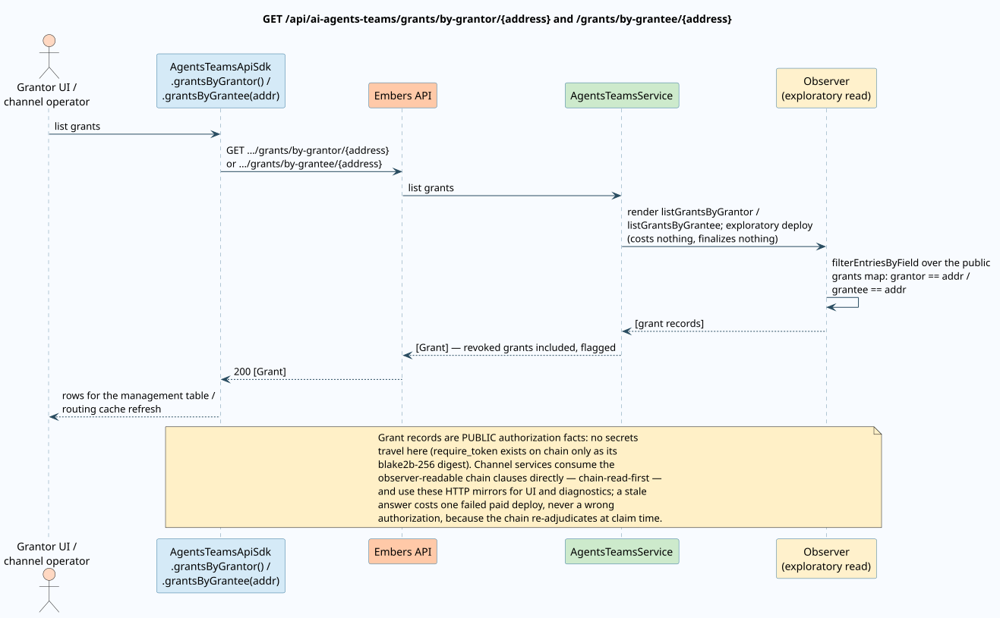

# List grants

Reads grant records by grantor (the management interface's view) or by grantee
(a channel operator's cross-check). Revoked grants are included, flagged.

| | |
| --- | --- |
| Operation | `GET /api/ai-agents-teams/grants/by-grantor/{address}` and `GET /api/ai-agents-teams/grants/by-grantee/{address}` (tag: AIAgentsTeams) |
| Generated client | `AIAgentsTeamsApi.agentsTeamsGrantsByGrantor`, `AIAgentsTeamsApi.agentsTeamsGrantsByGrantee` |
| SDK wrapper | `AgentsTeamsApiSdk.grantsByGrantor` (`sdk.agentsTeams.grantsByGrantor()`, the SDK wallet's own address), `AgentsTeamsApiSdk.grantsByGrantee` (`sdk.agentsTeams.grantsByGrantee(address)`) |
| Backend | `packages/embers/src/api/agents_teams/endpoints.rs:661` (by-grantor), `:681` (by-grantee) → `domain/agents_teams/grants.rs` |
| Schema pin | `packages/client/schema.json` @ `69012a4` (Embers API 0.1.0) |

## Semantics

Grant records are **public authorization facts**: plaintext on the agents-teams
env, containing no secret (`require_token` exists on chain only as its
blake2b-256 digest). Both reads render an observer exploratory deploy over the
env's `listGrantsByGrantor` / `listGrantsByGrantee` clauses, which filter the
public grants map by the requested field — costing nothing and finalizing
nothing.

The two directions serve two audiences:

- **By grantor** feeds the grant-management interface: everything this wallet
  has delegated, live and revoked, so revocation is one click from the list.
- **By grantee** is an **operations cross-check**. Channel services do not sit
  on this endpoint: they consume the observer-readable chain clause directly
  (**chain-read-first** — the gateway's 60-second cache sync and the mail
  bridge's authorization reads never require the embers HTTP service), and use
  this mirror for diagnostics. A stale channel cache is safe by construction:
  the chain re-adjudicates every claim atomically at deploy time, so staleness
  costs one failed paid deploy, never a wrong authorization.

There is no unfiltered global list operation, and no read exposes anything a
direct chain reader could not already compute from the public env.

## Request

| Parameter | In | Type | Required | Meaning |
| --- | --- | --- | --- | --- |
| `address` | path | `string` (REV address) | yes | The grantor wallet (by-grantor) or the channel service's wallet (by-grantee). |

## Responses

| Status | Body | Meaning |
| --- | --- | --- |
| 200 | `Grant[]` | Every grant whose grantor / grantee equals the address; empty array when none. |
| 500 | `InternalError` | Observer read failure. |

`Grant` — documented on the declaration below.

### Response types (TypeScript)

Generated declarations from `packages/client/src/api-client/models/`, doc comments included — the comments are generated from the backend models' Rust `///` doc comments (property names are the SDK's camelCase; the wire JSON uses snake_case where they differ):

```typescript
/**
 * A grant record as the chain holds it: a public authorization fact. The HTTP
 * surface mirrors the observer-readable chain clauses for UI and operations;
 * channel services consume the chain clauses directly.
 */
export interface Grant {
  /** The covered team deployment's registry URI. */
  agentsTeam: Uri;
  /** The delegated authority, as recorded. */
  authority: GrantAuthorityView;
  /** Frequency ceilings. */
  caps: GrantCaps;
  /** The channel the grant serves. */
  channel: string;
  /** The channel-native principal, opaque to embers. */
  channelPrincipal: string;
  /** Creation instant. */
  createdAt: TimestampMillis;
  /** The channel service's wallet address. */
  grantee: string;
  /** Grant identity (`UUIDv7`). */
  grantId: string;
  /**
   * The granting wallet address; derived on chain from the creating deploy's
   * signer.
   */
  grantor: string;
  /** Sender-authentication floor for mail-channel grants. */
  minAuth: string;
  /**
   * blake2b-256 hex digest of the subject bearer token, when one is required.
   * The token itself is never stored.
   */
  requireTokenHash?: string;
  /**
   * Whether the grant has been revoked. Revocation is delivery-only for
   * in-flight runs: they complete for their owner, while grantee reveal and
   * command claims fail from the moment of revocation.
   */
  revoked: boolean;
  /** The chain-maintained day counter. */
  runsToday: GrantRunsToday;
}

/**
 * Recorded authority, with classes as strings so future recorded values
 * survive the read path unmodified.
 */
export interface GrantAuthorityView {
  commands: Array<string>;
  reveal: boolean;
}

export interface GrantRunsToday {
  /** Runs admitted within that day. */
  count: Int64;
  /** The UTC epoch-day the counter covers. */
  day: Int64;
}
```

`GrantCaps` is shared with the create request and documented in
[grants create](grants-create.md#request-types-typescript).

## Retry semantics

Idempotent reads; safe to poll. `runsToday` is the live day counter, so polling
it shows cap consumption as the chain admits runs (with the documented
up-to-twice-the-cap behavior across a UTC midnight boundary).

## Sequence



## Worked example

```bash
curl -s http://localhost:8080/api/ai-agents-teams/grants/by-grantor/1111AtahZ...
```

```json
[
  {
    "grant_id": "0198f9a1-2233-7c44-9d55-6e7f8a9b0c1d",
    "grantor": "1111AtahZ...",
    "grantee": "1111Gatew...",
    "channel": "chat",
    "channel_principal": "a3f92c41d8e0...",
    "agents_team": "rho:id:o6c4x1zbdqjqzqzr8cgpgqf3zc9dsqn86wjc1xj8kuyxwbxwe8xn1p",
    "caps": { "max_runs_per_day": "20" },
    "authority": { "reveal": true, "commands": ["approve", "reject", "cancel"] },
    "require_token_hash": null,
    "min_auth": "none",
    "created_at": "1754900002000",
    "revoked": false,
    "runs_today": { "day": "20311", "count": "3" }
  }
]
```

## SDK usage

```typescript
// The management page: the SDK wallet's own delegations.
const mine = await sdk.agentsTeams.grantsByGrantor();
// An operator cross-check against a channel wallet.
const gateways = await sdk.agentsTeams.grantsByGrantee(gatewayAddress);
```

## Related

- [Grants create](grants-create.md) / [grants revoke](grants-revoke.md) — the
  mutations behind these rows.
- [Run under grant](run-under-grant.md) — what a listed grant authorizes.
- [Channel grants](../../../../../embers-frontend/docs/agent-teams/architecture/channel-grants.md)
  — field-by-field record semantics.
