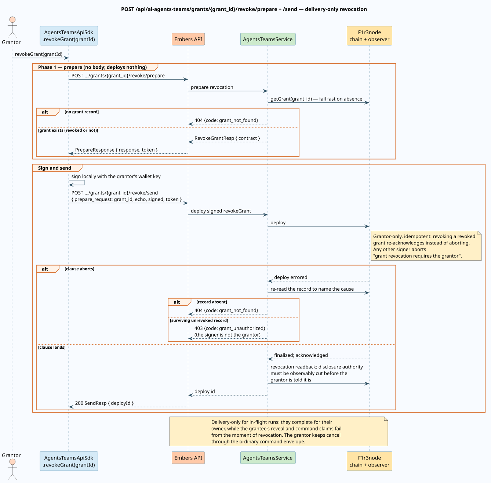

# Revoke a channel grant

Revokes a grant, grantor-signed. Revocation is **delivery-only** for in-flight
runs: they complete for their owner, while the grantee's reveal and command
claims fail from the moment of revocation.

| | |
| --- | --- |
| Operation | `POST /api/ai-agents-teams/grants/{grant_id}/revoke/prepare` + `POST /api/ai-agents-teams/grants/{grant_id}/revoke/send` (tag: AIAgentsTeams) |
| Generated client | `AIAgentsTeamsApi.agentsTeamsPrepareRevokeGrant`, `AIAgentsTeamsApi.agentsTeamsSendRevokeGrant` |
| SDK wrapper | `AgentsTeamsApiSdk.revokeGrant` (`sdk.agentsTeams.revokeGrant(grantId)`) |
| Backend | `packages/embers/src/api/agents_teams/endpoints.rs:606` → `domain/agents_teams/grants.rs` |
| Schema pin | `packages/client/schema.json` @ `69012a4` (Embers API 0.1.0) |

## Semantics

- **Prepare** takes no body — the grant id rides the path and is bound into the
  token as the hashed prepare request. The backend fails fast with 404 when no
  record exists; the chain re-checks at claim time.
- **Send** deploys the grantor-signed `revokeGrant`. The clause is
  **grantor-only** (any other signer aborts) and **idempotent** (revoking a
  revoked grant re-acknowledges). On an abort the backend re-reads the record to
  name the cause honestly: absence is knowable without authorization (404), and
  a surviving unrevoked record proves the signer was not the grantor (403).
  After finality the backend performs a **revocation readback**: disclosure
  authority must be observably cut before the grantor is told it is.
- **What revocation cuts, precisely.** From the revocation instant, new runs
  under the grant abort (`grant_revoked`), and the grantee branches of
  `claimOutputReveal` and `claimCommand` check `revoked` at claim time, so
  reveal and command claims fail immediately even for runs already in flight.
  What it does not touch: the runs themselves. An in-flight run completes for
  its owner, who can reveal it with their own wallet and retains `cancel`
  through the ordinary [command envelope](run-commands.md). Channels treat a
  revoked-mid-run reveal (bare 403) as an expected outcome with its own
  "output withheld" reply.
- **The record survives.** A revoked grant is never deleted — it remains a
  public audit fact, flagged `revoked: true` in every [listing](grants-list.md).

## Request

### `POST /api/ai-agents-teams/grants/{grant_id}/revoke/prepare`

Path `grant_id` — the grant identity. **No request body.**

### `POST /api/ai-agents-teams/grants/{grant_id}/revoke/send`

Body `SendRequestBody_SignedContract_string_RevokeGrantResp` — the standard echo
envelope where the echoed prepare request is the grant id string itself; the
handler additionally requires it to equal the path `grant_id`.

## Responses

| Phase | Status | Body | Meaning |
| --- | --- | --- | --- |
| prepare | 200 | `PrepareResponse_RevokeGrantResp` | The revocation contract (fields below). |
| prepare | 404 | `ErrorBody` `grant_not_found` | No grant record exists under the id. |
| prepare | 500 | `ErrorBody` `internal_error` | Render or head-block failure. |
| send | 200 | `SendResp` | The deploy identifier; the revocation is observable. |
| send | 404 | `ErrorBody` `grant_not_found` | Post-abort classification found no record. |
| send | 403 | `ErrorBody` `grant_unauthorized` | The signer is not the grantor. |
| send | 500 | `ErrorBody` `internal_error` | Token/echo mismatch, mismatched path/echo grant id, deploy failure, or readback failure. |

`RevokeGrantResp` (the `response` field) — documented on the declaration below.

### Response types (TypeScript)

Generated declarations from `packages/client/src/api-client/models/`, doc comments included — the comments are generated from the backend models' Rust `///` doc comments (property names are the SDK's camelCase; the wire JSON uses snake_case where they differ):

```typescript
export interface PrepareResponseRevokeGrantResp {
  /**
   * The operation-specific prepare payload, carrying the unsigned contract(s)
   * to sign.
   */
  response: RevokeGrantResp;
  /**
   * JWT binding the send to exactly this prepare exchange; expires after one
   * day.
   */
  token: string;
}

export interface RevokeGrantResp {
  /** The unsigned revocation contract bytes to sign (grantor-signed). */
  contract: Base64;
}
```

## Signing and binding

| Property | Value |
| --- | --- |
| Token | Present — binds the path grant id (the hashed prepare request) and the prepare response. |
| Signing key | The **grantor's** wallet key; the chain rejects every other signer. |
| Contracts signed | One: the revocation contract. |
| Deploy identifier | Returned as `SendResp.deployId`. |

## Retry semantics

Fully idempotent end to end: prepare is a read plus a render, and the clause
re-acknowledges an already-revoked grant, so replaying the flow (or racing two
revocations) converges on the same revoked record. There is no un-revoke —
create a new grant instead, which also rotates the subject token when one was in
use.

## Sequence



## Worked example

```bash
curl -s -X POST \
  http://localhost:8080/api/ai-agents-teams/grants/0198f9a1-2233-7c44-9d55-6e7f8a9b0c1d/revoke/prepare
```

The response's `response.contract` is signed locally and posted back to
`.../revoke/send` inside the standard envelope. From the moment the deploy
finalizes, the gateway's next reveal for a run under this grant answers 403 and
its chat reply becomes "output withheld — the owner can view it at Run: <url>".

## SDK usage

```typescript
const { sendResponse } = await sdk.agentsTeams.revokeGrant(grantId);
// Delivery authority is now cut; in-flight runs still complete for
// their owner, and the record stays listed with revoked: true.
```

## Related

- [Grants create](grants-create.md) — the record this cuts.
- [Grants list](grants-list.md) — where revoked grants remain visible, flagged.
- [Reveal output](reveal-output.md) — the claim the revocation gates.
- [Channel grants](../../../../../embers-frontend/docs/agent-teams/architecture/channel-grants.md#revocation-is-delivery-only)
  — why delivery-only is the designed scope.
