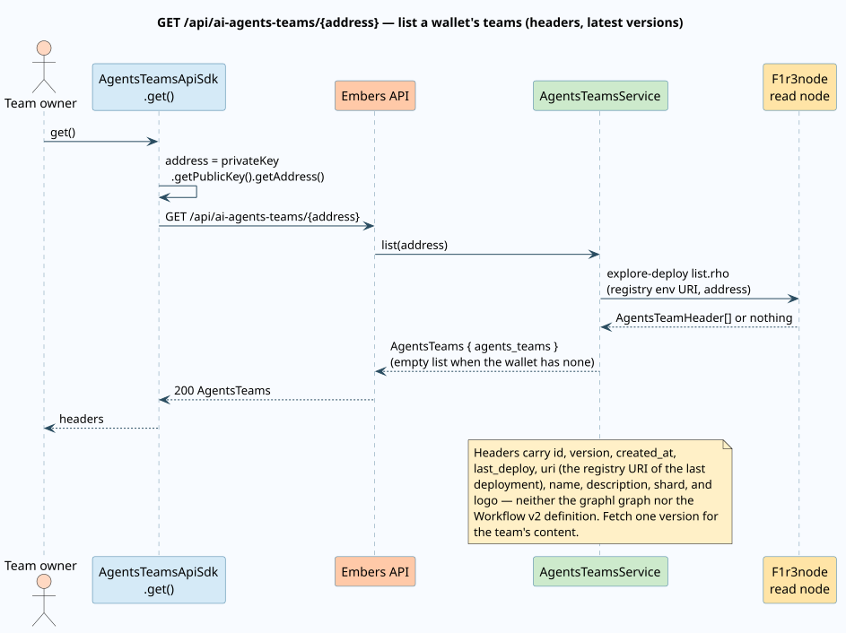

# List teams

Lists the headers of a wallet's agent teams (latest versions).

| | |
| --- | --- |
| Operation | `GET /api/ai-agents-teams/{address}` (tag: AIAgentsTeams) |
| Generated client | `AIAgentsTeamsApi.agentsTeamsList` |
| SDK wrapper | `AgentsTeamsApiSdk.get` (`sdk.agentsTeams.get()`) |
| Backend | `packages/embers/src/api/agents_teams/endpoints.rs:46` → `domain/agents_teams/list.rs` |
| Schema pin | `packages/client/schema.json` @ `01e8ea0` (Embers API 0.1.0) |

## Semantics

An **agent team** is the platform's composite unit: a workflow graph whose nodes include
[agents](../ai-agents/list.md), gateways, waits, approvals, and inputs/outputs, stored as
a versioned chain record (UUIDv4 identity, UUIDv7 versions) and carrying **two
serializations of one drawing** — the legacy `graph` (graphl, the TOGL-style term algebra)
and the Workflow v2 `definition` (the executable statechart; normative data contract in
[Workflow Definition v2](../../../../../embers-frontend/docs/agent-teams/specification/workflow-definition-v2.md)).

This explore-deploy read returns one `AgentsTeamHeader` per team: the latest version's
metadata including `last_deploy` and `uri` — the registry URI where the most recent
[deployment](deploy.md) answers — but neither serialization body. A wallet with no teams
yields an empty list. Reads are public; the SDK wrapper reads its own address.

## Request

| Parameter | In | Type | Required | Meaning |
| --- | --- | --- | --- | --- |
| `address` | path | `string` (`blockchain-address`) | yes | The owning wallet address. |

## Responses

| Status | Body | Meaning |
| --- | --- | --- |
| 200 | `AgentsTeams` | `{ agents_teams: AgentsTeamHeader[] }` — possibly empty. |
| 500 | `InternalError` | Readback failure. |

`AgentsTeamHeader` — documented on the declaration below.

### Response types (TypeScript)

Generated declarations from `packages/client/src/api-client/models/`, doc comments included — the comments are generated from the backend models' Rust `///` doc comments (property names are the SDK's camelCase; the wire JSON uses snake_case where they differ):

```typescript
export interface AgentsTeams {
  /** The wallet's teams, latest version each. */
  agentsTeams: Array<AgentsTeamHeader>;
}

export interface AgentsTeamHeader {
  /** When this version was prepared. */
  createdAt: TimestampMillis;
  /** Team description. */
  description?: string;
  /** Team identity (`UUIDv4`), stable across versions. */
  id: string;
  /** When this version was last deployed; absent if never. */
  lastDeploy?: TimestampMillis;
  /** Logo reference. */
  logo?: string;
  /** Team name. */
  name: string;
  /** Declared shard label. */
  shard?: string;
  /**
   * Registry URI of the last deployment; the value run invocations
   * consume.
   */
  uri?: Uri;
  /** Latest version identifier (`UUIDv7`). */
  version: string;
}
```

## Retry semantics

Idempotent read; safe to retry.

## Sequence



## Worked example

```bash
curl -s http://localhost:8080/api/ai-agents-teams/1111LAdaDDGGVKgwBRPGeR2v9uHvsxFcqogtC2Xbmbo81zpxV1U9M
```

```json
{
  "agents_teams": [
    {
      "id": "7b2e4f8a-1c9d-4a3b-8e5f-6d0a2c4b8f13",
      "version": "0198e4b1-77aa-7c02-bd31-5f8a9c2e6d47",
      "created_at": "1754241793120",
      "last_deploy": "1754328212843",
      "uri": "rho:id:o6c4x1zbdqjqzqzr8cgpgqf3zc9dsqn86wjc1xj8kuyxwbxwe8xn1p",
      "name": "review-loop",
      "description": "Draft, critique, decide"
    }
  ]
}
```

## SDK usage

```typescript
const { agentsTeams } = await sdk.agentsTeams.get();
```

## Related

- [Version](version.md) — one full team, both serializations.
- [Create](create.md), [Save](save.md), [Deploy](deploy.md), [Delete](delete.md) — the
  writes behind this listing.
- [Endpoint reference table](../../http-api.md#agent-teams-endpoint-reference) — the whole
  module at a glance.
