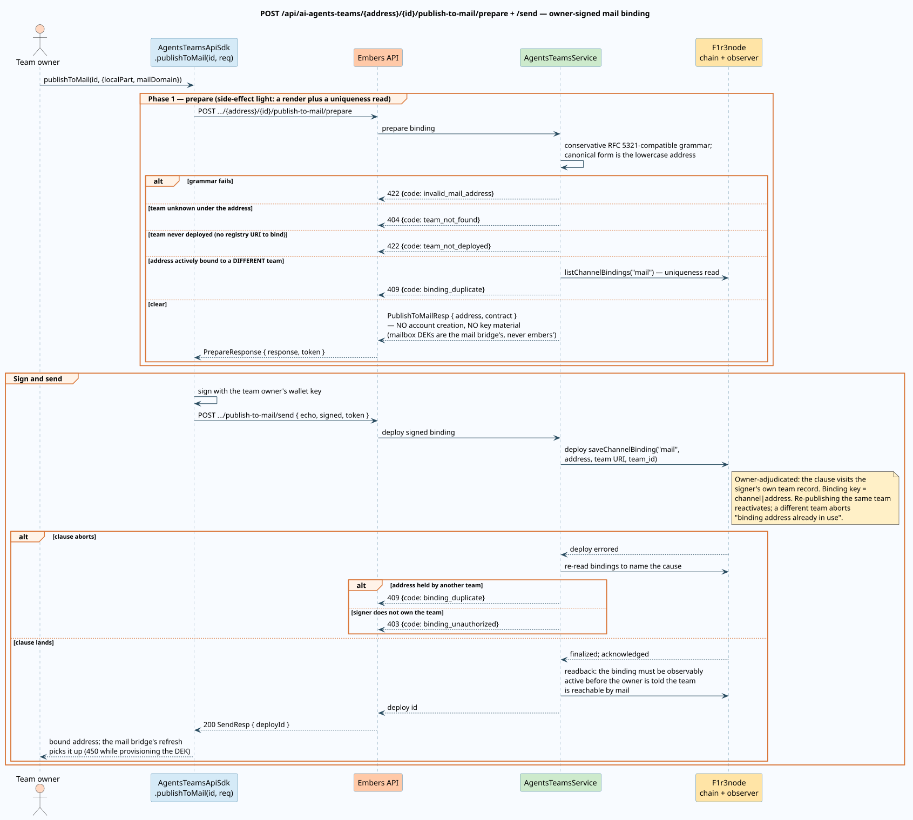

# Publish a team to mail

Binds `local@domain` to the team on chain, making it reachable by mail. The
prepare is deliberately side-effect light — a pure render plus an
address-uniqueness read — and the binding carries **no key material**.

| | |
| --- | --- |
| Operation | `POST /api/ai-agents-teams/{address}/{id}/publish-to-mail/prepare` + `POST /api/ai-agents-teams/{address}/{id}/publish-to-mail/send` (tag: AIAgentsTeams) |
| Generated client | `AIAgentsTeamsApi.agentsTeamsPreparePublishToMail`, `AIAgentsTeamsApi.agentsTeamsSendPublishToMail` |
| SDK wrapper | `AgentsTeamsApiSdk.publishToMail` (`sdk.agentsTeams.publishToMail(id, req)`) |
| Backend | `packages/embers/src/api/agents_teams/endpoints.rs:751` → `domain/agents_teams/publish_to_mail.rs` |
| Schema pin | `packages/client/schema.json` @ `69012a4` (Embers API 0.1.0) |

## Semantics

Mail has no external account, so the on-chain binding record **is** the
publication — the contrast with [publish-to-firesky](publish-to-firesky.md),
whose prepare-time account and app-password minting taught the cost of
prepare-time irreversibility, is deliberate:

- **Prepare** validates a conservative RFC 5321-compatible grammar
  ([doi:10.17487/RFC5321](https://doi.org/10.17487/RFC5321)) — local part 1-64
  characters from `[a-z0-9._+-]` with no leading/trailing/doubled dots, dotted
  domain of 63-character LDH labels — and lowercases both halves: the canonical
  bound address is the lowercase form, echoed in the response. It then requires
  the team to exist (404) and to have a deployed registry URI to bind (422),
  and reads every existing mail binding so an address actively bound to a
  *different* team fails before anything is signed (409). Nothing is created:
  no account, no mailbox, **no key** — mailbox content keys are minted and
  custodied by the mail bridge, never by embers (an embers-held key would let
  embers read third-party mail sent to the team).
- **Send** deploys the owner-signed `saveChannelBinding`. The clause is
  owner-adjudicated (it visits the signer's own team record — only the address
  the team lives under may bind it) and keyed by `channel|address`:
  re-publishing the **same** team reactivates the existing binding; a
  **different** team aborts. On an abort the backend re-reads the bindings to
  classify honestly (an address held by another team is knowable from the
  public record; what remains is a signer who does not own the team). After
  finality it performs a **registration readback**: the binding must be
  observably active before the owner is told the team is reachable by mail.
- **Reachability follows by chain read.** The mail bridge's refresh loop picks
  the binding up from the observer, mints the mailbox key, and the SMTP
  frontend starts answering RCPT — `450` while provisioning (SMTP retry
  absorbs it), `250` when ready. Embers never probes SMTP, so
  [published-channels](published-channels.md) reports mail reachability as
  unknown by design.

## Request

### `POST /api/ai-agents-teams/{address}/{id}/publish-to-mail/prepare`

Path `address` (the owning wallet), `id` (the team). Body `PublishToMailReq` —
fields documented on the declaration below.

### `POST /api/ai-agents-teams/{address}/{id}/publish-to-mail/send`

Body `SendRequestBody_SignedContract_PublishToMailReq_PublishToMailResp` — the
standard echo envelope.

### Request types (TypeScript)

Generated declarations from `packages/client/src/api-client/models/`, doc comments included — the comments are generated from the backend models' Rust `///` doc comments (property names are the SDK's camelCase; the wire JSON uses snake_case where they differ):

```typescript
export interface PublishToMailReq {
  /** The local part of the team's mail address (before the `@`). */
  localPart: string;
  /** The mail domain the address lives under. */
  mailDomain: string;
}
```

## Responses

| Phase | Status | Body | Meaning |
| --- | --- | --- | --- |
| prepare | 200 | `PrepareResponse_PublishToMailResp` | The canonical address and the binding contract (fields below). |
| prepare | 404 | `ErrorBody` `team_not_found` | The team does not exist under the address. |
| prepare | 409 | `ErrorBody` `binding_duplicate` | The address is already actively bound to a different team. |
| prepare | 422 | `ErrorBody` `invalid_mail_address` / `team_not_deployed` | The address fails the grammar / the team has no deployment to bind. |
| prepare | 500 | `ErrorBody` `internal_error` | Render, read, or head-block failure. |
| send | 200 | `SendResp` | The deploy identifier; the binding is observably active. |
| send | 409 | `ErrorBody` `binding_duplicate` | The clause found the address held by another team at claim time. |
| send | 403 | `ErrorBody` `binding_unauthorized` | The signer does not own the team. |
| send | 404 | `ErrorBody` `binding_not_found` | Post-abort classification found no binding (unpublish-shaped abort; unexpected here). |
| send | 500 | `ErrorBody` `internal_error` | Token/echo mismatch, deploy failure, or readback failure. |

`PublishToMailResp` (the `response` field) — documented on the declaration
below.

### Response types (TypeScript)

Generated declarations from `packages/client/src/api-client/models/`, doc comments included — the comments are generated from the backend models' Rust `///` doc comments (property names are the SDK's camelCase; the wire JSON uses snake_case where they differ):

```typescript
export interface PrepareResponsePublishToMailResp {
  /**
   * The operation-specific prepare payload, carrying the unsigned contract(s)
   * to sign.
   */
  response: PublishToMailResp;
  /**
   * JWT binding the send to exactly this prepare exchange; expires after one
   * day.
   */
  token: string;
}

export interface PublishToMailResp {
  /** The canonical (lowercased) address the team will be reachable at. */
  address: string;
  /** The unsigned binding contract bytes to sign (team-owner-signed). */
  contract: Base64;
}
```

## Signing and binding

| Property | Value |
| --- | --- |
| Token | Present — standard hash-bound exchange. |
| Signing key | The **team owner's** wallet key; the chain rejects every other signer. |
| Contracts signed | One: the binding contract. |
| Deploy identifier | Returned as `SendResp.deployId`. |

## Retry semantics

Prepare is a pure computation over reads — always safe to retry. A resent send
envelope re-executes an owner-adjudicated upsert whose same-team path
reactivates idempotently, so replays converge on the same active binding. The
race two owners can create (both preparing the same free address) is settled at
claim time by the clause: the second deploy aborts and surfaces
`binding_duplicate`.

## Sequence



## Worked example

Prepare request:

```json
{ "local_part": "Research-Crew", "mail_domain": "Agents.Example" }
```

Prepare response (`response` field, truncated) — note the canonicalized
address:

```json
{
  "address": "research-crew@agents.example",
  "contract": "CtQBbmV3IGRlcGxveUlkKGByaG86cmNoYWlu...TRUNCATED..."
}
```

## SDK usage

```typescript
const { prepareResponse, sendResponse } = await sdk.agentsTeams.publishToMail(
  teamId,
  { localPart: "research-crew", mailDomain: "agents.example" },
);
// prepareResponse.response.address is what the success modal shows;
// the mail bridge's next refresh makes it answer RCPT.
```

## Related

- [Unpublish mail](unpublish-mail.md) — the reversible deactivation.
- [Bindings](bindings.md) — the channel-wide binding read the mail bridge
  consumes chain-first.
- [Published channels](published-channels.md) — where the binding appears in
  the three-valued aggregation.
- [F1R3Mail integration](../../../integrations/f1r3mail.md) — provisioning,
  the keystore split, and the RCPT states.
