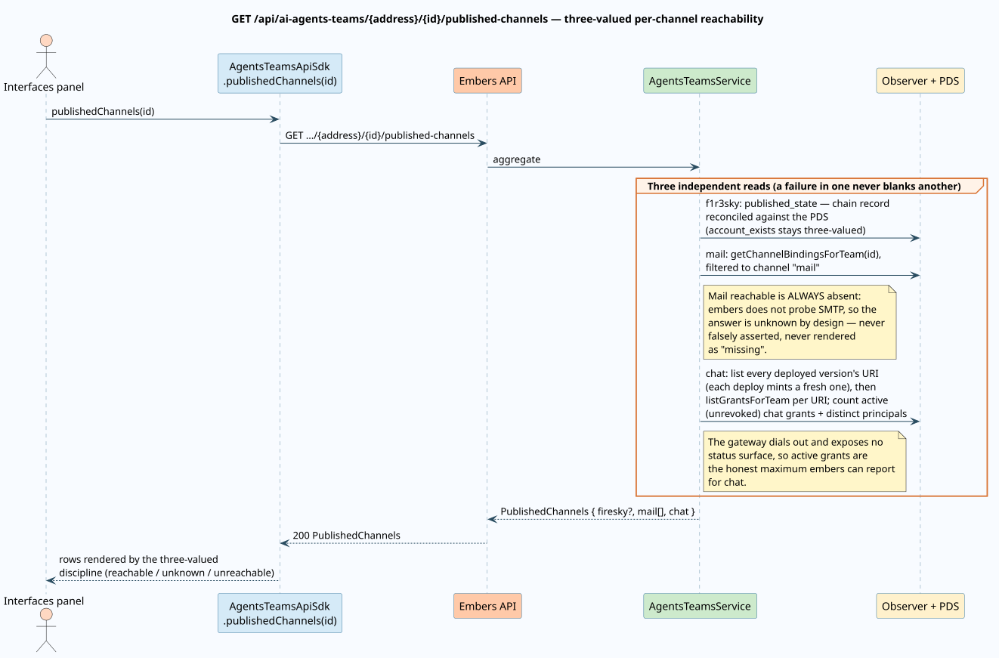

# Published channels

Reports where a team is reachable, per channel, with honestly three-valued
reachability. Feeds the Interfaces panel.

| | |
| --- | --- |
| Operation | `GET /api/ai-agents-teams/{address}/{id}/published-channels` (tag: AIAgentsTeams) |
| Generated client | `AIAgentsTeamsApi.agentsTeamsPublishedChannels` |
| SDK wrapper | `AgentsTeamsApiSdk.publishedChannels` (`sdk.agentsTeams.publishedChannels(id)`) |
| Backend | `packages/embers/src/api/agents_teams/endpoints.rs:861` → `domain/agents_teams/channels.rs` |
| Schema pin | `packages/client/schema.json` @ `69012a4` (Embers API 0.1.0) |

## Semantics

One aggregation over three independent sources, under the discipline the
[published state](published.md) read established: `true` is verified reachable,
`false` is a verified divergence worth flagging, and an **absent answer means
"could not be determined" and must never be rendered as "missing"**. The three
lookups are awaited independently — a failure in one channel's source fails the
call rather than silently blanking another's row.

- **F1r3sky** — the existing [published state](published.md), PDS-reconciled,
  present when the team was ever published there (its `account_exists` stays
  three-valued for exactly this discipline).
- **Mail** — the team's mail bindings with their `active` flags. `reachable` is
  **always absent today, by design**: embers does not probe SMTP, so asserting
  reachability would be fabrication. Activity of the binding is fact; liveness
  of the mail edge is not embers' to claim.
- **Chat** — derived from **grant presence**: the count of active (unrevoked)
  chat grants and the distinct principals they name. Grants name a deployment
  URI and every deploy mints a fresh one, so the aggregation walks **all** of
  the team's deployed version URIs, not only the latest. The gateway dials out
  and exposes no status surface, so active grants are the honest maximum embers
  can report — the frontend renders zero grants as "unknown", not
  "unreachable", because a grant could exist against an older deployment URI
  this aggregation cannot see.

## Request

| Parameter | In | Type | Required | Meaning |
| --- | --- | --- | --- | --- |
| `address` | path | `string` (REV address) | yes | The owning wallet. |
| `id` | path | `string` (UUIDv4) | yes | The team. |

## Responses

| Status | Body | Meaning |
| --- | --- | --- |
| 200 | `PublishedChannels` | The per-channel aggregation (fields below). |
| 500 | `InternalError` | Any of the three sources failed. |

`PublishedChannels` — documented on the declaration below.

### Response types (TypeScript)

Generated declarations from `packages/client/src/api-client/models/`, doc comments included — the comments are generated from the backend models' Rust `///` doc comments (property names are the SDK's camelCase; the wire JSON uses snake_case where they differ):

```typescript
/**
 * Where a team is reachable, per channel, with honestly three-valued
 * reachability: `true` verified reachable, `false` verified unreachable,
 * absent when the question could not be answered -- which must never be
 * rendered as "missing".
 */
export interface PublishedChannels {
  /** Chat reachability, derived from grant presence. */
  chat: ChatChannelState;
  /** F1R3SKY publication state, when the team was ever published there. */
  firesky?: PublishedState;
  /** Mail bindings for the team. */
  mail: Array<MailChannelState>;
}

export interface MailChannelState {
  /** Whether the binding is in force. */
  active: boolean;
  /** The bound mail address. */
  address: string;
  /**
   * Always absent today: embers deliberately does not probe SMTP, so mail
   * reachability is unknown by design rather than falsely asserted.
   */
  reachable?: boolean;
}

/**
 * Chat reachability derived from grant presence: a team with active chat
 * grants is connectable by exactly those principals. The gateway dials out
 * and exposes no status surface, so this is the honest maximum embers can
 * report.
 */
export interface ChatChannelState {
  /** Active (unrevoked) chat grants across all of the team's deployments. */
  activeGrantCount: UInt64;
  /** The distinct principals those grants name. */
  principals: Array<string>;
}
```

`PublishedState` is documented in [published state](published.md#responses).

## Retry semantics

Idempotent read; safe to poll. The chat row moves when grants are created or
revoked; the mail row when bindings publish, unpublish, or republish; the
f1r3sky row follows its own publication lifecycle.

## Sequence



## Worked example

```bash
curl -s http://localhost:8080/api/ai-agents-teams/1111AtahZ.../6a1c9c2e-.../published-channels
```

```json
{
  "firesky": null,
  "mail": [
    {
      "address": "research-crew@agents.example",
      "active": true,
      "reachable": null
    }
  ],
  "chat": {
    "active_grant_count": "2",
    "principals": ["a3f92c41d8e0...", "7b1e00c9aa54..."]
  }
}
```

The frontend's `lib/interfaces.ts` collapses each row to
`reachable | unknown | unreachable` in one place, so no call site can quietly
render `null` as an absence: this team shows a mail row ("unknown" — bound,
never probed) and a chat row ("reachable" — two active grants).

## Related

- [Published state](published.md) — the f1r3sky component, and the origin of
  the three-valued discipline.
- [Publish to mail](publish-to-mail.md) / [unpublish mail](unpublish-mail.md)
  — moving the mail row.
- [Grants create](grants-create.md) / [grants revoke](grants-revoke.md) —
  moving the chat row.
