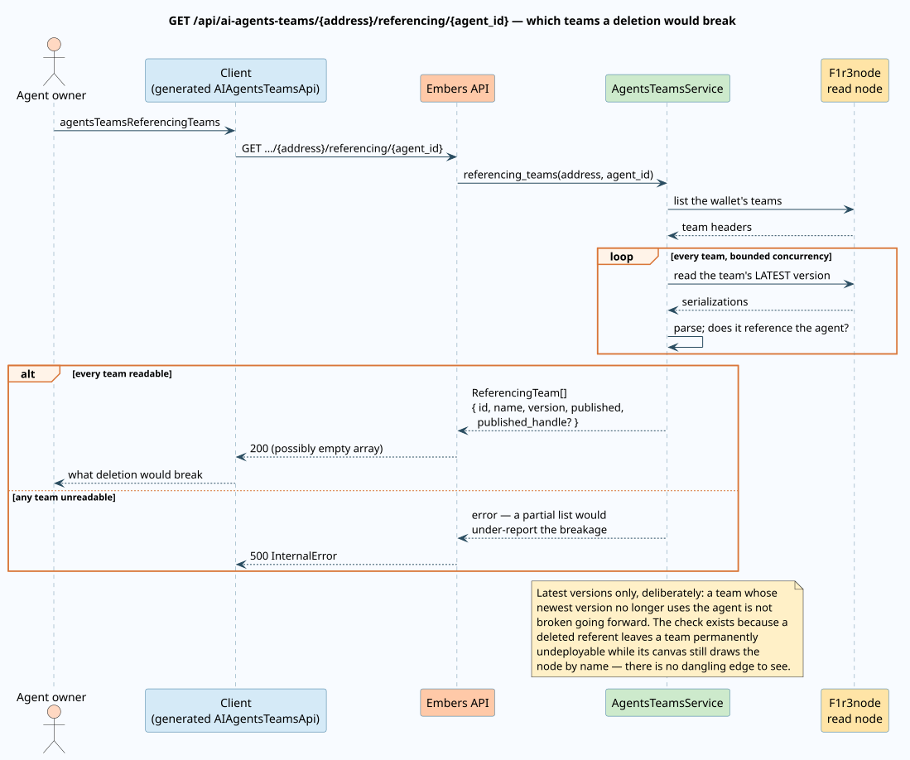

# Referencing teams

Names every team whose latest version uses a given agent — what deleting that agent would
break.

| | |
| --- | --- |
| Operation | `GET /api/ai-agents-teams/{address}/referencing/{agent_id}` (tag: AIAgentsTeams) |
| Generated client | `AIAgentsTeamsApi.agentsTeamsReferencingTeams` |
| SDK wrapper | none — generated client only |
| Backend | `packages/embers/src/api/agents_teams/endpoints.rs:314` → `domain/agents_teams/referencing_teams.rs` |
| Schema pin | `packages/client/schema.json` @ `01e8ea0` (Embers API 0.1.0) |

## Semantics

Deleting an agent a team references leaves that team **permanently undeployable, with
nothing showing it**: the team's canvas carries the agent's *name*, so the editor keeps
drawing the node, and the failure appears only at deploy time, in another process, naming
an identifier the author never sees. Unlike a dangling edge there is no repair — the node
is well formed; only its referent is gone. This read exists so
[agent deletion](../ai-agents/delete.md) can warn first.

Three deliberate design points, verbatim from the implementation's rationale:

- **Latest versions only.** A team whose latest version does not use the agent is not
  broken going forward; treating it as affected would destroy work to protect a
  historical version nobody is deploying. This also bounds the cost: one list read plus
  one parse per team, not one read per version of every team.
- **Bounded concurrency.** Each team is an independent chain read, answered faster
  together than sequentially — but sub-linearly, so the fan-out is a small fixed number
  rather than "all of them"; a wallet holding fifty teams must not become fifty
  simultaneous explore-deploys.
- **Fails loudly.** If any team cannot be read, the whole call errors: a partial list
  under-reports what is about to break, and "1 team affected" when the true answer is
  three is worse than an error.

Each hit reports whether the team is [published](published.md) and under which handle —
the difference between breaking a private draft and breaking a live social account.

## Request

| Parameter | In | Type | Required | Meaning |
| --- | --- | --- | --- | --- |
| `address` | path | `string` (`blockchain-address`) | yes | The wallet whose teams are scanned. |
| `agent_id` | path | `string` (UUIDv4) | yes | The agent being considered for deletion. |

## Responses

| Status | Body | Meaning |
| --- | --- | --- |
| 200 | `ReferencingTeam[]` (inline array — no named component schema) | Possibly empty: nothing breaks. |
| 500 | `InternalError` | Any team unreadable — no partial answers. |

`ReferencingTeam` — documented on the declaration below.

### Response types (TypeScript)

Generated declarations from `packages/client/src/api-client/models/`, doc comments included — the comments are generated from the backend models' Rust `///` doc comments (property names are the SDK's camelCase; the wire JSON uses snake_case where they differ):

```typescript
/** A team whose latest version uses a given agent, and would break if it were deleted. */
export interface ReferencingTeam {
  /** The referencing team's identity (`UUIDv4`). */
  id: string;
  /** Its name. */
  name: string;
  /** Whether the team is currently published. */
  published: boolean;
  /** The handle that would stop working meaningfully. */
  publishedHandle?: string;
  /** The latest version (`UUIDv7`) — the one that references the agent. */
  version: string;
}
```

## Retry semantics

Idempotent read; safe to retry. On a 500, retrying is the right move — the failure is a
read problem, not a domain state.

## Sequence



## Worked example

```bash
curl -s http://localhost:8080/api/ai-agents-teams/1111LAdaDDGGVKgwBRPGeR2v9uHvsxFcqogtC2Xbmbo81zpxV1U9M/referencing/5c1f9d3a-8e2b-4f6c-a7d1-3b9e0c4f8a25
```

```json
[
  {
    "id": "7b2e4f8a-1c9d-4a3b-8e5f-6d0a2c4b8f13",
    "name": "review-loop",
    "version": "0198e4b1-77aa-7c02-bd31-5f8a9c2e6d47",
    "published": true,
    "published_handle": "review-loop.f1r3sky.dev"
  }
]
```

## SDK usage

```typescript
import { AIAgentsTeamsApi, Configuration } from "@f1r3fly-io/embers-client-sdk";

const teams = new AIAgentsTeamsApi(new Configuration({ basePath }));
const affected = await teams.agentsTeamsReferencingTeams({
  address,
  agentId,
});
if (affected.length > 0) {
  // warn before sdk.agents.delete(agentId)
}
```

## Related

- [Agent delete](../ai-agents/delete.md) — the operation this read gates.
- [Published](published.md) — what `published`/`published_handle` summarize.
