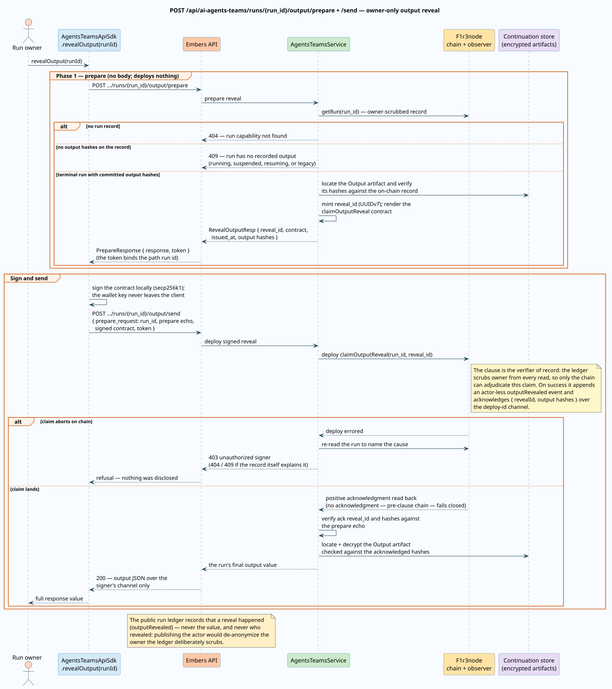

# Reveal a run's output

Owner-authenticated read of a terminal run's final output value. The public run ledger is
metadata-only; this pair is the one content read on the surface, and the on-chain
`claimOutputReveal` clause — not the HTTP service — adjudicates who may perform it.

| | |
| --- | --- |
| Operation | `POST /api/ai-agents-teams/runs/{run_id}/output/prepare` + `POST /api/ai-agents-teams/runs/{run_id}/output/send` (tag: AIAgentsTeams) |
| Generated client | `AIAgentsTeamsApi.agentsTeamsPrepareRevealOutput`, `AIAgentsTeamsApi.agentsTeamsSendRevealOutput` |
| SDK wrapper | `AgentsTeamsApiSdk.revealOutput` (`sdk.agentsTeams.revealOutput(runId)`) |
| Backend | `packages/embers/src/api/agents_teams/endpoints.rs:317` → `domain/agents_teams/reveal_output.rs` |
| Schema pin | `packages/client/schema.json` @ `01e8ea0` (Embers API 0.1.0) |

## Semantics

A terminal run's output value rests as an encrypted `Output` artifact whose content and
capability hashes the terminal advancement committed on the on-chain run record; the
bearer run link exposes those hashes and never the value. The reveal is a **signed,
non-bearer, owner-only read** of that artifact:

- **Prepare** takes no body — the run id rides the path and is bound into the token as
  the hashed prepare request. The backend refuses before anything is signed when the run
  does not exist (404) or carries no output hashes (409: still `running`, `suspended`,
  `resuming`, or a legacy `returned` run whose value went inline). It also verifies the
  store actually holds the artifact the chain commits to, then mints a fresh
  `reveal_id` (UUIDv7) and renders the `claimOutputReveal` contract.
- **Send** deploys the signed claim. The clause adjudicates ownership **on chain** — the
  ledger scrubs `owner` from every read (`getRun`/`listRuns`), so no off-chain party can
  make this decision — appends an actor-less `outputRevealed` event, and acknowledges
  `{revealId, output hashes}` over the deploy-id channel. The backend releases the
  decrypted value only after reading that positive acknowledgment and matching it
  against the prepare echo; against an environment predating the clause no
  acknowledgment ever appears and the reveal **fails closed**.
- **Ownership is the entire authority tier.** Delegated approver grants are wait-scoped
  and the terminal advancement republishes them empty, so delegated authority provably
  ends when the run completes; the service address needs no HTTP read path (it holds the
  store keys ambiently). A mention-triggered F1r3sky run is signed by the mentioning
  user's own wallet, so the person who posted the mention is the owner and can reveal.
- **The occurrence is public, the value and the actor are not.** `outputRevealed`
  appears on the run's public timeline — good audit at zero cost — while the value
  travels only over the signer's response channel and the revealer's identity stays off
  the ledger (publishing it would de-anonymize the scrubbed owner).

## Request

### `POST /api/ai-agents-teams/runs/{run_id}/output/prepare`

Path `run_id` — the run capability. **No request body.**

### `POST /api/ai-agents-teams/runs/{run_id}/output/send`

Body `SendRequestBody_SignedContract_string_RevealOutputResp` — the standard echo
envelope where the echoed prepare request is the run id string itself; the handler
additionally requires it to equal the path `run_id`.

## Responses

| Phase | Status | Body | Meaning |
| --- | --- | --- | --- |
| prepare | 200 | `PrepareResponse_RevealOutputResp` | The reveal claim (fields below). |
| prepare | 404 | — | No run record exists under the id. |
| prepare | 409 | — | The run has no recorded output artifact yet. |
| send | 200 | untyped JSON | The run's final output value, released only over this channel. |
| send | 400 | `InternalError` | Token/echo mismatch, or the echoed run id differs from the path. |
| send | 403 | — | The signer is not the run's on-chain owner. Deliberately not 404: run existence is already public through the bearer link. |
| send | 404 / 409 | — | The post-abort classification found the record absent / output-less — or (409) the envelope was already consumed: a replayed send produces no new `outputRevealed` event and is refused without disclosure. |
| send | 500 | `InternalError` | Deploy not finalized, missing acknowledgment (fail-closed), store drift. |

`RevealOutputResp` (the `response` field) — documented on the declaration below.

### Response types (TypeScript)

Generated declarations from `packages/client/src/api-client/models/`, doc comments included — the comments are generated from the backend models' Rust `///` doc comments (property names are the SDK's camelCase; the wire JSON uses snake_case where they differ):

```typescript
export interface PrepareResponseRevealOutputResp {
  /**
   * The operation-specific prepare payload, carrying the unsigned
   * contract(s) to sign.
   */
  response: RevealOutputResp;
  /**
   * JWT binding the send to exactly this prepare exchange; expires after
   * one day.
   */
  token: string;
}

export interface RevealOutputResp {
  /** The unsigned `claimOutputReveal` contract bytes to sign. */
  contract: Base64;
  /** Prepare instant. */
  issuedAt: TimestampMillis;
  /**
   * Capability commitment over the encrypted output artifact, echoed so
   * the send can verify nothing moved between prepare and claim.
   */
  outputCapabilityHash: string;
  /**
   * Content commitment over the encrypted output artifact, echoed so the
   * send can verify nothing moved between prepare and claim.
   */
  outputContentHash: string;
  /**
   * Fresh `UUIDv7` identity minted at prepare; echoed by the on-chain
   * acknowledgment.
   */
  revealId: string;
}
```

## Signing and binding

| Property | Value |
| --- | --- |
| Token | Present — binds the path run id (the hashed prepare request) and the prepare response. |
| Signing key | The run owner's wallet key; the chain rejects every other signer. |
| Contracts signed | One: the claim contract. |
| Deploy identifier | Not returned — the response is the value itself. |

## Retry semantics

Completed runs are immutable, so there is no revision fence. Each prepare mints a fresh
`reveal_id`; a re-run of the whole flow simply reveals again and appends another
`outputRevealed` event — each is a true audit fact. **Send envelopes are single-use**: a
replayed envelope carries the same signature and therefore the same deploy identity, so
its deploy never lands a second time — the backend counts `outputRevealed` events under
the per-run lock before and after the deploy, and an envelope whose claim produced no new
event is refused with 409 and no disclosure. Tokens expire after one day; prepare again.

## Sequence



## Worked example

Revealing a completed run from the inspector page's "Reveal full response" button is the
same flow as below; there is no request body to compose. The response is the run's final
output value verbatim — for the Research Desk demo's escalation path, the released
record plus the Archivist's `archived` flag:

```json
{
  "question": "What is the exact rotation schedule of the Zephyr-9 attestation committee?",
  "answer": "The Zephyr-9 attestation committee rotates every 400 blocks by stake-weighted round robin.",
  "feedback": "human-authored at the escalation gate",
  "score": 100,
  "archived": true
}
```

## SDK usage

```typescript
const { sendResponse } = await sdk.agentsTeams.revealOutput(runId);
// sendResponse is the run's final output value; it exists nowhere on the
// public ledger, which records only the outputRevealed event and hashes.
```

## Related

- [Run state](run-state.md) — the public record whose `output_content_hash` /
  `output_capability_hash` witness the sealed artifact.
- [Run commands](run-commands.md) — the sibling signed-claim surface for resuming runs.
- [Capability model](../../../../../embers-frontend/docs/agent-teams/security/capability-model.md) — where this
  read sits in the platform's authority taxonomy.
- [Error semantics](../../http-api.md#error-semantics) — the 403/404/409 rows.
