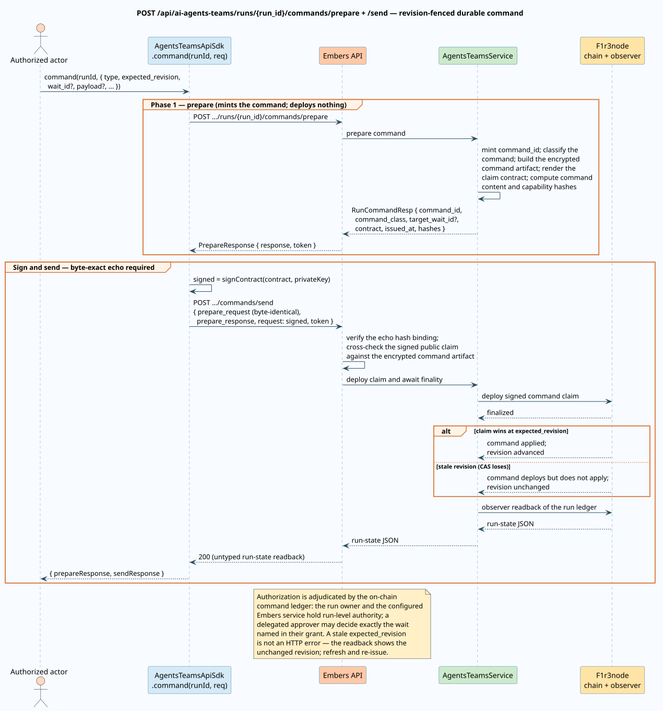

# Run commands

Issues an authenticated, revision-fenced command against a durable run: signal, event,
approve, reject, retry, cancel, timerFired, or migrate.

| | |
| --- | --- |
| Operation | `POST /api/ai-agents-teams/runs/{run_id}/commands/prepare` + `POST /api/ai-agents-teams/runs/{run_id}/commands/send` (tag: AIAgentsTeams) |
| Generated client | `AIAgentsTeamsApi.agentsTeamsPrepareRunCommand`, `AIAgentsTeamsApi.agentsTeamsSendRunCommand` |
| SDK wrapper | `AgentsTeamsApiSdk.command` (`sdk.agentsTeams.command(runId, req)`) |
| Backend | `packages/embers/src/api/agents_teams/endpoints.rs:222` → `domain/agents_teams/run_commands.rs` |
| Schema pin | `packages/client/schema.json` @ `69012a4` (Embers API 0.1.0) |

## Semantics

A command is a **durable claim on the run's on-chain ledger**, not an in-memory poke. The
pair "atomically claims and applies one durable command against an exact run revision"
(the SDK wrapper's own contract), with the observer-readback response shape of
[run](run.md):

- **Prepare** mints the command identity, classifies it, builds the encrypted command
  artifact, and returns the claim contract plus the command's content and capability
  hashes.
- **Send** requires the prepare request echoed **byte-for-byte** — beyond the standard
  token binding, the backend cross-checks the signed public claim against the encrypted
  command artifact, so any re-serialization drift is a rejection. Use the SDK wrapper,
  which preserves all hashes and timestamps.
- **Application is revision-fenced.** The ledger applies the command only if
  `expected_revision` still matches (compare-and-set at claim time). A stale revision is
  **not an HTTP error**: the command deploys but does not apply, and the readback shows
  the unchanged revision and current waits — refresh via [run state](run-state.md) and
  re-issue. Kernel-level rejections (a timer fire whose deadline differs from the recorded
  one; a decision on a wait no longer pending) surface in the readback the same way.
- **Authorization is adjudicated on chain**: the run owner and the configured Embers
  service hold run-level authority for every command class; a delegated approver may
  decide exactly the wait named in their grant
  (`approval_authority_grants`). The full model is in
  [Durable and hierarchical execution](../../../../../embers-frontend/docs/agent-teams/architecture/durable-execution.md)
  and the [threat model](../../../../../embers-frontend/docs/agent-teams/security/threat-model.md).

## Request

### `POST /api/ai-agents-teams/runs/{run_id}/commands/prepare`

Path `run_id` — the run capability. Body `RunCommandReq`:

### `POST /api/ai-agents-teams/runs/{run_id}/commands/send`

Body `SendRequestBody_SignedContract_RunCommandReq_RunCommandResp` — the standard echo
envelope, with the byte-exactness requirement above.

### Request types (TypeScript)

Generated declarations from `packages/client/src/api-client/models/`, doc comments included — the comments are generated from the backend models' Rust `///` doc comments (property names are the SDK's camelCase; the wire JSON uses snake_case where they differ):

```typescript
export interface RunCommandReq {
  /** Per-actor decision identity for approvals; blocks decision replay. */
  decisionId?: string;
  /**
   * Required for `timerFired`; must equal the wait's recorded deadline
   * exactly, or the kernel rejects the fire in the readback.
   */
  expectedDeadline?: TimestampMillis;
  /**
   * The revision the command fences on; read it from the run state. A
   * stale value is not an HTTP error: the command deploys but does not
   * apply.
   */
  expectedRevision: UInt64;
  /** Required for `migrate`: the hash-checked current definition. */
  fromDefinitionHash?: string;
  /** Event or signal name; required where the kind carries one. */
  name?: string;
  /** Signal, event, or decision payload. */
  payload?: any | null;
  /** Reject or cancel reason. */
  reason?: string;
  /**
   * Required for `migrate`: `set`/`remove` patch applied to portable
   * state.
   */
  statePatch?: any | null;
  /** Required for `migrate`: the target deployment's registry URI. */
  targetTeamUri?: string;
  /** Required for `migrate`: the hash-checked target definition. */
  toDefinitionHash?: string;
  /** The command kind being issued. */
  type: RunCommandKind;
  /**
   * The exact qualified wait addressed; required for signals, events,
   * decisions, timer fires, and retries.
   */
  waitId?: string;
}

/** The authenticated run-command kinds the ledger adjudicates. */
export const RunCommandKind = {
  Approve: "approve",
  Cancel: "cancel",
  Event: "event",
  Migrate: "migrate",
  Reject: "reject",
  Retry: "retry",
  Signal: "signal",
  TimerFired: "timerFired",
} as const;

export type RunCommandKind =
  (typeof RunCommandKind)[keyof typeof RunCommandKind];
```

## Responses

| Phase | Status | Body | Meaning |
| --- | --- | --- | --- |
| prepare | 200 | `PrepareResponse_RunCommandResp` | The command claim (fields below). |
| send | 200 | untyped JSON | The run ledger's post-state — applied, or unchanged on a stale revision. |
| send | 500 | `InternalError` | Token/echo mismatch (including artifact cross-check failures), deploy or readback failure. |

`RunCommandResp` (the `response` field) — documented on the declaration below.

### Response types (TypeScript)

Generated declarations from `packages/client/src/api-client/models/`, doc comments included — the comments are generated from the backend models' Rust `///` doc comments (property names are the SDK's camelCase; the wire JSON uses snake_case where they differ):

```typescript
export interface PrepareResponseRunCommandResp {
  /**
   * The operation-specific prepare payload, carrying the unsigned
   * contract(s) to sign.
   */
  response: RunCommandResp;
  /**
   * JWT binding the send to exactly this prepare exchange; expires after
   * one day.
   */
  token: string;
}

export interface RunCommandResp {
  /** Capability commitment over the encrypted command artifact. */
  commandCapabilityHash: string;
  /** The authorization class the ledger adjudicates. */
  commandClass: string;
  /** Content commitment over the encrypted command artifact. */
  commandContentHash: string;
  /** The minted command identity. */
  commandId: string;
  /** The unsigned claim contract bytes to sign. */
  contract: Base64;
  /** Prepare instant. */
  issuedAt: TimestampMillis;
  /** The wait the command addresses. */
  targetWaitId?: string;
}
```

## Signing and binding

| Property | Value |
| --- | --- |
| Token | Present — plus the byte-exact echo cross-check against the encrypted artifact. |
| Signing key | The commanding actor's wallet key (owner, service, or granted approver). |
| Contracts signed | One: the claim contract. |
| Deploy identifier | Not returned — the response is the readback. |

## Retry semantics

**Safe-by-CAS**: re-sending a command whose claim already applied loses the
compare-and-set and does not double-apply; the readback shows the revision having moved
once. A stale-revision outcome is the signal to refresh and re-issue against the observed
revision. Approvals are additionally idempotent per actor via `decision_id` uniqueness.

## Sequence



## Worked example

Approving a pending wait (revision read from run state):

```json
{
  "expected_revision": "2",
  "type": "approve",
  "wait_id": "wait:t1:approval-gate",
  "decision_id": "d-2026-08-03-01"
}
```

The raw two-phase walk-through — prepare, sign, send by hand — is worked in the
[operator guide](../../../../../embers-frontend/docs/agent-teams/usage/editor-and-operations.md).

## SDK usage

```typescript
const state = await sdk.agentsTeams.getRun(runId);
const { sendResponse } = await sdk.agentsTeams.command(runId, {
  expectedRevision: state.revision,
  type: "approve",
  waitId: state.wait_ids[0],
  decisionId: crypto.randomUUID(),
});
```

## Related

- [Run state](run-state.md) — the revision and waits a command cites.
- [Durable execution](../../../../../embers-frontend/docs/agent-teams/architecture/durable-execution.md) — the
  command envelope and authority table.
- [Error semantics](../../http-api.md#error-semantics) — stale-revision and
  kernel-rejection rows.
