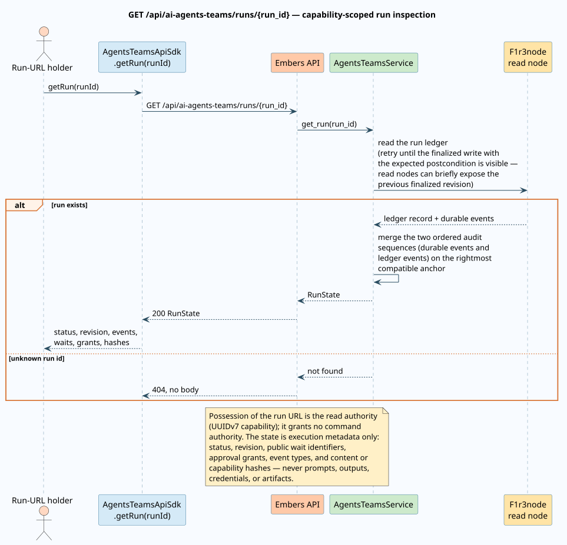

# Run state

Inspects a run's execution metadata via its capability URL.

| | |
| --- | --- |
| Operation | `GET /api/ai-agents-teams/runs/{run_id}` (tag: AIAgentsTeams) |
| Generated client | `AIAgentsTeamsApi.agentsTeamsGetRun` |
| SDK wrapper | `AgentsTeamsApiSdk.getRun` (`sdk.agentsTeams.getRun(runId)`) |
| Backend | `packages/embers/src/api/agents_teams/endpoints.rs:213` → `domain/agents_teams/get_run.rs` |
| Schema pin | `packages/client/schema.json` @ `69012a4` (Embers API 0.1.0) |

## Semantics

**Capability-scoped read**: the UUIDv7 run identifier doubles as the read authority —
whoever holds the URL can inspect, and holding it grants no command authority
([the three-authority model](../../http-api.md#authentication-and-authorization)). The
response is execution metadata only: status, revision, wait identifiers, approval grants,
event types, and content/capability hashes — deliberately **never** prompts, outputs,
credentials, or artifacts (artifact contents are encrypted and capability-bound
elsewhere).

Two implementation properties make the read trustworthy:

- **Postcondition-aware retry.** Read nodes can briefly expose the *previous* finalized
  revision after a write; the backend retries until the finalized write with the expected
  postcondition is observable, so a read after a command reflects that command.
- **Audit-sequence merge.** A durable run records two ordered sequences — durable events
  between checkpoints and coordination-only ledger events. The backend merges them on the
  rightmost compatible anchor, so repeated command claims align with the successful latest
  claim rather than an earlier rejected attempt, and both inputs remain subsequences of
  the merged history.

## Request

| Parameter | In | Type | Required | Meaning |
| --- | --- | --- | --- | --- |
| `run_id` | path | `string` (UUIDv7) | yes | The run capability. |

## Responses

| Status | Body | Meaning |
| --- | --- | --- |
| 200 | `RunState` | The run's current ledger projection. |
| 404 | none | Unknown run identifier. |
| 500 | `InternalError` | Readback failure. |

`RunState` (optional fields absent when not applicable) — documented on the declaration below.

### Response types (TypeScript)

Generated declarations from `packages/client/src/api-client/models/`, doc comments included — the comments are generated from the backend models' Rust `///` doc comments (property names are the SDK's camelCase; the wire JSON uses snake_case where they differ):

```typescript
export interface RunState {
  /** The invoked team's registry URI. */
  agentsTeam: Uri;
  /** Grant entries (`waitId|address`) naming delegated approvers. */
  approvalAuthorityGrants: Array<string>;
  /** The last applied command's public claim: the commanding actor. */
  commandActor?: string;
  /** The last applied command's public claim: capability commitment. */
  commandCapabilityHash?: string;
  /** The last applied command's public claim: its authorization class. */
  commandClass?: string;
  /** The last applied command's public claim: content commitment. */
  commandContentHash?: string;
  /** The last applied command's public claim: its identity. */
  commandId?: string;
  /** The last applied command's public claim: the wait it addressed. */
  commandWaitId?: string;
  /** Capability commitment over the durable continuation. */
  continuationCapabilityHash?: string;
  /** Content commitment over the durable continuation. */
  continuationContentHash?: string;
  /** Run creation instant. */
  createdAt: TimestampMillis;
  /** Pin of the executed definition. */
  definitionHash?: string;
  /** Next scheduled resume instant (parked durable yield or timer). */
  dueAt?: TimestampMillis;
  /** The merged, ordered audit history — event types only. */
  events: Array<RunEvent>;
  /** Capability commitment over the terminal output artifact. */
  outputCapabilityHash?: string;
  /** Content commitment over the terminal output artifact. */
  outputContentHash?: string;
  /** Capability commitment over the invocation artifact. */
  requestCapabilityHash?: string;
  /** Content commitment over the invocation artifact. */
  requestContentHash?: string;
  /** The optimistic-concurrency revision commands fence on. */
  revision: UInt64;
  /** The run capability (`UUIDv7`). */
  runId: string;
  /**
   * Ledger status: running, suspended, resuming, completed, failed, or
   * cancelled.
   */
  status: string;
  /** Public qualified wait identifiers currently pending. */
  waitIds: Array<string>;
}

export interface RunEvent {
  /** The event's type label; contents never appear here. */
  eventType: string;
  /** Position in the merged audit order. */
  sequence: UInt64;
}
```

## Retry semantics

Idempotent read; safe to poll. `revision` is what a subsequent
[command](run-commands.md) should cite as `expected_revision`.

## Sequence



## Worked example

```bash
curl -s http://localhost:8080/api/ai-agents-teams/runs/0198f7c2-55aa-7b31-8d02-3e6a9c4f7b15
```

```json
{
  "run_id": "0198f7c2-55aa-7b31-8d02-3e6a9c4f7b15",
  "agents_team": "rho:id:o6c4x1zbdqjqzqzr8cgpgqf3zc9dsqn86wjc1xj8kuyxwbxwe8xn1p",
  "created_at": "1754329001523",
  "status": "suspended",
  "events": [
    { "sequence": "1", "event_type": "runStarted" },
    { "sequence": "2", "event_type": "waitRegistered" }
  ],
  "revision": "2",
  "approval_authority_grants": [],
  "wait_ids": ["wait:t1:approval-gate"]
}
```

## SDK usage

```typescript
const state = await sdk.agentsTeams.getRun(runId);
if (state.status === "suspended") {
  // state.wait_ids names what the run is waiting on
}
```

## Related

- [Run](run.md) — where the capability is minted.
- [Run commands](run-commands.md) — acting on the waits this read reveals.
- [Durable and hierarchical execution](../../../../../embers-frontend/docs/agent-teams/architecture/durable-execution.md) —
  the run lifecycle behind `status`.
- [Operator guide](../../../../../embers-frontend/docs/agent-teams/usage/editor-and-operations.md) — inspecting and
  resuming a durable run by hand.
