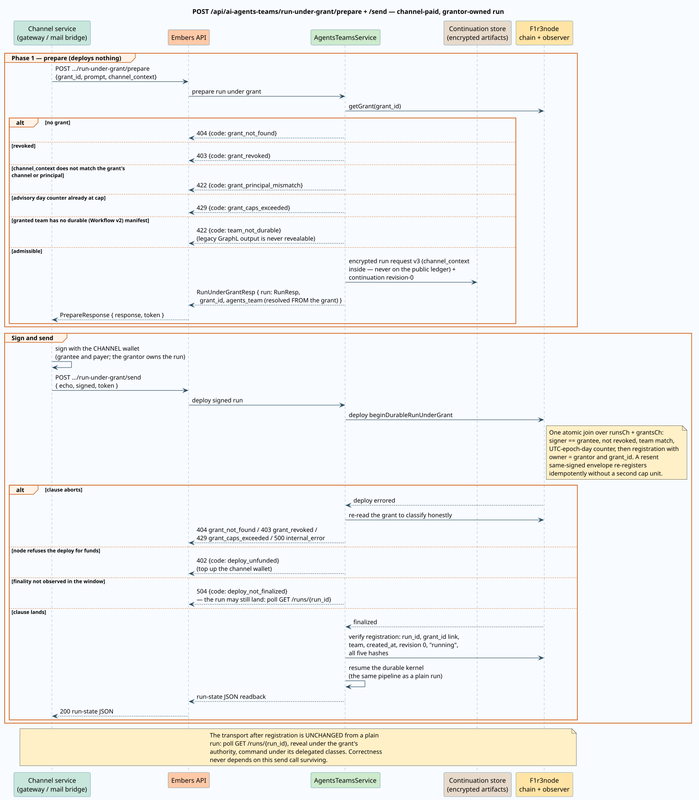

# Run a team under a grant

Invokes a granted team with the channel wallet signing and paying the deploy
while the **grantor owns the run**. The chain adjudicates the grant atomically
with run registration; after registration the run is a plain durable run on the
unchanged poll/reveal/command transport.

| | |
| --- | --- |
| Operation | `POST /api/ai-agents-teams/run-under-grant/prepare` + `POST /api/ai-agents-teams/run-under-grant/send` (tag: AIAgentsTeams) |
| Generated client | `AIAgentsTeamsApi.agentsTeamsPrepareRunUnderGrant`, `AIAgentsTeamsApi.agentsTeamsSendRunUnderGrant` |
| SDK wrapper | `AgentsTeamsApiSdk.runUnderGrant` (`sdk.agentsTeams.runUnderGrant(grantId, prompt, channelContext)`) |
| Backend | `packages/embers/src/api/agents_teams/endpoints.rs:701` → `domain/agents_teams/run_under_grant.rs` |
| Schema pin | `packages/client/schema.json` @ `69012a4` (Embers API 0.1.0) |

## Semantics

The request names a **grant, never a team** — the target comes from the grant,
and the response echoes the resolved `agents_team`. The pair mirrors
[run](run.md) with a grant-adjudication layer in front:

- **Prepare** fetches the grant and fails fast — revoked (403), channel context
  not matching the grant's channel or principal (422; the chain cannot see who
  typed a message, so this server-side check is the fail-fast half of the
  channel's routing duty), advisory day counter at its cap (429), or a team
  without a durable Workflow v2 manifest (422 `team_not_durable`: legacy GraphL
  runs never record an output artifact, so their results could never be revealed
  for delivery). It then mints the run capability and writes the encrypted
  durable run request at schema `embers-agent-team-run-request-v3` — the
  `channelContext` (principal, fingerprint, subject) lives **inside that
  encrypted artifact**, never on the public ledger, which records only the
  `grant_id`.
- **Send** deploys the channel-signed `beginDurableRunUnderGrant`. The clause
  takes the runs and grants states in **one join**, so grant adjudication
  (signer is the grantee, not revoked, team matches), the UTC-epoch-day counter
  increment, and run registration with `owner = grantor` plus the `grant_id`
  link commit atomically — no revocation or cap race can interleave. On an
  abort the backend re-reads the public grant to classify honestly (absence,
  revocation, and cap exhaustion are knowable without authorization). After
  finality it verifies the registered record (grant link, team, hashes,
  revision 0) and resumes the durable kernel — the same pipeline as a plain
  run — then answers with the observer readback.
- **The response shape is untyped** in the schema (the run-state JSON after
  finality), exactly as [run](run.md); parse it with
  [run state](run-state.md#responses)'s expectations. `RunState.grantId` links
  the run back to its grant on the capability-gated read.
- **Caps are an abuse throttle, not an invariant**: the counter admits per UTC
  epoch day (`floor(deploy_ms / 86 400 000)`), so up to twice the cap can land
  across one midnight boundary. Channels needing hard bounds keep their own
  admission control.

## Request

### `POST /api/ai-agents-teams/run-under-grant/prepare`

Body `RunUnderGrantReq` — fields documented on the declaration below.

### `POST /api/ai-agents-teams/run-under-grant/send`

Body `SendRequestBody_SignedContract_RunUnderGrantReq_RunUnderGrantResp` — the
standard echo envelope.

### Request types (TypeScript)

Generated declarations from `packages/client/src/api-client/models/`, doc comments included — the comments are generated from the backend models' Rust `///` doc comments (property names are the SDK's camelCase; the wire JSON uses snake_case where they differ):

```typescript
export interface RunUnderGrantReq {
  /** Provenance of the triggering channel message. */
  channelContext: ChannelContext;
  /** The grant authorizing this run; the target team comes from it. */
  grantId: string;
  /** The invocation input. */
  prompt: string;
}

/**
 * Channel-supplied provenance for a grant-initiated run. Stored only inside
 * the encrypted durable run-request artifact; the public ledger records only
 * the grant id.
 */
export interface ChannelContext {
  /** The channel issuing the run; must equal the grant's channel. */
  channel: GrantChannel;
  /**
   * The channel's content-derived idempotency handle for the triggering
   * message. Recorded for audit; channels own their dedup discipline.
   */
  messageFingerprint: string;
  /** The channel-native principal; must equal the grant's principal. */
  principal: string;
  /** Mail subject line, when the channel has one. */
  subject?: string;
}
```

`GrantChannel` is documented in
[grants create](grants-create.md#request-types-typescript).

## Responses

| Phase | Status | Body | Meaning |
| --- | --- | --- | --- |
| prepare | 200 | `PrepareResponse_RunUnderGrantResp` | The prepared run, the echoed grant, and the resolved team (fields below). |
| prepare | 404 | `ErrorBody` `grant_not_found` | No grant record exists under the id. |
| prepare | 403 | `ErrorBody` `grant_revoked` | The grant exists but is revoked. |
| prepare | 422 | `ErrorBody` `grant_principal_mismatch` / `team_not_durable` | Channel context does not match the grant / the granted team has no durable deployment. |
| prepare | 429 | `ErrorBody` `grant_caps_exceeded` | The grant's daily run cap is exhausted (advisory read; the chain re-checks). |
| prepare | 500 | `ErrorBody` `internal_error` | Manifest, artifact, or head-block failure. |
| send | 200 | untyped JSON | The run ledger's post-state, read from the observer after finality. |
| send | 404 | `ErrorBody` `grant_not_found` | Post-abort classification: the grant disappeared. |
| send | 403 | `ErrorBody` `grant_revoked` | Revoked between prepare and the deploy's claim — the atomic join refused. |
| send | 429 | `ErrorBody` `grant_caps_exceeded` | The counter filled between prepare and claim. |
| send | 402 | `ErrorBody` `deploy_unfunded` | The node refused the deploy for funds — top up the **channel** wallet. |
| send | 504 | `ErrorBody` `deploy_not_finalized` | Finality not observed in the window; **the run may still land — poll `GET /runs/{run_id}`**. |
| send | 500 | `ErrorBody` `internal_error` | Token/echo mismatch, identity conflict, or readback failure. |

`RunUnderGrantResp` (the `response` field) — documented on the declaration
below.

### Response types (TypeScript)

Generated declarations from `packages/client/src/api-client/models/`, doc comments included — the comments are generated from the backend models' Rust `///` doc comments (property names are the SDK's camelCase; the wire JSON uses snake_case where they differ):

```typescript
export interface PrepareResponseRunUnderGrantResp {
  /**
   * The operation-specific prepare payload, carrying the unsigned contract(s)
   * to sign.
   */
  response: RunUnderGrantResp;
  /**
   * JWT binding the send to exactly this prepare exchange; expires after one
   * day.
   */
  token: string;
}

export interface RunUnderGrantResp {
  /**
   * The team the grant names; the request never carries a team, so the caller
   * learns the resolved target here.
   */
  agentsTeam: Uri;
  /** The authorizing grant, echoed. */
  grantId: string;
  /**
   * The prepared run, identical in shape to a plain run prepare. The deploy
   * is signed and paid by the grantee; the run is owned by the grantor per
   * the on-chain grant.
   */
  run: RunResp;
}
```

`RunResp` is the plain run's prepare payload, documented in
[run](run.md#response-types-typescript); `ErrorBody` in
[grants create](grants-create.md#response-types-typescript).

## Signing and binding

| Property | Value |
| --- | --- |
| Token | Present — standard hash-bound exchange. |
| Signing key | The **channel service's** wallet key (the grantee; an ordinary funded wallet, never the embers service key). The grantor signs nothing here — their standing grant is the authority. |
| Contracts signed | One: the invocation contract (`response.run.contract`). |
| Deploy identifier | Not returned — the response is the readback; the run is inspected via its capability URL. |

## Retry semantics

Prepare is always safe to retry (each prepare mints a fresh run capability;
abandoned ones never ran). **A resent send envelope is safe twice over**: the
same signature carries the same deploy identity so it cannot land twice, and if
the first deploy was lost, the clause's re-registration path verifies the run's
full identity and acknowledges idempotently **without consuming a second unit of
the daily cap**. A 504 is not a failure verdict — poll `GET /runs/{run_id}` and
carry the run home from there (the channel sweeper pattern). Only 403/429/402
mean nothing registered.

## Sequence



## Worked example

Prepare request, as the chat gateway builds it:

```json
{
  "grant_id": "0198f9a1-2233-7c44-9d55-6e7f8a9b0c1d",
  "prompt": "Summarize this thread for the weekly report.",
  "channel_context": {
    "channel": "chat",
    "principal": "a3f92c41d8e0...",
    "message_fingerprint": "discord:g813:c405:m9921",
    "subject": null
  }
}
```

Prepare response (`response` field, truncated):

```json
{
  "run": {
    "run_id": "0198fa07-91b2-7d63-8e14-5f6a7b8c9d0e",
    "contract": "CtQBbmV3IHJsKGByaG86cmVn...TRUNCATED...",
    "created_at": "1754900050000",
    "durable": true,
    "definition_hash": "b3f8a2c1...TRUNCATED...",
    "request_content_hash": "9d4e7f2a...TRUNCATED...",
    "request_capability_hash": "1c8b5e9f...TRUNCATED...",
    "continuation_content_hash": "77aa02bc...TRUNCATED...",
    "continuation_capability_hash": "e0d1c2b3...TRUNCATED..."
  },
  "grant_id": "0198f9a1-2233-7c44-9d55-6e7f8a9b0c1d",
  "agents_team": "rho:id:o6c4x1zbdqjqzqzr8cgpgqf3zc9dsqn86wjc1xj8kuyxwbxwe8xn1p"
}
```

## SDK usage

```typescript
const { prepareResponse, sendResponse } = await sdk.agentsTeams.runUnderGrant(
  grantId,
  "Summarize this thread for the weekly report.",
  { channel: "chat", principal, messageFingerprint, subject: undefined },
);
const runId = prepareResponse.response.run.runId;
// sendResponse is the post-state readback (unknown); ongoing inspection:
const state = await sdk.agentsTeams.getRun(runId);
// state.grantId === grantId on this capability-gated read.
```

## Related

- [Run](run.md) — the plain-run sibling whose transport this reuses.
- [Run state](run-state.md) — polling; carries `grantId` for granted runs.
- [Reveal output](reveal-output.md) — delivery under `authority.reveal`.
- [Run commands](run-commands.md) — the grant branch of command authority.
- [Channel grants](../../../../../embers-frontend/docs/agent-teams/architecture/channel-grants.md)
  — the adjudicating clause in literate form.
