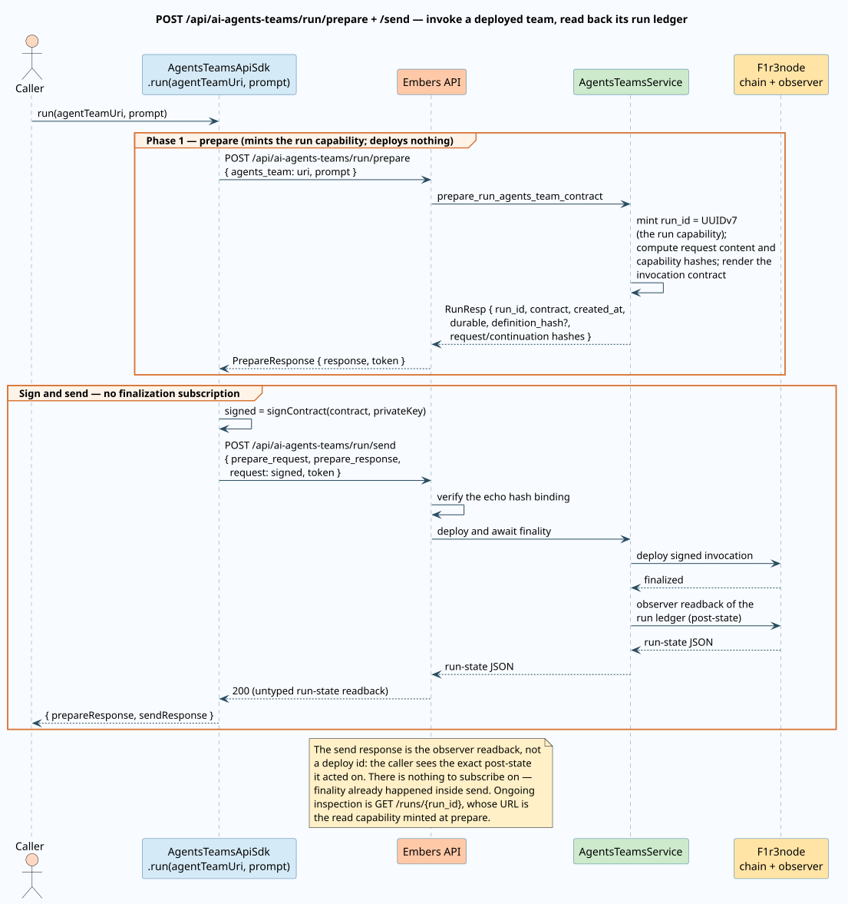

# Run a team

Invokes a deployed team with a prompt and returns the run's ledger state after finality.

| | |
| --- | --- |
| Operation | `POST /api/ai-agents-teams/run/prepare` + `POST /api/ai-agents-teams/run/send` (tag: AIAgentsTeams) |
| Generated client | `AIAgentsTeamsApi.agentsTeamsPrepareRun`, `AIAgentsTeamsApi.agentsTeamsSendRun` |
| SDK wrapper | `AgentsTeamsApiSdk.run` (`sdk.agentsTeams.run(agentTeamUri, prompt)`) |
| Backend | `packages/embers/src/api/agents_teams/endpoints.rs:140` → `domain/agents_teams/run_agents_team.rs` |
| Schema pin | `packages/client/schema.json` @ `01e8ea0` (Embers API 0.1.0) |

## Semantics

Running is a token-bound pair with the **observer-readback** response shape: the send call
deploys the signed invocation, **awaits chain finality**, then reads the run's ledger back
from the observer and returns that JSON — so the caller sees the exact post-state it acted
on. There is no deploy identifier in the response and no finalization WebSocket
involvement; nothing exists to subscribe on, and the SDK wrapper correspondingly returns
only `{ prepareResponse, sendResponse }`.

Prepare mints the run's identities before anything executes:

- `run_id` — a UUIDv7, **the run capability**: possession of the run URL
  (`/runs/{run_id}`) is the read authority for the run's metadata ledger
  ([run state](run-state.md)). It grants no command authority.
- `request_content_hash` / `request_capability_hash` and, for durable runs, the
  continuation hashes — the commitments that let the durable-execution machinery verify
  artifacts later (the model is specified in
  [Durable and hierarchical execution](../../../../../embers-frontend/docs/agent-teams/architecture/durable-execution.md)).
- `durable` — whether the target team compiled with the durable run ledger (Workflow v2
  definitions do; a legacy graph-only deployment runs the pre-ledger path).
- `definition_hash` — pins the definition the run executes; later
  [saves](save.md) never move a started run.

The target is addressed by its **registry URI** (`agents_team`) — the value
[deploy](deploy.md) claimed and [list](list.md) reports as `uri`.

The send response is **untyped** in the schema (and `unknown` in the SDK): it is the
run-state JSON as the ledger records it; parse it with the same expectations as
[run state](run-state.md#responses).

## Request

### `POST /api/ai-agents-teams/run/prepare`

Body `RunReq` — fields documented on the declaration below.

### `POST /api/ai-agents-teams/run/send`

Body `SendRequestBody_SignedContract_RunReq_RunResp` — the standard echo envelope.

### Request types (TypeScript)

Generated declarations from `packages/client/src/api-client/models/`, doc comments included — the comments are generated from the backend models' Rust `///` doc comments (property names are the SDK's camelCase; the wire JSON uses snake_case where they differ):

```typescript
export interface RunReq {
  /** The deployed team's registry URI. */
  agentsTeam: Uri;
  /** The invocation input. */
  prompt: string;
}
```

## Responses

| Phase | Status | Body | Meaning |
| --- | --- | --- | --- |
| prepare | 200 | `PrepareResponse_RunResp` | The run capability and contract (fields below). |
| send | 200 | untyped JSON | The run ledger's post-state, read from the observer after finality. |
| send | 500 | `InternalError` | Token/echo mismatch, deploy failure, or finality/readback failure. |

`RunResp` (the `response` field) — documented on the declaration below.

### Response types (TypeScript)

Generated declarations from `packages/client/src/api-client/models/`, doc comments included — the comments are generated from the backend models' Rust `///` doc comments (property names are the SDK's camelCase; the wire JSON uses snake_case where they differ):

```typescript
export interface PrepareResponseRunResp {
  /**
   * The operation-specific prepare payload, carrying the unsigned
   * contract(s) to sign.
   */
  response: RunResp;
  /**
   * JWT binding the send to exactly this prepare exchange; expires after
   * one day.
   */
  token: string;
}

export interface RunResp {
  /** Capability commitment over the durable continuation. */
  continuationCapabilityHash?: string;
  /** Content commitment over the durable continuation. */
  continuationContentHash?: string;
  /** The unsigned invocation contract bytes to sign. */
  contract: Base64;
  /** Prepare instant. */
  createdAt: TimestampMillis;
  /** Hash pinning the executed definition. */
  definitionHash?: string;
  /** Whether the run uses the durable ledger. */
  durable: boolean;
  /** Capability commitment over the invocation artifact. */
  requestCapabilityHash: string;
  /** Content commitment over the invocation artifact. */
  requestContentHash: string;
  /** The run capability (`UUIDv7`), minted at prepare. */
  runId: string;
}
```

## Signing and binding

| Property | Value |
| --- | --- |
| Token | Present — standard hash-bound exchange. |
| Signing key | The caller's wallet key. |
| Contracts signed | One: the invocation contract. |
| Deploy identifier | Not returned — the response is the readback; the run is inspected via its capability URL. |

## Retry semantics

Prepare is always safe to retry (each prepare mints a fresh run capability; abandoned ones
never ran). A failed send is diagnosable through `GET /runs/{run_id}`: if the run exists,
the invocation landed. Re-running is never idempotent — every successful run is a distinct
run.

## Sequence



## Worked example

Prepare request:

```json
{ "agents_team": "rho:id:o6c4x1zbdqjqzqzr8cgpgqf3zc9dsqn86wjc1xj8kuyxwbxwe8xn1p",
  "prompt": "Summarize the discussion in this thread." }
```

Prepare response (`response` field, truncated):

```json
{
  "run_id": "0198f7c2-55aa-7b31-8d02-3e6a9c4f7b15",
  "contract": "CtQBbmV3IHJsKGByaG86cmVn...TRUNCATED...",
  "created_at": "1754329001523",
  "durable": true,
  "definition_hash": "b3f8a2c1...TRUNCATED...",
  "request_content_hash": "9d4e7f2a...TRUNCATED...",
  "request_capability_hash": "1c8b5e9f...TRUNCATED..."
}
```

## SDK usage

```typescript
const { prepareResponse, sendResponse } =
  await sdk.agentsTeams.run(teamUri, "Summarize the discussion in this thread.");
const runId = prepareResponse.response.run_id;
// sendResponse is the post-state readback (unknown); ongoing inspection:
const state = await sdk.agentsTeams.getRun(runId);
```

## Related

- [Run state](run-state.md) — inspecting the run via its capability.
- [Run commands](run-commands.md) — signals, approvals, retries, cancellation.
- [Run on F1r3sky](run-on-firesky.md) — the socially-answered variant.
- [Deploy](deploy.md) — where the target URI comes from.
