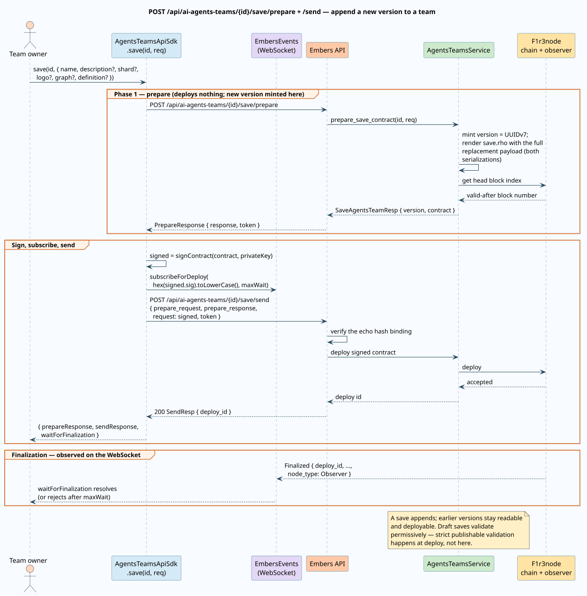

# Save a team

Appends a new version to an existing team.

| | |
| --- | --- |
| Operation | `POST /api/ai-agents-teams/{id}/save/prepare` + `POST /api/ai-agents-teams/{id}/save/send` (tag: AIAgentsTeams) |
| Generated client | `AIAgentsTeamsApi.agentsTeamsPrepareSave`, `AIAgentsTeamsApi.agentsTeamsSendSave` |
| SDK wrapper | `AgentsTeamsApiSdk.save` (`sdk.agentsTeams.save(id, req)`) |
| Backend | `packages/embers/src/api/agents_teams/endpoints.rs:262` → `domain/agents_teams/save.rs` |
| Schema pin | `packages/client/schema.json` @ `69012a4` (Embers API 0.1.0) |

## Semantics

Append-only versioning with the standard token-bound flow, as specified for
[agent save](../ai-agents/save.md): prepare mints a fresh UUIDv7 `version` for the path's
`id`; the payload is a full replacement carrying both serializations; earlier versions
remain readable and deployable.

The validation split matters here: **draft saves validate permissively** — a work-in-
progress definition with unfinished routes is saveable — while the strict
publishable-validation gate runs at [deploy](deploy.md) (its rule catalog is the
[validation phases](../../../../../embers-frontend/docs/agent-teams/specification/workflow-definition-v2.md#validation-phases)).
Runs already started are unaffected by saves: a [run](run.md) pins the definition by hash
at start.

## Request

### `POST /api/ai-agents-teams/{id}/save/prepare`

| Parameter | In | Type | Required | Meaning |
| --- | --- | --- | --- | --- |
| `id` | path | `string` (UUIDv4) | yes | The team identity to append to. |

Body `CreateAgentsTeamReq` — the full replacement payload
([fields](create.md#request)). The endpoint reference names this shape
`SaveAgentsTeamReq`; it is structurally the create request.

### `POST /api/ai-agents-teams/{id}/save/send`

Path `id` as above; body
`SendRequestBody_SignedContract_CreateAgentsTeamReq_SaveAgentsTeamResp` — the standard
echo envelope.

### Request types (TypeScript)

Generated declarations from `packages/client/src/api-client/models/`, doc comments included — the comments are generated from the backend models' Rust `///` doc comments (property names are the SDK's camelCase; the wire JSON uses snake_case where they differ):

```typescript
export interface CreateAgentsTeamReq {
  /**
   * The Workflow v2 definition document; validated permissively at save
   * time, strictly at deploy.
   */
  definition?: any | null;
  /** Team description. */
  description?: string;
  /** The graphl serialization of the canvas. */
  graph?: Graph;
  /** Logo reference. */
  logo?: string;
  /** Team name. */
  name: string;
  /** Declared shard label. */
  shard?: string;
}
```

## Responses

| Phase | Status | Body | Meaning |
| --- | --- | --- | --- |
| prepare | 200 | `PrepareResponse_SaveAgentsTeamResp` | `{ response: { version, contract }, token }`. |
| send | 200 | `SendResp` | `{ deploy_id }` — accepted; finalization pending. |
| send | 500 | `InternalError` | Token/echo mismatch, or deploy submission failure. |

### Response types (TypeScript)

Generated declarations from `packages/client/src/api-client/models/`, doc comments included — the comments are generated from the backend models' Rust `///` doc comments (property names are the SDK's camelCase; the wire JSON uses snake_case where they differ):

```typescript
export interface PrepareResponseSaveAgentsTeamResp {
  /**
   * The operation-specific prepare payload, carrying the unsigned
   * contract(s) to sign.
   */
  response: SaveAgentsTeamResp;
  /**
   * JWT binding the send to exactly this prepare exchange; expires after
   * one day.
   */
  token: string;
}

export interface SaveAgentsTeamResp {
  /** The unsigned save contract bytes to sign. */
  contract: Base64;
  /** The appended version's identifier (`UUIDv7`). */
  version: string;
}

export interface SendResp {
  /**
   * The accepted deploy's identifier (lowercase hex of its signature);
   * finalization is still pending when this returns.
   */
  deployId: string;
}
```

## Signing and binding

Identical to [create](create.md#signing-and-binding).

## Retry semantics

Prepare is always safe to retry. A re-run after a finalization timeout appends a duplicate
version — observable via [versions](versions.md), never a corruption.

## Sequence



## Worked example

Shapes follow [create](create.md#worked-example) with the save response
(`{ version, contract }`) substituted.

## SDK usage

```typescript
const { waitForFinalization } =
  await sdk.agentsTeams.save(teamId, { name, graph, definition });
await waitForFinalization;
```

## Related

- [Deploy](deploy.md) — where strict validation and compilation happen.
- [Versions](versions.md) — the append history.
