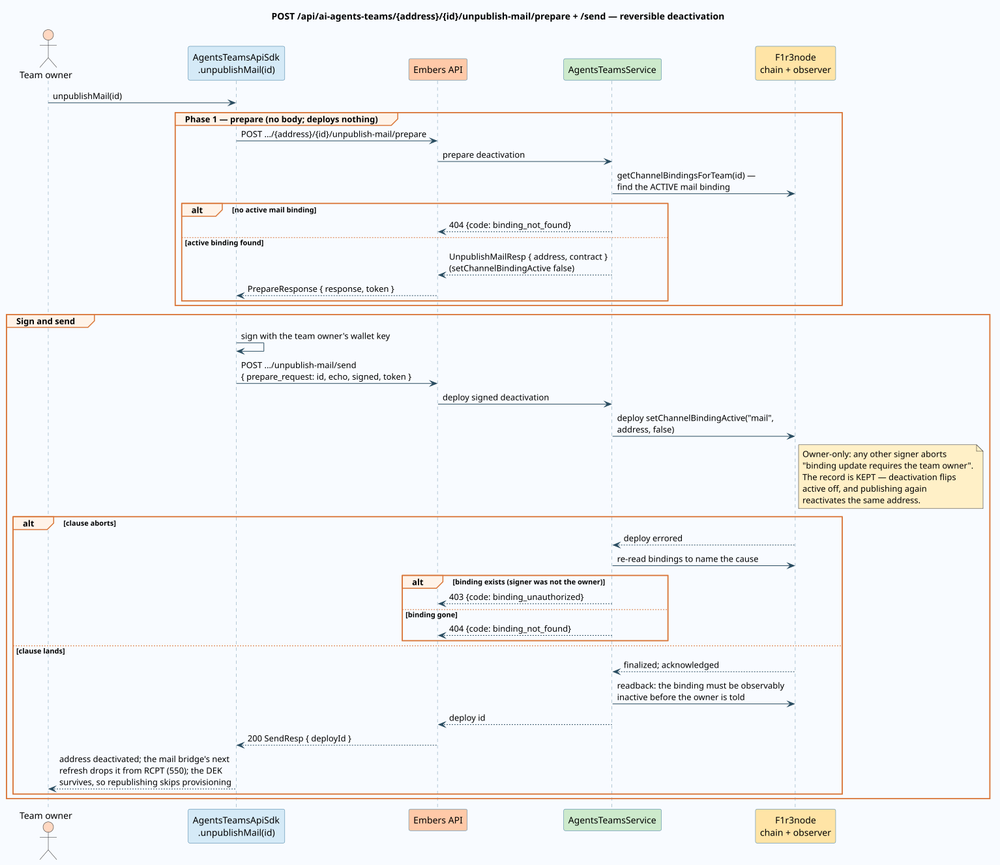

# Unpublish a team's mail address

Deactivates the team's mail binding, reversibly: the record is kept, and
publishing again reactivates the same address.

| | |
| --- | --- |
| Operation | `POST /api/ai-agents-teams/{address}/{id}/unpublish-mail/prepare` + `POST /api/ai-agents-teams/{address}/{id}/unpublish-mail/send` (tag: AIAgentsTeams) |
| Generated client | `AIAgentsTeamsApi.agentsTeamsPrepareUnpublishMail`, `AIAgentsTeamsApi.agentsTeamsSendUnpublishMail` |
| SDK wrapper | `AgentsTeamsApiSdk.unpublishMail` (`sdk.agentsTeams.unpublishMail(id)`) |
| Backend | `packages/embers/src/api/agents_teams/endpoints.rs:803` → `domain/agents_teams/publish_to_mail.rs` |
| Schema pin | `packages/client/schema.json` @ `69012a4` (Embers API 0.1.0) |

## Semantics

The mirror of the mail channel's reversibility promise, and the same shape as
[unpublish](unpublish.md) on the f1r3sky side (which keeps the account while
removing the record):

- **Prepare** takes no body — the team id rides the path and is bound into the
  token as the hashed prepare request. The backend finds the team's **active**
  mail binding (404 when none) and renders `setChannelBindingActive(..., false)`
  against its address.
- **Send** deploys the owner-signed deactivation. The clause is owner-only (any
  other signer aborts) and flips `active` off **without deleting anything**: the
  binding record keeps its address, team link, and creation instant. On an
  abort the backend re-reads the bindings to classify honestly: a surviving
  record proves the signer was not the owner (403); absence is 404. After
  finality it verifies the binding is observably inactive before answering.
- **Effect at the mail edge.** The bridge's next directory refresh drops the
  address from the bound set — it replaces the set wholesale, never merges, so
  deactivated bindings cannot resurrect — and RCPT answers `550` for it. The
  mailbox key survives in the bridge's keystore, so re-publishing restores
  service without re-provisioning (no `450` window the second time).

## Request

### `POST /api/ai-agents-teams/{address}/{id}/unpublish-mail/prepare`

Path `address` (the owning wallet), `id` (the team). **No request body.**

### `POST /api/ai-agents-teams/{address}/{id}/unpublish-mail/send`

Body `SendRequestBody_SignedContract_string_UnpublishMailResp` — the standard
echo envelope where the echoed prepare request is the team id string itself;
the handler additionally requires it to equal the path `id`.

## Responses

| Phase | Status | Body | Meaning |
| --- | --- | --- | --- |
| prepare | 200 | `PrepareResponse_UnpublishMailResp` | The address being deactivated and the contract (fields below). |
| prepare | 404 | `ErrorBody` `binding_not_found` | No active mail binding exists for the team. |
| prepare | 500 | `ErrorBody` `internal_error` | Render, read, or head-block failure. |
| send | 200 | `SendResp` | The deploy identifier; the binding is observably inactive. |
| send | 403 | `ErrorBody` `binding_unauthorized` | The signer does not own the team. |
| send | 404 | `ErrorBody` `binding_not_found` | Post-abort classification found no binding record. |
| send | 500 | `ErrorBody` `internal_error` | Token/echo mismatch, mismatched path/echo team id, deploy failure, or readback failure. |

`UnpublishMailResp` (the `response` field) — documented on the declaration
below.

### Response types (TypeScript)

Generated declarations from `packages/client/src/api-client/models/`, doc comments included — the comments are generated from the backend models' Rust `///` doc comments (property names are the SDK's camelCase; the wire JSON uses snake_case where they differ):

```typescript
export interface PrepareResponseUnpublishMailResp {
  /**
   * The operation-specific prepare payload, carrying the unsigned contract(s)
   * to sign.
   */
  response: UnpublishMailResp;
  /**
   * JWT binding the send to exactly this prepare exchange; expires after one
   * day.
   */
  token: string;
}

export interface UnpublishMailResp {
  /** The address whose binding is being deactivated. */
  address: string;
  /** The unsigned deactivation contract bytes to sign (team-owner-signed). */
  contract: Base64;
}
```

## Signing and binding

| Property | Value |
| --- | --- |
| Token | Present — binds the path team id (the hashed prepare request) and the prepare response. |
| Signing key | The **team owner's** wallet key; the chain rejects every other signer. |
| Contracts signed | One: the deactivation contract. |
| Deploy identifier | Returned as `SendResp.deployId`. |

## Retry semantics

Idempotent in effect: flipping `active` to `false` twice converges, so a
replayed envelope or a re-run of the whole flow is safe. After a successful
unpublish, a fresh *prepare* answers 404 (there is no active binding left) —
that is the confirmation, not an error. Reactivation is
[publish-to-mail](publish-to-mail.md) with the same address.

## Sequence



## Worked example

```bash
curl -s -X POST \
  http://localhost:8080/api/ai-agents-teams/1111AtahZ.../6a1c9c2e-.../unpublish-mail/prepare
```

```json
{
  "response": {
    "address": "research-crew@agents.example",
    "contract": "CtQBbmV3IGRlcGxveUlkKGByaG86cmNoYWlu...TRUNCATED..."
  },
  "token": "eyJhbGciOiJIUzI1NiJ9...TRUNCATED..."
}
```

## SDK usage

```typescript
const { sendResponse } = await sdk.agentsTeams.unpublishMail(teamId);
// The address stops answering RCPT at the bridge's next refresh;
// publishing again restores it without re-provisioning.
```

## Related

- [Publish to mail](publish-to-mail.md) — the binding this deactivates, and
  the reactivation path.
- [Bindings](bindings.md) — where the record remains visible with
  `active: false`.
- [Published channels](published-channels.md) — the aggregation reflecting the
  flip.
