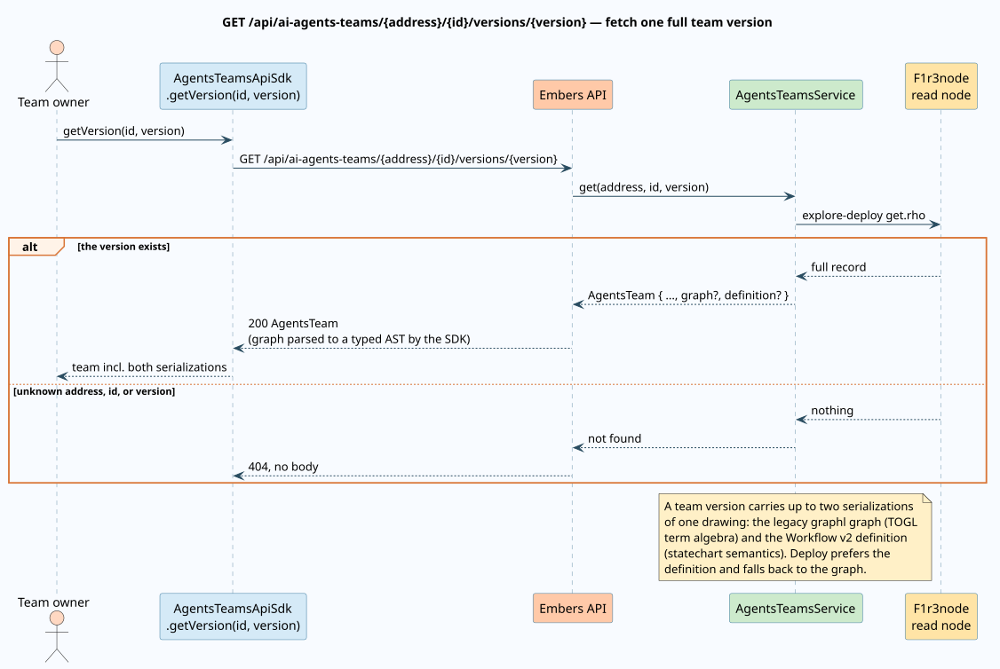

# Fetch a team version

Fetches one full version of a team, including both workflow serializations.

| | |
| --- | --- |
| Operation | `GET /api/ai-agents-teams/{address}/{id}/versions/{version}` (tag: AIAgentsTeams) |
| Generated client | `AIAgentsTeamsApi.agentsTeamsGetVersion` |
| SDK wrapper | `AgentsTeamsApiSdk.getVersion` (`sdk.agentsTeams.getVersion(id, version)`) |
| Backend | `packages/embers/src/api/agents_teams/endpoints.rs:66` → `domain/agents_teams/get.rs` |
| Schema pin | `packages/client/schema.json` @ `01e8ea0` (Embers API 0.1.0) |

## Semantics

The full-record read: header metadata plus up to two serializations of the team's canvas —

- `graph` — the graphl term (wire format: graphl **text** inside the JSON string; the SDK
  parses it into the typed `Graph` AST of `@f1r3fly-io/graphl-parser` on deserialization
  and re-serializes on the way out).
- `definition` — the Workflow v2 JSON document
  ([normative contract](../../../../../embers-frontend/docs/agent-teams/specification/workflow-definition-v2.md)).

Records written by the current editor carry both; older records may carry only the legacy
`graph`. [Deploy](deploy.md) prefers the `definition` when present and falls back to the
`graph` — a version with neither is undeployable. This read is also the one deploy performs
internally (with a retry loop for observer lag) when deploying a stored version.

## Request

| Parameter | In | Type | Required | Meaning |
| --- | --- | --- | --- | --- |
| `address` | path | `string` (`blockchain-address`) | yes | The owning wallet address. |
| `id` | path | `string` (UUIDv4) | yes | The team identity. |
| `version` | path | `string` (UUIDv7) | yes | The exact version to fetch. |

## Responses

| Status | Body | Meaning |
| --- | --- | --- |
| 200 | `AgentsTeam` | The full version record. |
| 404 | none | No such address, team, or version. |
| 500 | `InternalError` | Readback failure. |

`AgentsTeam` is `AgentsTeamHeader` ([fields](list.md#responses)) plus this version's `graph` and `definition`; every field is documented on the declaration below.

### Response types (TypeScript)

Generated declarations from `packages/client/src/api-client/models/`, doc comments included — the comments are generated from the backend models' Rust `///` doc comments (property names are the SDK's camelCase; the wire JSON uses snake_case where they differ):

```typescript
export interface AgentsTeam {
  /** When this version was prepared. */
  createdAt: TimestampMillis;
  /** The Workflow v2 definition document. */
  definition?: any | null;
  /** Team description. */
  description?: string;
  /** The graphl serialization of the canvas. */
  graph?: Graph;
  /** Team identity (`UUIDv4`), stable across versions. */
  id: string;
  /** When this version was last deployed; absent if never. */
  lastDeploy?: TimestampMillis;
  /** Logo reference. */
  logo?: string;
  /** Team name. */
  name: string;
  /** Declared shard label. */
  shard?: string;
  /**
   * Registry URI of the last deployment; the value run invocations
   * consume.
   */
  uri?: Uri;
  /** This version's identifier (`UUIDv7`). */
  version: string;
}
```

## Retry semantics

Idempotent read; a written version never changes.

## Sequence



## Worked example

```bash
curl -s http://localhost:8080/api/ai-agents-teams/1111LAdaDDGGVKgwBRPGeR2v9uHvsxFcqogtC2Xbmbo81zpxV1U9M/7b2e4f8a-1c9d-4a3b-8e5f-6d0a2c4b8f13/versions/0198e4b1-77aa-7c02-bd31-5f8a9c2e6d47
```

```json
{
  "id": "7b2e4f8a-1c9d-4a3b-8e5f-6d0a2c4b8f13",
  "version": "0198e4b1-77aa-7c02-bd31-5f8a9c2e6d47",
  "created_at": "1754241793120",
  "name": "review-loop",
  "graph": "0 * {context \"{\\\"type\\\":\\\"input-node\\\"}\" for input1 in let input1 = < input1 > in < input1 > | ...TRUNCATED...}",
  "definition": { "schema": "2.0", "entryScopeId": "scope:root", "nodes": [ "...TRUNCATED..." ] }
}
```

## SDK usage

```typescript
const team = await sdk.agentsTeams.getVersion(teamId, versionId);
// team.graph is a typed Graph AST; team.definition is the v2 JSON document
```

## Related

- [Deploy](deploy.md) — the consumer of exactly this read.
- [Workflow Definition v2](../../../../../embers-frontend/docs/agent-teams/specification/workflow-definition-v2.md) —
  the definition's normative contract.
- [TOGL correspondence](../../../../../embers-frontend/docs/agent-teams/design/togl-correspondence.md) — why the two
  serializations exist and how they relate.
