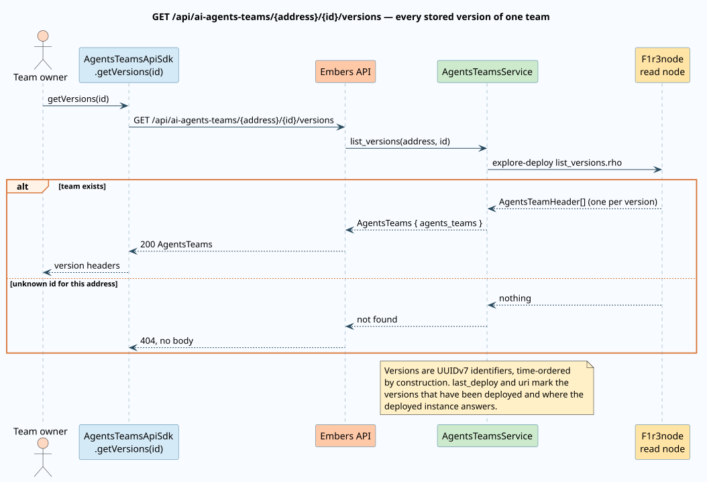

# List team versions

Lists every stored version of one team.

| | |
| --- | --- |
| Operation | `GET /api/ai-agents-teams/{address}/{id}/versions` (tag: AIAgentsTeams) |
| Generated client | `AIAgentsTeamsApi.agentsTeamsListVersions` |
| SDK wrapper | `AgentsTeamsApiSdk.getVersions` (`sdk.agentsTeams.getVersions(id)`) |
| Backend | `packages/embers/src/api/agents_teams/endpoints.rs:56` → `domain/agents_teams/list_versions.rs` |
| Schema pin | `packages/client/schema.json` @ `69012a4` (Embers API 0.1.0) |

## Semantics

Teams are append-only versioned like [agents](../ai-agents/versions.md) and
[OSLF documents](../oslfs/versions.md): [create](create.md) writes the first version,
every [save](save.md) appends one. This explore-deploy read returns headers for all
versions of one team; UUIDv7 identifiers are time-ordered, and `last_deploy`/`uri` mark
versions that have been [deployed](deploy.md) and where they answer. Unknown `id` for the
address is a 404.

## Request

| Parameter | In | Type | Required | Meaning |
| --- | --- | --- | --- | --- |
| `address` | path | `string` (`blockchain-address`) | yes | The owning wallet address. |
| `id` | path | `string` (UUIDv4) | yes | The team identity. |

## Responses

| Status | Body | Meaning |
| --- | --- | --- |
| 200 | `AgentsTeams` | `{ agents_teams: AgentsTeamHeader[] }` — one header per version. |
| 404 | none | No such team for this address. |
| 500 | `InternalError` | Readback failure. |

`AgentsTeamHeader` fields are specified in the [collection listing](list.md#responses).

### Response types (TypeScript)

Generated declarations from `packages/client/src/api-client/models/`, doc comments included — the comments are generated from the backend models' Rust `///` doc comments (property names are the SDK's camelCase; the wire JSON uses snake_case where they differ):

```typescript
export interface AgentsTeams {
  /** The wallet's teams, latest version each. */
  agentsTeams: Array<AgentsTeamHeader>;
}

export interface AgentsTeamHeader {
  /** When this version was prepared. */
  createdAt: TimestampMillis;
  /** Team description. */
  description?: string;
  /** Team identity (`UUIDv4`), stable across versions. */
  id: string;
  /** When this version was last deployed; absent if never. */
  lastDeploy?: TimestampMillis;
  /** Logo reference. */
  logo?: string;
  /** Team name. */
  name: string;
  /** Declared shard label. */
  shard?: string;
  /**
   * Registry URI of the last deployment; the value run invocations
   * consume.
   */
  uri?: Uri;
  /** Latest version identifier (`UUIDv7`). */
  version: string;
}
```

## Retry semantics

Idempotent read; safe to retry.

## Sequence



## Worked example

Shape as in the [collection listing](list.md#worked-example), one entry per version of the
requested team.

## SDK usage

```typescript
const { agentsTeams } = await sdk.agentsTeams.getVersions(teamId);
```

## Related

- [Version](version.md) — one full version, serializations included.
- [Deploy](deploy.md) — running a specific version.
