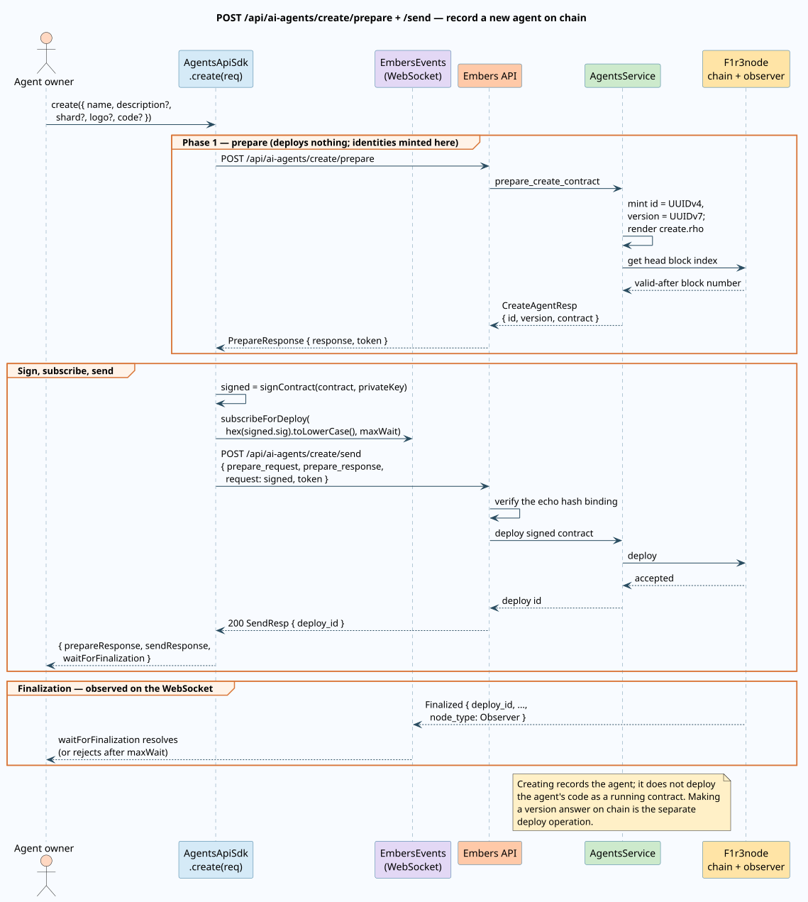

# Create an agent

Records a new agent on chain, minting its identity and first version.

| | |
| --- | --- |
| Operation | `POST /api/ai-agents/create/prepare` + `POST /api/ai-agents/create/send` (tag: AIAgents) |
| Generated client | `AIAgentsApi.agentsPrepareCreate`, `AIAgentsApi.agentsSendCreate` |
| SDK wrapper | `AgentsApiSdk.create` (`sdk.agents.create(req)`) |
| Backend | `packages/embers/src/api/agents/endpoints.rs` → `domain/agents/create.rs` |
| Schema pin | `packages/client/schema.json` @ `01e8ea0` (Embers API 0.1.0) |

## Semantics

Structurally identical to [OSLF create](../oslfs/create.md) — a token-bound
[two-phase](../../http-api.md#the-two-phase-prepare-sign-send-protocol) fire-and-forget
mutation with **identity minting at prepare** (`id` UUIDv4, first `version` UUIDv7) — with
the agent's richer payload. The one distinction worth stating twice: **creating records
the agent; it does not run it.** The `code` field is stored source. Making a version
answer on chain as a live contract is the separate [deploy](deploy.md) operation, and
using it inside a team is a matter of the team's definition
[referencing](../ai-agents-teams/referencing.md) the pinned `(id, version)`.

The record is owned by the signing wallet's address, where [list](list.md) finds it after
the deploy finalizes.

## Request

### `POST /api/ai-agents/create/prepare`

Body `CreateAgentReq` — fields documented on the declaration below.

### `POST /api/ai-agents/create/send`

Body `SendRequestBody_SignedContract_CreateAgentReq_CreateAgentResp` — the standard echo
envelope (`prepare_request`, `prepare_response`, `request: SignedContract`, `token`).

### Request types (TypeScript)

Generated declarations from `packages/client/src/api-client/models/`, doc comments included — the comments are generated from the backend models' Rust `///` doc comments (property names are the SDK's camelCase; the wire JSON uses snake_case where they differ):

```typescript
export interface CreateAgentReq {
  /** The agent's Rholang source. */
  code?: string;
  /** Agent description. */
  description?: string;
  /** Logo reference recorded with the agent. */
  logo?: string;
  /** Agent name. */
  name: string;
  /** Declared shard label recorded with the agent. */
  shard?: string;
}
```

## Responses

| Phase | Status | Body | Meaning |
| --- | --- | --- | --- |
| prepare | 200 | `PrepareResponse_CreateAgentResp` | `{ response: { id, version, contract }, token }`. |
| send | 200 | `SendResp` | `{ deploy_id }` — accepted; finalization pending. |
| send | 500 | `InternalError` | Token/echo mismatch, or deploy submission failure. |

### Response types (TypeScript)

Generated declarations from `packages/client/src/api-client/models/`, doc comments included — the comments are generated from the backend models' Rust `///` doc comments (property names are the SDK's camelCase; the wire JSON uses snake_case where they differ):

```typescript
export interface PrepareResponseCreateAgentResp {
  /**
   * The operation-specific prepare payload, carrying the unsigned
   * contract(s) to sign.
   */
  response: CreateAgentResp;
  /**
   * JWT binding the send to exactly this prepare exchange; expires after
   * one day.
   */
  token: string;
}

export interface CreateAgentResp {
  /** The unsigned creation contract bytes to sign. */
  contract: Base64;
  /** The minted agent identity (`UUIDv4`). */
  id: string;
  /** The first version's identifier (`UUIDv7`). */
  version: string;
}

export interface SendResp {
  /**
   * The accepted deploy's identifier (lowercase hex of its signature);
   * finalization is still pending when this returns.
   */
  deployId: string;
}
```

## Signing and binding

| Property | Value |
| --- | --- |
| Token | Present — standard hash-bound exchange. |
| Signing key | The caller's wallet key. |
| Contracts signed | One: the creation contract. |
| Deploy identifier | `hex(sig).toLowerCase()` — subscribed before send. |

## Retry semantics

Prepare is always safe to retry (fresh identities each time; abandoned prepares cost
nothing). After a finalization timeout, verify before re-creating — a re-run mints a
second agent with a different `id`. Check [list](list.md) for the returned `id` first.

## Sequence



## Worked example

Prepare request and response:

```json
{ "name": "summarizer", "description": "Summarizes long threads", "code": "contract main(@input, output) = { ... }" }
```

```json
{
  "response": {
    "id": "5c1f9d3a-8e2b-4f6c-a7d1-3b9e0c4f8a25",
    "version": "0198c2aa-1b7e-7f03-92d5-6a3e8b1c4d90",
    "contract": "CtQBbmV3IHJsKGByaG86cmVn...TRUNCATED..."
  },
  "token": "eyJ0eXAiOiJKV1QiLCJhbGciOiJIUzI1NiJ9...TRUNCATED..."
}
```

## SDK usage

```typescript
const { prepareResponse, waitForFinalization } = await sdk.agents.create({
  name: "summarizer",
  code: agentSource,
});
await waitForFinalization;
const { id, version } = prepareResponse.response;
```

## Related

- [Save](save.md) — appending versions; [Deploy](deploy.md) — running a version.
- [OSLF create](../oslfs/create.md) — the same protocol shape on the simpler collection.
