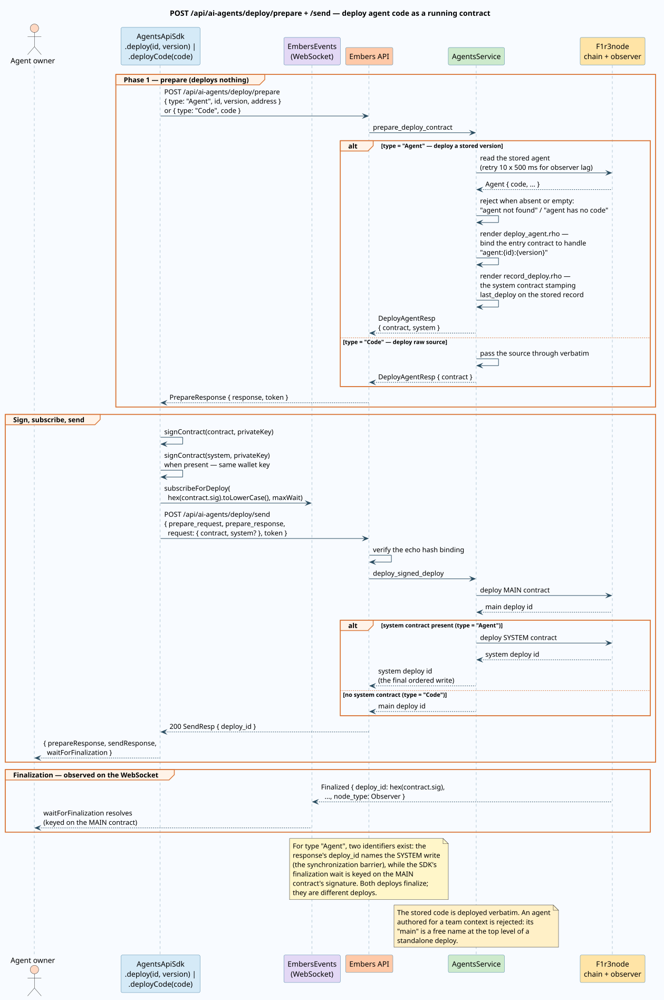

# Deploy an agent

Deploys agent code to the chain as a running contract — either a stored agent version or
raw source.

| | |
| --- | --- |
| Operation | `POST /api/ai-agents/deploy/prepare` + `POST /api/ai-agents/deploy/send` (tag: AIAgents) |
| Generated client | `AIAgentsApi.agentsPrepareDeploy`, `AIAgentsApi.agentsSendDeploy` |
| SDK wrappers | `AgentsApiSdk.deploy(id, version)` (type `Agent`) and `AgentsApiSdk.deployCode(code)` (type `Code`) |
| Backend | `packages/embers/src/api/agents/endpoints.rs` → `domain/agents/deploy.rs` |
| Schema pin | `packages/client/schema.json` @ `69012a4` (Embers API 0.1.0) |

## Semantics

Deployment is what turns stored source into a **running contract**. The request is a
discriminated union with two variants, served by one endpoint pair and two SDK wrappers:

- **`type: "Agent"`** — deploy a stored version. Prepare fetches the exact
  [agent version](version.md) from the chain (retrying 10 times at 500 ms to absorb
  observer read lag) and rejects with `agent not found`, `agent has no code`, or
  `agent … has empty code` when it cannot. The stored source is wrapped in
  `deploy_agent.rho`, which binds the agent's entry contract and publishes it under the
  **handle** `agent:{id}:{version}` — derived from identity and version so that
  redeploying a version is idempotent and two versions never collide. Prepare additionally
  returns a **system contract** (`record_deploy.rho`) that stamps `last_deploy` on the
  stored record.
- **`type: "Code"`** — deploy raw source verbatim, with no stored record involved and no
  system contract. This is the editor's scratch-deploy path.

The stored code is deployed **verbatim**: an agent authored for a team context is rejected
outright, because its `main` is a free name at the top level of a standalone deploy —
team-embedded execution is the [team deploy](../ai-agents-teams/deploy.md)'s job.

**Two deploy identifiers exist for `type: "Agent"`.** Send deploys the main contract
first, then the system contract, and returns the **system** deploy's identifier — the
final ordered write, which is the correct synchronization barrier for reading the updated
record. The SDK's `waitForFinalization`, however, is keyed on the **main** contract's
signature (subscribed before send), confirming the executable contract itself. Both
deploys finalize; they are different deploys with different identifiers. For
`type: "Code"` there is no system contract and the single identifier plays both roles.

## Request

### `POST /api/ai-agents/deploy/prepare`

Body `DeployAgentReq` — a discriminated union on `type`; each variant's fields
are documented on its declaration below.

### `POST /api/ai-agents/deploy/send`

Body `SendRequestBody_DeploySignedAgentReq_DeployAgentReq_DeployAgentResp` — the standard
echo envelope whose `request` is:

`DeploySignedAgentReq` — documented on the declaration below.

### Request types (TypeScript)

Generated declarations from `packages/client/src/api-client/models/`, doc comments included — the comments are generated from the backend models' Rust `///` doc comments (property names are the SDK's camelCase; the wire JSON uses snake_case where they differ):

```typescript
export type DeployAgentReq =
  | ({ type: "Agent" } & DeployAgentReqDeployAgent)
  | ({ type: "Code" } & DeployAgentReqDeployCode);

export interface DeployAgentReqDeployAgent {
  /** The owning wallet address, where the record is read from. */
  address: Address;
  /** Stored agent identity (`UUIDv4`). */
  id: string;
  type: DeployAgentReqDeployAgentTypeEnum;
  /** Exact version to deploy (`UUIDv7`). */
  version: string;
}

export interface DeployAgentReqDeployCode {
  /** Raw Rholang source to deploy verbatim. */
  code: string;
  type: DeployAgentReqDeployCodeTypeEnum;
}

export interface SendRequestBodyDeploySignedAgentReqDeployAgentReqDeployAgentResp {
  /** Byte-identical echo of the prepare request. */
  prepareRequest: DeployAgentReq;
  /** Byte-identical echo of the prepare response body. */
  prepareResponse: DeployAgentResp;
  /** The signed contract(s) for this operation. */
  request: DeploySignedAgentReq;
  /** The JWT issued by prepare; binds this send to that exchange. */
  token: string;
}

export interface DeploySignedAgentReq {
  /** The signed main contract. */
  contract: SignedContract;
  /** The signed system contract; present exactly when prepare returned one. */
  system?: SignedContract;
}
```

## Responses

| Phase | Status | Body | Meaning |
| --- | --- | --- | --- |
| prepare | 200 | `PrepareResponse_DeployAgentResp` | `{ response: { contract, system? }, token }`. |
| prepare | 500 | `InternalError` | Stored agent missing, code absent or empty, or head-block read failure. |
| send | 200 | `SendResp` | `{ deploy_id }` — the system deploy's id when a system contract exists, else the main deploy's. |
| send | 500 | `InternalError` | Token/echo mismatch, or a deploy submission failure. |

### Response types (TypeScript)

Generated declarations from `packages/client/src/api-client/models/`, doc comments included — the comments are generated from the backend models' Rust `///` doc comments (property names are the SDK's camelCase; the wire JSON uses snake_case where they differ):

```typescript
export interface PrepareResponseDeployAgentResp {
  /**
   * The operation-specific prepare payload, carrying the unsigned
   * contract(s) to sign.
   */
  response: DeployAgentResp;
  /**
   * JWT binding the send to exactly this prepare exchange; expires after
   * one day.
   */
  token: string;
}

export interface DeployAgentResp {
  /** The unsigned main contract bytes to sign. */
  contract: Base64;
  /**
   * The unsigned system contract bytes; present only when the deployment
   * needs one.
   */
  system?: Base64;
}

export interface SendResp {
  /**
   * The accepted deploy's identifier (lowercase hex of its signature);
   * finalization is still pending when this returns.
   */
  deployId: string;
}
```

## Signing and binding

| Property | Value |
| --- | --- |
| Token | Present — standard hash-bound exchange. |
| Signing key | The caller's wallet key — signs **both** contracts when a system contract is present. |
| Contracts signed | Main (always) + system (type `Agent` only). |
| Deploy identifiers | Finalization wait: `hex(contract.sig).toLowerCase()` (main). Response `deploy_id`: the final ordered write (system when present). |

## Retry semantics

Prepare is always safe to retry. Redeploying the same `(id, version)` is **idempotent by
design** — the handle `agent:{id}:{version}` is derived, so a repeat binds the same name.
After a finalization timeout, verifying is therefore cheaper than for creates: re-running
the deploy converges on the same handle rather than minting a duplicate.

## Sequence



## Worked example

Prepare request (stored version):

```json
{ "type": "Agent",
  "id": "5c1f9d3a-8e2b-4f6c-a7d1-3b9e0c4f8a25",
  "version": "0198c2aa-1b7e-7f03-92d5-6a3e8b1c4d90",
  "address": "1111LAdaDDGGVKgwBRPGeR2v9uHvsxFcqogtC2Xbmbo81zpxV1U9M" }
```

Prepare response:

```json
{
  "response": {
    "contract": "CtQBbmV3IHJsKGByaG86cmVn...TRUNCATED...",
    "system": "CqIBbmV3IHJsKGByaG86cmVn...TRUNCATED..."
  },
  "token": "eyJ0eXAiOiJKV1QiLCJhbGciOiJIUzI1NiJ9...TRUNCATED..."
}
```

## SDK usage

```typescript
// Stored version:
const { waitForFinalization } = await sdk.agents.deploy(agentId, versionId);
await waitForFinalization; // main contract finalized

// Raw source (scratch):
await sdk.agents.deployCode("new x in { ... }");
```

## Related

- [Version](version.md) — the read prepare performs internally.
- [Team deploy](../ai-agents-teams/deploy.md) — deploying agents *inside* a team graph.
- [Testnet deploy](../testnet/deploy.md) — the test-harness way to run code with logs.
