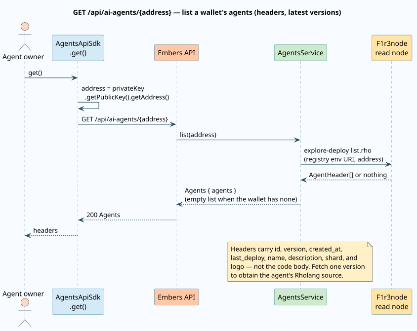

# List agents

Lists the headers of a wallet's AI agents (latest versions).

| | |
| --- | --- |
| Operation | `GET /api/ai-agents/{address}` (tag: AIAgents) |
| Generated client | `AIAgentsApi.agentsList` |
| SDK wrapper | `AgentsApiSdk.get` (`sdk.agents.get()`) |
| Backend | `packages/embers/src/api/agents/endpoints.rs` → `domain/agents/list.rs` |
| Schema pin | `packages/client/schema.json` @ `69012a4` (Embers API 0.1.0) |

## Semantics

An **agent** is a stored, versioned record owned by a wallet address: a name, optional
description, optional `shard` and `logo` metadata, and the optional `code` body — the
agent's Rholang source, authored in the platform's editors. Like
[OSLF documents](../oslfs/list.md), agents are append-only versioned (UUIDv4 identity,
UUIDv7 versions); unlike them, an agent version can additionally be
[deployed](deploy.md) as a running on-chain contract, which stamps the record's
`last_deploy` timestamp.

This read is an explore-deploy of `list.rho` for the address: one `AgentHeader` per agent
(the latest version's metadata, without the `code` body), an empty list for a wallet with
no agents. Reads are public; the SDK wrapper reads its own address.

## Request

| Parameter | In | Type | Required | Meaning |
| --- | --- | --- | --- | --- |
| `address` | path | `string` (`blockchain-address`) | yes | The owning wallet address. |

## Responses

| Status | Body | Meaning |
| --- | --- | --- |
| 200 | `Agents` | `{ agents: AgentHeader[] }` — possibly empty. |
| 500 | `InternalError` | Readback failure. |

`AgentHeader` — documented on the declaration below.

### Response types (TypeScript)

Generated declarations from `packages/client/src/api-client/models/`, doc comments included — the comments are generated from the backend models' Rust `///` doc comments (property names are the SDK's camelCase; the wire JSON uses snake_case where they differ):

```typescript
export interface Agents {
  /** The wallet's agents, latest version each. */
  agents: Array<AgentHeader>;
}

export interface AgentHeader {
  /** When this version was prepared. */
  createdAt: TimestampMillis;
  /** Agent description. */
  description?: string;
  /** Agent identity (`UUIDv4`), stable across versions. */
  id: string;
  /** When this version was last deployed standalone; absent if never. */
  lastDeploy?: TimestampMillis;
  /** Logo reference recorded with the agent. */
  logo?: string;
  /** Agent name. */
  name: string;
  /** Declared shard label recorded with the agent. */
  shard?: string;
  /** Latest version identifier (`UUIDv7`). */
  version: string;
}
```

## Retry semantics

Idempotent read; safe to retry.

## Sequence



## Worked example

```bash
curl -s http://localhost:8080/api/ai-agents/1111LAdaDDGGVKgwBRPGeR2v9uHvsxFcqogtC2Xbmbo81zpxV1U9M
```

```json
{
  "agents": [
    {
      "id": "5c1f9d3a-8e2b-4f6c-a7d1-3b9e0c4f8a25",
      "version": "0198c2aa-1b7e-7f03-92d5-6a3e8b1c4d90",
      "created_at": "1754241793120",
      "last_deploy": "1754328212843",
      "name": "summarizer",
      "description": "Summarizes long threads"
    }
  ]
}
```

## SDK usage

```typescript
const { agents } = await sdk.agents.get();
```

## Related

- [Versions](versions.md), [Version](version.md) — one agent's history and code.
- [Create](create.md), [Save](save.md), [Deploy](deploy.md), [Delete](delete.md) — the
  writes behind this listing.
- [Referencing teams](../ai-agents-teams/referencing.md) — which teams use an agent.
