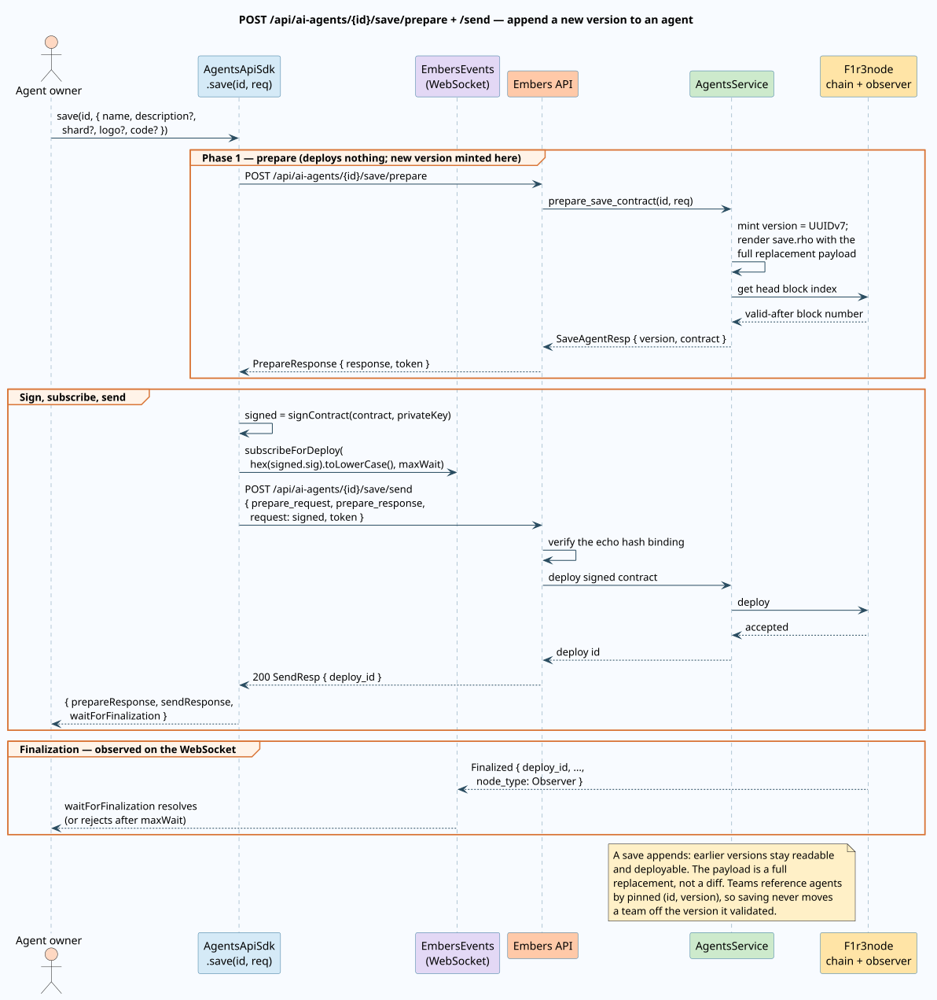

# Save an agent

Appends a new version to an existing agent.

| | |
| --- | --- |
| Operation | `POST /api/ai-agents/{id}/save/prepare` + `POST /api/ai-agents/{id}/save/send` (tag: AIAgents) |
| Generated client | `AIAgentsApi.agentsPrepareSave`, `AIAgentsApi.agentsSendSave` |
| SDK wrapper | `AgentsApiSdk.save` (`sdk.agents.save(id, req)`) |
| Backend | `packages/embers/src/api/agents/endpoints.rs` → `domain/agents/save.rs` |
| Schema pin | `packages/client/schema.json` @ `69012a4` (Embers API 0.1.0) |

## Semantics

Append-only versioning, exactly as specified for [OSLF save](../oslfs/save.md): prepare
mints a fresh UUIDv7 `version` for the path's `id`, the payload is a **full replacement**
(a field omitted here is absent from the new version), and earlier versions remain
readable and [deployable](deploy.md).

Because teams pin agents by `(id, version)`, saving is always safe for consumers: no team
moves off the version it validated until its author re-pins. The
[referencing read](../ai-agents-teams/referencing.md) shows which teams currently use the
agent's versions.

## Request

### `POST /api/ai-agents/{id}/save/prepare`

| Parameter | In | Type | Required | Meaning |
| --- | --- | --- | --- | --- |
| `id` | path | `string` (UUIDv4) | yes | The agent identity to append to. |

Body `CreateAgentReq` — the full replacement payload
([fields](create.md#request)).

### `POST /api/ai-agents/{id}/save/send`

Path `id` as above; body `SendRequestBody_SignedContract_CreateAgentReq_SaveAgentResp` —
the standard echo envelope.

### Request types (TypeScript)

Generated declarations from `packages/client/src/api-client/models/`, doc comments included — the comments are generated from the backend models' Rust `///` doc comments (property names are the SDK's camelCase; the wire JSON uses snake_case where they differ):

```typescript
export interface CreateAgentReq {
  /** The agent's Rholang source. */
  code?: string;
  /** Agent description. */
  description?: string;
  /** Logo reference recorded with the agent. */
  logo?: string;
  /** Agent name. */
  name: string;
  /** Declared shard label recorded with the agent. */
  shard?: string;
}
```

## Responses

| Phase | Status | Body | Meaning |
| --- | --- | --- | --- |
| prepare | 200 | `PrepareResponse_SaveAgentResp` | `{ response: { version, contract }, token }`. |
| send | 200 | `SendResp` | `{ deploy_id }` — accepted; finalization pending. |
| send | 500 | `InternalError` | Token/echo mismatch, or deploy submission failure. |

### Response types (TypeScript)

Generated declarations from `packages/client/src/api-client/models/`, doc comments included — the comments are generated from the backend models' Rust `///` doc comments (property names are the SDK's camelCase; the wire JSON uses snake_case where they differ):

```typescript
export interface PrepareResponseSaveAgentResp {
  /**
   * The operation-specific prepare payload, carrying the unsigned
   * contract(s) to sign.
   */
  response: SaveAgentResp;
  /**
   * JWT binding the send to exactly this prepare exchange; expires after
   * one day.
   */
  token: string;
}

export interface SaveAgentResp {
  /** The unsigned save contract bytes to sign. */
  contract: Base64;
  /** The appended version's identifier (`UUIDv7`). */
  version: string;
}

export interface SendResp {
  /**
   * The accepted deploy's identifier (lowercase hex of its signature);
   * finalization is still pending when this returns.
   */
  deployId: string;
}
```

## Signing and binding

Identical to [create](create.md#signing-and-binding).

## Retry semantics

Prepare is always safe to retry. A re-run after a finalization timeout appends a duplicate
new version — observable and recoverable via [versions](versions.md), never a corruption.

## Sequence



## Worked example

`POST /api/ai-agents/5c1f9d3a-8e2b-4f6c-a7d1-3b9e0c4f8a25/save/prepare`

```json
{ "name": "summarizer", "description": "Now with citation support", "code": "contract main(@input, output) = { ... }" }
```

```json
{
  "response": {
    "version": "0198d1f0-42cc-7a55-8e01-9b7f3a2d6c18",
    "contract": "CtQBbmV3IHJsKGByaG86cmVn...TRUNCATED..."
  },
  "token": "eyJ0eXAiOiJKV1QiLCJhbGciOiJIUzI1NiJ9...TRUNCATED..."
}
```

## SDK usage

```typescript
const { prepareResponse, waitForFinalization } =
  await sdk.agents.save(agentId, { name: "summarizer", code: newSource });
await waitForFinalization;
```

## Related

- [Create](create.md) — the first version; [Versions](versions.md) — the history.
- [Deploy](deploy.md) — running the new version.
