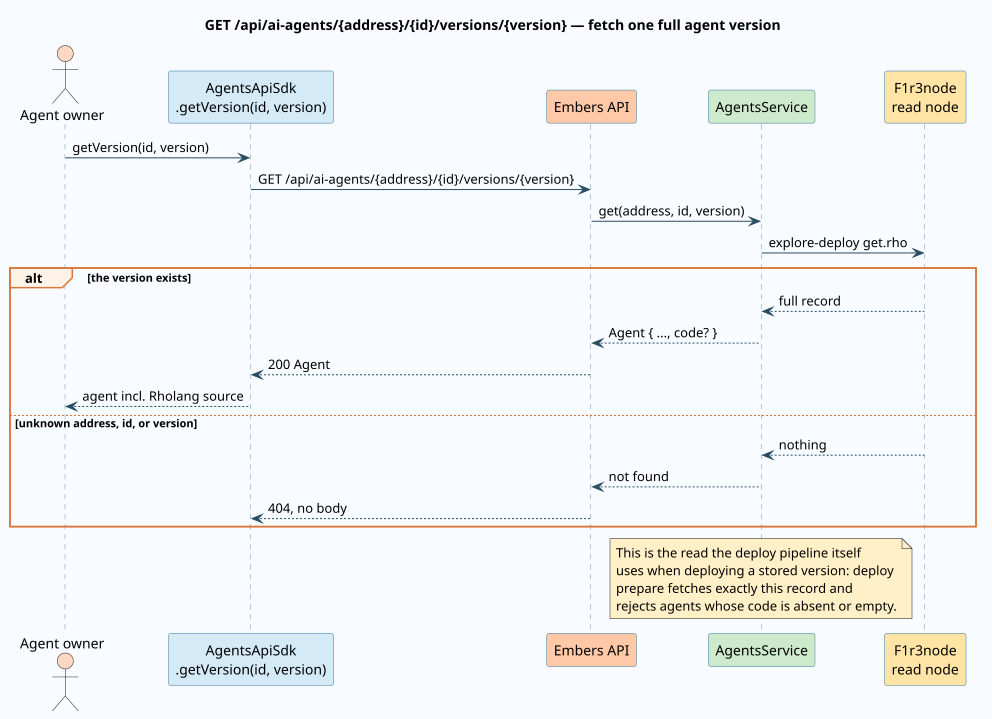

# Fetch an agent version

Fetches one full version of an agent, including its Rholang source.

| | |
| --- | --- |
| Operation | `GET /api/ai-agents/{address}/{id}/versions/{version}` (tag: AIAgents) |
| Generated client | `AIAgentsApi.agentsGetVersion` |
| SDK wrapper | `AgentsApiSdk.getVersion` (`sdk.agents.getVersion(id, version)`) |
| Backend | `packages/embers/src/api/agents/endpoints.rs` → `domain/agents/get.rs` |
| Schema pin | `packages/client/schema.json` @ `01e8ea0` (Embers API 0.1.0) |

## Semantics

The full-record read: everything the headers carry plus the `code` body — the agent's
Rholang source. This is also the read the [deploy](deploy.md) pipeline performs internally
when deploying a stored version (with a retry loop absorbing observer lag), and its
rejection conditions preview deploy's: a version whose `code` is absent or empty cannot be
deployed.

Version pinning is load-bearing here exactly as for
[OSLF versions](../oslfs/version.md#semantics): agent teams reference agents by
`(id, version)`, so a recorded reference always reads back the exact source it was built
against, regardless of later [saves](save.md).

## Request

| Parameter | In | Type | Required | Meaning |
| --- | --- | --- | --- | --- |
| `address` | path | `string` (`blockchain-address`) | yes | The owning wallet address. |
| `id` | path | `string` (UUIDv4) | yes | The agent identity. |
| `version` | path | `string` (UUIDv7) | yes | The exact version to fetch. |

## Responses

| Status | Body | Meaning |
| --- | --- | --- |
| 200 | `Agent` | The full version record. |
| 404 | none | No such address, agent, or version. |
| 500 | `InternalError` | Readback failure. |

`Agent` is `AgentHeader` ([fields](list.md#responses)) plus this version's `code`; every field is documented on the declaration below.

### Response types (TypeScript)

Generated declarations from `packages/client/src/api-client/models/`, doc comments included — the comments are generated from the backend models' Rust `///` doc comments (property names are the SDK's camelCase; the wire JSON uses snake_case where they differ):

```typescript
export interface Agent {
  /**
   * The agent's Rholang source; absent when the version was written
   * without one.
   */
  code?: string;
  /** When this version was prepared. */
  createdAt: TimestampMillis;
  /** Agent description. */
  description?: string;
  /** Agent identity (`UUIDv4`), stable across versions. */
  id: string;
  /** When this version was last deployed standalone; absent if never. */
  lastDeploy?: TimestampMillis;
  /** Logo reference recorded with the agent. */
  logo?: string;
  /** Agent name. */
  name: string;
  /** Declared shard label recorded with the agent. */
  shard?: string;
  /** This version's identifier (`UUIDv7`). */
  version: string;
}
```

## Retry semantics

Idempotent read; a written version never changes.

## Sequence



## Worked example

```bash
curl -s http://localhost:8080/api/ai-agents/1111LAdaDDGGVKgwBRPGeR2v9uHvsxFcqogtC2Xbmbo81zpxV1U9M/5c1f9d3a-8e2b-4f6c-a7d1-3b9e0c4f8a25/versions/0198c2aa-1b7e-7f03-92d5-6a3e8b1c4d90
```

```json
{
  "id": "5c1f9d3a-8e2b-4f6c-a7d1-3b9e0c4f8a25",
  "version": "0198c2aa-1b7e-7f03-92d5-6a3e8b1c4d90",
  "created_at": "1754241793120",
  "name": "summarizer",
  "code": "contract main(@input, output) = { ... }"
}
```

The `code` value is illustrative of shape.

## SDK usage

```typescript
const agent = await sdk.agents.getVersion(agentId, versionId);
console.log(agent.code);
```

## Related

- [Deploy](deploy.md) — the pipeline that consumes exactly this read.
- [Versions](versions.md) — discovering which versions exist.
