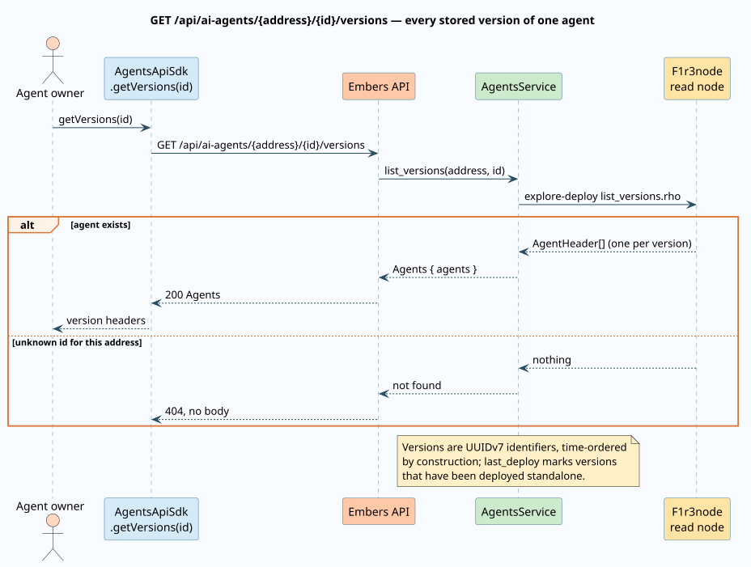

# List agent versions

Lists every stored version of one agent.

| | |
| --- | --- |
| Operation | `GET /api/ai-agents/{address}/{id}/versions` (tag: AIAgents) |
| Generated client | `AIAgentsApi.agentsListVersions` |
| SDK wrapper | `AgentsApiSdk.getVersions` (`sdk.agents.getVersions(id)`) |
| Backend | `packages/embers/src/api/agents/endpoints.rs` → `domain/agents/list_versions.rs` |
| Schema pin | `packages/client/schema.json` @ `01e8ea0` (Embers API 0.1.0) |

## Semantics

Agents are append-only versioned: [create](create.md) writes the first version, every
[save](save.md) appends another. This explore-deploy read returns headers for **all**
versions of one agent. UUIDv7 version identifiers are time-ordered by construction;
`last_deploy` marks the versions that have been [deployed](deploy.md) standalone.

An unknown `id` for the address is a 404; a wallet with no agents at all is visible as an
empty [collection listing](list.md) instead.

## Request

| Parameter | In | Type | Required | Meaning |
| --- | --- | --- | --- | --- |
| `address` | path | `string` (`blockchain-address`) | yes | The owning wallet address. |
| `id` | path | `string` (UUIDv4) | yes | The agent identity. |

## Responses

| Status | Body | Meaning |
| --- | --- | --- |
| 200 | `Agents` | `{ agents: AgentHeader[] }` — one header per version. |
| 404 | none | No such agent for this address. |
| 500 | `InternalError` | Readback failure. |

`AgentHeader` fields are specified in the [collection listing](list.md#responses).

### Response types (TypeScript)

Generated declarations from `packages/client/src/api-client/models/`, doc comments included — the comments are generated from the backend models' Rust `///` doc comments (property names are the SDK's camelCase; the wire JSON uses snake_case where they differ):

```typescript
export interface Agents {
  /** The wallet's agents, latest version each. */
  agents: Array<AgentHeader>;
}

export interface AgentHeader {
  /** When this version was prepared. */
  createdAt: TimestampMillis;
  /** Agent description. */
  description?: string;
  /** Agent identity (`UUIDv4`), stable across versions. */
  id: string;
  /** When this version was last deployed standalone; absent if never. */
  lastDeploy?: TimestampMillis;
  /** Logo reference recorded with the agent. */
  logo?: string;
  /** Agent name. */
  name: string;
  /** Declared shard label recorded with the agent. */
  shard?: string;
  /** Latest version identifier (`UUIDv7`). */
  version: string;
}
```

## Retry semantics

Idempotent read; safe to retry.

## Sequence



## Worked example

```bash
curl -s http://localhost:8080/api/ai-agents/1111LAdaDDGGVKgwBRPGeR2v9uHvsxFcqogtC2Xbmbo81zpxV1U9M/5c1f9d3a-8e2b-4f6c-a7d1-3b9e0c4f8a25/versions
```

```json
{
  "agents": [
    { "id": "5c1f9d3a-8e2b-4f6c-a7d1-3b9e0c4f8a25",
      "version": "0198c2aa-1b7e-7f03-92d5-6a3e8b1c4d90",
      "created_at": "1754241793120", "name": "summarizer" },
    { "id": "5c1f9d3a-8e2b-4f6c-a7d1-3b9e0c4f8a25",
      "version": "0198d1f0-42cc-7a55-8e01-9b7f3a2d6c18",
      "created_at": "1754328212843", "name": "summarizer",
      "description": "Now with citation support" }
  ]
}
```

## SDK usage

```typescript
const { agents } = await sdk.agents.getVersions(agentId);
```

## Related

- [Version](version.md) — one full version, code included.
- [Deploy](deploy.md) — running a specific version on chain.
