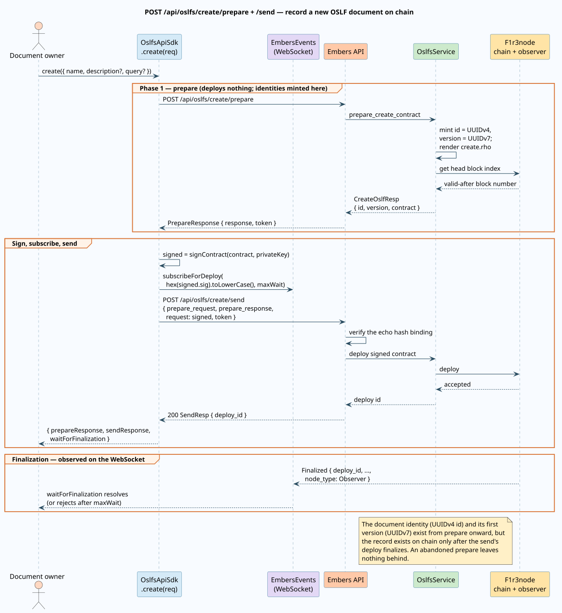

# Create an OSLF document

Records a new OSLF document on chain, minting its identity and first version.

| | |
| --- | --- |
| Operation | `POST /api/oslfs/create/prepare` + `POST /api/oslfs/create/send` (tag: Oslfs) |
| Generated client | `OslfsApi.oslfsPrepareCreate`, `OslfsApi.oslfsSendCreate` |
| SDK wrapper | `OslfsApiSdk.create` (`sdk.oslfs.create(req)`) |
| Backend | `packages/embers/src/api/oslfs/endpoints.rs` → `domain/oslfs/create.rs` |
| Schema pin | `packages/client/schema.json` @ `01e8ea0` (Embers API 0.1.0) |

## Semantics

A standard token-bound instance of the
[two-phase protocol](../../http-api.md#the-two-phase-prepare-sign-send-protocol), in the
fire-and-forget form (send returns a deploy identifier; finalization is observed on the
[deploys WebSocket](../wallets/deploys-websocket.md)). What is specific here is **identity
minting at prepare**:

- Prepare mints the document's identity `id` (UUIDv4) and its first `version` (UUIDv7),
  stamps `created_at`, renders the `create.rho` contract embedding the full record, and
  returns `{ id, version, contract }` alongside the token. The identities are known to the
  client before anything exists on chain.
- The record exists on chain only once the send's deploy **finalizes**. An abandoned
  prepare leaves nothing behind; a sent-but-unconfirmed create is exactly the window the
  finalization wait covers.
- Ownership follows the deployer: the document is recorded under the signing wallet's
  address, which is where [list](list.md) will find it.

## Request

### `POST /api/oslfs/create/prepare`

Body `CreateOslfReq` — fields documented on the declaration below.

### `POST /api/oslfs/create/send`

Body `SendRequestBody_SignedContract_CreateOslfReq_CreateOslfResp` — the standard echo
envelope (`prepare_request`, `prepare_response`, `request: SignedContract`, `token`).

### Request types (TypeScript)

Generated declarations from `packages/client/src/api-client/models/`, doc comments included — the comments are generated from the backend models' Rust `///` doc comments (property names are the SDK's camelCase; the wire JSON uses snake_case where they differ):

```typescript
export interface CreateOslfReq {
  /** Document description. */
  description?: string;
  /** Document name. */
  name: string;
  /** The OSLF expression body (from the OSLF editor). */
  query?: string;
}
```

## Responses

| Phase | Status | Body | Meaning |
| --- | --- | --- | --- |
| prepare | 200 | `PrepareResponse_CreateOslfResp` | `{ response: { id, version, contract }, token }`. |
| send | 200 | `SendResp` | `{ deploy_id }` — accepted; finalization pending. |
| send | 500 | `InternalError` | Token/echo mismatch, or deploy submission failure. |

### Response types (TypeScript)

Generated declarations from `packages/client/src/api-client/models/`, doc comments included — the comments are generated from the backend models' Rust `///` doc comments (property names are the SDK's camelCase; the wire JSON uses snake_case where they differ):

```typescript
export interface PrepareResponseCreateOslfResp {
  /**
   * The operation-specific prepare payload, carrying the unsigned
   * contract(s) to sign.
   */
  response: CreateOslfResp;
  /**
   * JWT binding the send to exactly this prepare exchange; expires after
   * one day.
   */
  token: string;
}

export interface CreateOslfResp {
  /** The unsigned creation contract bytes to sign. */
  contract: Base64;
  /** The minted document identity (`UUIDv4`). */
  id: string;
  /** The first version's identifier (`UUIDv7`). */
  version: string;
}

export interface SendResp {
  /**
   * The accepted deploy's identifier (lowercase hex of its signature);
   * finalization is still pending when this returns.
   */
  deployId: string;
}
```

## Signing and binding

| Property | Value |
| --- | --- |
| Token | Present — standard hash-bound exchange ([binding rules](../../http-api.md#the-two-phase-prepare-sign-send-protocol)). |
| Signing key | The caller's wallet key. |
| Contracts signed | One: the creation contract. |
| Deploy identifier | `hex(sig).toLowerCase()` — the SDK subscribes with it before send. |

## Retry semantics

Prepare is always safe to retry (each prepare mints fresh identities; abandoned ones cost
nothing). After a finalization timeout, **verify before re-creating**: the deploy "may
still finalize", and re-running create mints a *second* document with a different `id`.
Check [list](list.md) for the returned `id` first.

## Sequence



## Worked example

Prepare request and response:

```json
{ "name": "reachability-query", "description": "Reachable-configuration filter", "query": "(diamond completed true)" }
```

```json
{
  "response": {
    "id": "9f4a1c2e-7d3b-4e8a-9c1d-2f6b8a0e4d71",
    "version": "0198a7f2-3c41-7de2-b1a4-8c92e5d10f36",
    "contract": "CtQBbmV3IHJsKGByaG86cmVn...TRUNCATED..."
  },
  "token": "eyJ0eXAiOiJKV1QiLCJhbGciOiJIUzI1NiJ9...TRUNCATED..."
}
```

Send response: `{ "deploy_id": "3045022100...TRUNCATED..." }`.

## SDK usage

```typescript
const { prepareResponse, waitForFinalization } = await sdk.oslfs.create({
  name: "reachability-query",
  query: "(diamond completed true)",
});
await waitForFinalization;
const { id, version } = prepareResponse.response; // now readable on chain
```

## Related

- [Save](save.md) — appending later versions to this identity.
- [Version](version.md) — reading the record back, query included.
- [Transfer](../wallets/transfer.md#retry-semantics) — the same
  timeout-then-verify discipline, stated for value transfers.
