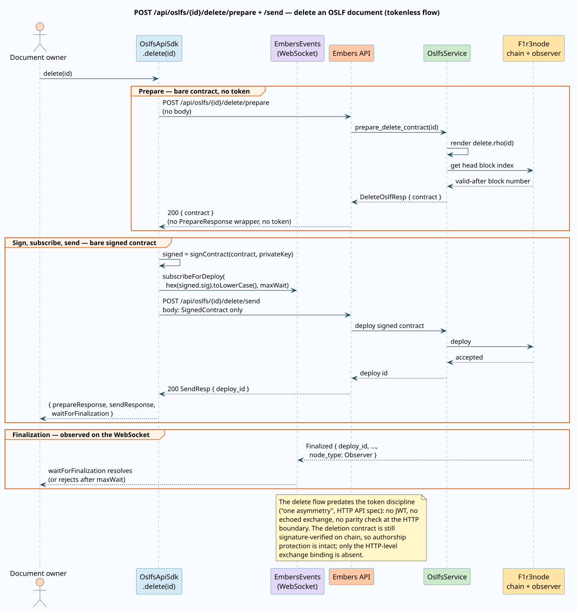

# Delete an OSLF document

Deletes an OSLF document from the caller's collection.

| | |
| --- | --- |
| Operation | `POST /api/oslfs/{id}/delete/prepare` + `POST /api/oslfs/{id}/delete/send` (tag: Oslfs) |
| Generated client | `OslfsApi.oslfsPrepareDelete`, `OslfsApi.oslfsSendDelete` |
| SDK wrapper | `OslfsApiSdk.delete` (`sdk.oslfs.delete(id)`) |
| Backend | `packages/embers/src/api/oslfs/endpoints.rs` → `domain/oslfs/delete.rs` |
| Schema pin | `packages/client/schema.json` @ `69012a4` (Embers API 0.1.0) |

## Semantics

Deletion removes the document record from the owner's on-chain collection, so it no longer
appears in [list](list.md). The prepared contract (`delete.rho`) names only the document
`id`; signing it with the owner's wallet key is what authorizes the removal on chain.

**This pair is the protocol's one asymmetry** (documented at
[the two-phase protocol](../../http-api.md#the-two-phase-prepare-sign-send-protocol)): the
delete flow predates the token discipline.

- Prepare takes **no body** and returns the **bare** `DeleteOslfResp { contract }` — there
  is no `PrepareResponse` wrapper and **no token**.
- Send takes the **bare** `SignedContract` as its body — no echoed exchange, no
  hash-binding parity check at the HTTP boundary.

What the asymmetry does and does not cost: the deletion contract is still
signature-verified on chain, so nobody can delete a document they do not own; what is
absent is only the HTTP-layer check that this send matches one specific prepare. The SDK
still subscribes for finalization exactly as in the token-bound flows.

## Request

### `POST /api/oslfs/{id}/delete/prepare`

| Parameter | In | Type | Required | Meaning |
| --- | --- | --- | --- | --- |
| `id` | path | `string` (UUIDv4) | yes | The document to delete. |

No body.

### `POST /api/oslfs/{id}/delete/send`

Path `id` as above. Body: `SignedContract` — `{contract, sig, sig_algorithm, deployer}`,
nothing else.

### Request types (TypeScript)

Generated declarations from `packages/client/src/api-client/models/`, doc comments included — the comments are generated from the backend models' Rust `///` doc comments (property names are the SDK's camelCase; the wire JSON uses snake_case where they differ):

```typescript
/**
 * A client-signed contract, ready to deploy: the send phase of the two-phase
 * protocol carries it, and the chain is the verifier of record.
 */
export interface SignedContract {
  /** The exact prepared contract bytes that were signed. */
  contract: Base64;
  /** The signing wallet's public key. */
  deployer: Base64;
  /** Signature over the contract's blake2b digest, per `sig_algorithm`. */
  sig: Base64;
  /** The signature algorithm; the platform signs with `secp256k1`. */
  sigAlgorithm: string;
}
```

## Responses

| Phase | Status | Body | Meaning |
| --- | --- | --- | --- |
| prepare | 200 | `DeleteOslfResp` | `{ contract }` — bare unsigned contract bytes. |
| send | 200 | `SendResp` | `{ deploy_id }` — accepted; finalization pending. |
| send | 500 | `InternalError` | Deploy submission failure. |

### Response types (TypeScript)

Generated declarations from `packages/client/src/api-client/models/`, doc comments included — the comments are generated from the backend models' Rust `///` doc comments (property names are the SDK's camelCase; the wire JSON uses snake_case where they differ):

```typescript
export interface DeleteOslfResp {
  /** The unsigned deletion contract bytes to sign. */
  contract: Base64;
}

export interface SendResp {
  /**
   * The accepted deploy's identifier (lowercase hex of its signature);
   * finalization is still pending when this returns.
   */
  deployId: string;
}
```

## Signing and binding

| Property | Value |
| --- | --- |
| Token | **Absent** — the delete asymmetry. |
| Signing key | The owner's wallet key. |
| Contracts signed | One: the deletion contract. |
| Deploy identifier | `hex(sig).toLowerCase()` — the SDK subscribes with it before send. |

## Retry semantics

Deletion is naturally idempotent at the domain level: deleting an already-deleted document
is a no-op on the collection. After a finalization timeout, a [list](list.md) read tells
you whether the removal landed.

## Sequence



## Worked example

`POST /api/oslfs/9f4a1c2e-7d3b-4e8a-9c1d-2f6b8a0e4d71/delete/prepare` (no body):

```json
{ "contract": "CtQBbmV3IHJsKGByaG86cmVn...TRUNCATED..." }
```

Send body:

```json
{
  "contract": "CtQBbmV3IHJsKGByaG86cmVn...TRUNCATED...",
  "sig": "MEUCIQDl5lo...TRUNCATED...",
  "sig_algorithm": "secp256k1",
  "deployer": "BArx1Qk...TRUNCATED..."
}
```

## SDK usage

```typescript
const { waitForFinalization } = await sdk.oslfs.delete(documentId);
await waitForFinalization;
```

## Related

- [List](list.md) — where the removal becomes observable.
- [The delete asymmetry](../../http-api.md#the-two-phase-prepare-sign-send-protocol) —
  protocol context ("One asymmetry").
- [AI agent delete](../ai-agents/delete.md), [team delete](../ai-agents-teams/delete.md) —
  the same tokenless flow on the other collections.
