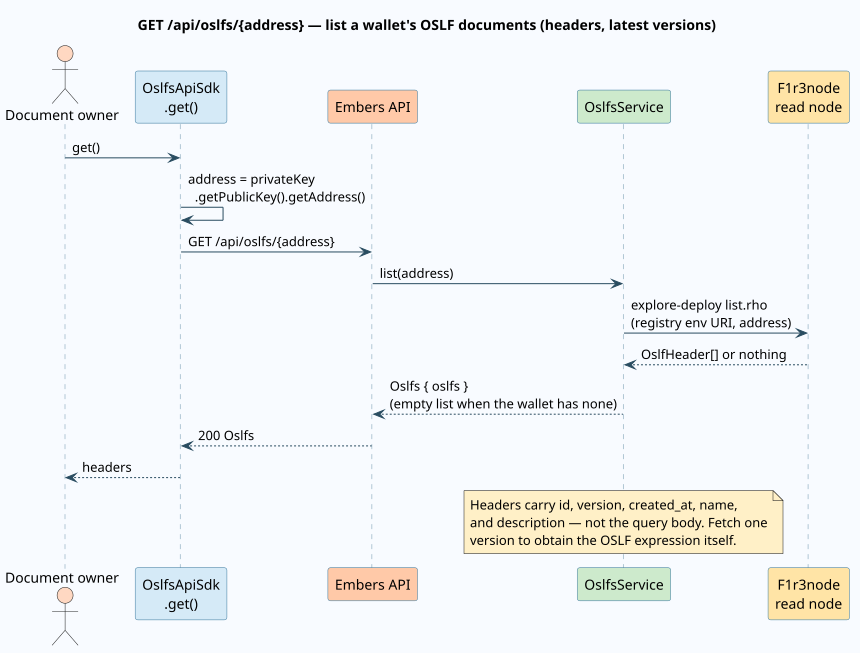

# List OSLF documents

Lists the headers of a wallet's OSLF documents (latest versions).

| | |
| --- | --- |
| Operation | `GET /api/oslfs/{address}` (tag: Oslfs) |
| Generated client | `OslfsApi.oslfsList` |
| SDK wrapper | `OslfsApiSdk.get` (`sdk.oslfs.get()`) |
| Backend | `packages/embers/src/api/oslfs/endpoints.rs` → `domain/oslfs/list.rs` |
| Schema pin | `packages/client/schema.json` @ `69012a4` (Embers API 0.1.0) |

## Semantics

An **OSLF document** is a stored expression in Operational Semantics in Logical Form — the
spatial-behavioral logic whose visual editor is the Blockly-based
[`@f1r3fly.io/oslf-editor`](../../../../../embers-frontend/packages/oslf-editor/README.md) package. Each
document is a chain record owned by a wallet address, carrying a name, an optional
description, and the optional OSLF `query` body, and versioned append-only: the identity is
a UUIDv4 `id`, and every write mints a UUIDv7 `version` (see [create](create.md) and
[save](save.md)).

This read renders `list.rho` for the address and executes it as an **explore-deploy** on
the read node (no deploy, no cost, no mutation). It returns one `OslfHeader` per document —
the latest version's metadata **without** the `query` body; fetch a
[specific version](version.md) for the expression itself. A wallet with no documents
yields an empty list, not a 404.

Reads are public: chain records are readable by anyone. The SDK wrapper always reads its
own address (derived from the configured private key); use the generated client directly
for other addresses.

## Request

| Parameter | In | Type | Required | Meaning |
| --- | --- | --- | --- | --- |
| `address` | path | `string` (`blockchain-address`) | yes | The owning wallet address. |

No query parameters, no body.

## Responses

| Status | Body | Meaning |
| --- | --- | --- |
| 200 | `Oslfs` | `{ oslfs: OslfHeader[] }` — possibly empty. |
| 500 | `InternalError` | The read node was unreachable or the readback failed. |

`OslfHeader` — documented on the declaration below.

### Response types (TypeScript)

Generated declarations from `packages/client/src/api-client/models/`, doc comments included — the comments are generated from the backend models' Rust `///` doc comments (property names are the SDK's camelCase; the wire JSON uses snake_case where they differ):

```typescript
export interface Oslfs {
  /** The wallet's OSLF documents, latest version each. */
  oslfs: Array<OslfHeader>;
}

export interface OslfHeader {
  /** When this version was prepared. */
  createdAt: TimestampMillis;
  /** Document description. */
  description?: string;
  /** Document identity (`UUIDv4`), stable across versions. */
  id: string;
  /** Document name. */
  name: string;
  /** Latest version identifier (`UUIDv7`); creation-ordered by construction. */
  version: string;
}
```

## Retry semantics

Idempotent read; safe to retry. A read racing a just-finalized [create](create.md) or
[save](save.md) reflects the new version only after the observer has caught up.

## Sequence



## Worked example

```bash
curl -s http://localhost:8080/api/oslfs/1111LAdaDDGGVKgwBRPGeR2v9uHvsxFcqogtC2Xbmbo81zpxV1U9M
```

```json
{
  "oslfs": [
    {
      "id": "9f4a1c2e-7d3b-4e8a-9c1d-2f6b8a0e4d71",
      "version": "0198a7f2-3c41-7de2-b1a4-8c92e5d10f36",
      "created_at": "1754241793120",
      "name": "reachability-query",
      "description": "Reachable-configuration filter for the review team"
    }
  ]
}
```

## SDK usage

```typescript
const { oslfs } = await sdk.oslfs.get();
for (const header of oslfs) console.log(header.id, header.name);
```

## Related

- [Versions](versions.md), [Version](version.md) — drilling into one document.
- [Create](create.md), [Save](save.md), [Delete](delete.md) — the mutations behind this
  listing.
