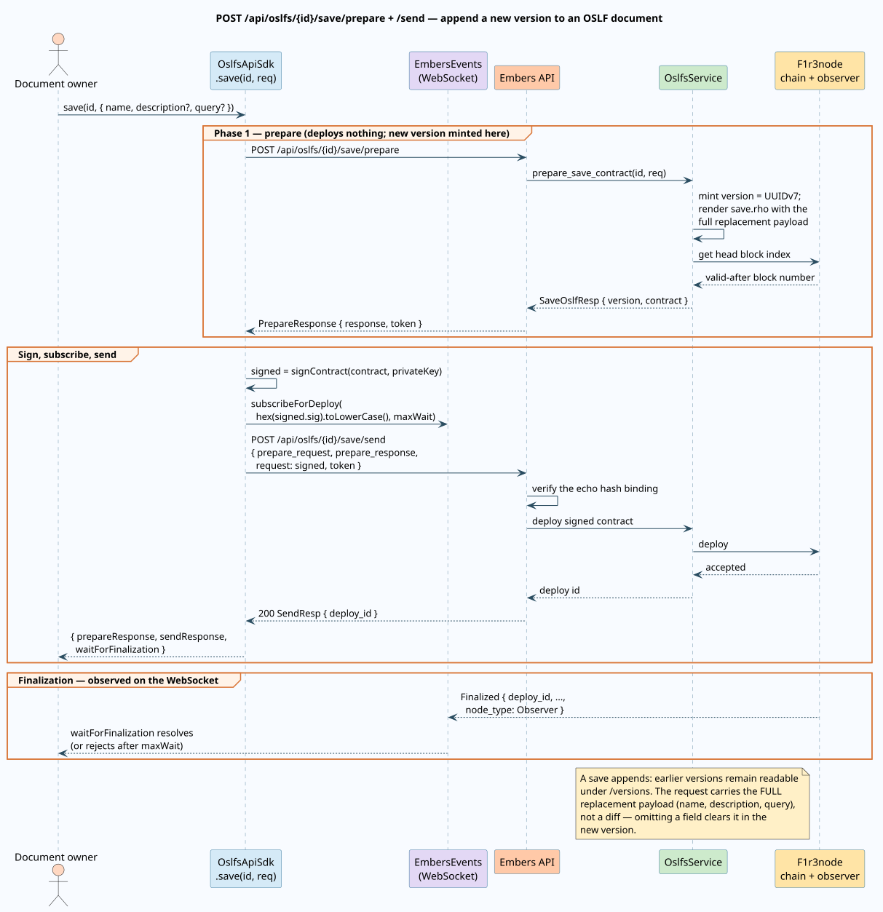

# Save an OSLF document

Appends a new version to an existing OSLF document.

| | |
| --- | --- |
| Operation | `POST /api/oslfs/{id}/save/prepare` + `POST /api/oslfs/{id}/save/send` (tag: Oslfs) |
| Generated client | `OslfsApi.oslfsPrepareSave`, `OslfsApi.oslfsSendSave` |
| SDK wrapper | `OslfsApiSdk.save` (`sdk.oslfs.save(id, req)`) |
| Backend | `packages/embers/src/api/oslfs/endpoints.rs` → `domain/oslfs/save.rs` |
| Schema pin | `packages/client/schema.json` @ `01e8ea0` (Embers API 0.1.0) |

## Semantics

Saving never mutates in place: it **appends** a version. Prepare mints a fresh UUIDv7
`version` for the existing `id` (taken from the path), renders `save.rho` with the request
payload, and returns `{ version, contract }` with the token; send deploys it
fire-and-forget, and all earlier versions remain readable under
[versions](versions.md).

Two consequences worth internalizing:

- **The payload is a full replacement, not a diff.** `save.rho` records exactly the
  `name`, `description`, and `query` given in this request as the new version's content;
  a field omitted here is absent from the new version even if earlier versions carried it.
- **Version identifiers order themselves.** UUIDv7 minting makes the append history
  time-ordered without a counter; `created_at` stamps each version's prepare instant.

The protocol shape is otherwise identical to [create](create.md): token-bound echo, wallet
signature, finalization observed on the
[deploys WebSocket](../wallets/deploys-websocket.md).

## Request

### `POST /api/oslfs/{id}/save/prepare`

| Parameter | In | Type | Required | Meaning |
| --- | --- | --- | --- | --- |
| `id` | path | `string` (UUIDv4) | yes | The document identity to append to. |

Body `CreateOslfReq` (same schema as create — the full replacement payload); fields documented on the declaration below.

### `POST /api/oslfs/{id}/save/send`

Path `id` as above; body
`SendRequestBody_SignedContract_CreateOslfReq_SaveOslfResp` — the standard echo envelope.

### Request types (TypeScript)

Generated declarations from `packages/client/src/api-client/models/`, doc comments included — the comments are generated from the backend models' Rust `///` doc comments (property names are the SDK's camelCase; the wire JSON uses snake_case where they differ):

```typescript
export interface CreateOslfReq {
  /** Document description. */
  description?: string;
  /** Document name. */
  name: string;
  /** The OSLF expression body (from the OSLF editor). */
  query?: string;
}
```

## Responses

| Phase | Status | Body | Meaning |
| --- | --- | --- | --- |
| prepare | 200 | `PrepareResponse_SaveOslfResp` | `{ response: { version, contract }, token }`. |
| send | 200 | `SendResp` | `{ deploy_id }` — accepted; finalization pending. |
| send | 500 | `InternalError` | Token/echo mismatch, or deploy submission failure. |

### Response types (TypeScript)

Generated declarations from `packages/client/src/api-client/models/`, doc comments included — the comments are generated from the backend models' Rust `///` doc comments (property names are the SDK's camelCase; the wire JSON uses snake_case where they differ):

```typescript
export interface PrepareResponseSaveOslfResp {
  /**
   * The operation-specific prepare payload, carrying the unsigned
   * contract(s) to sign.
   */
  response: SaveOslfResp;
  /**
   * JWT binding the send to exactly this prepare exchange; expires after
   * one day.
   */
  token: string;
}

export interface SaveOslfResp {
  /** The unsigned save contract bytes to sign. */
  contract: Base64;
  /** The appended version's identifier (`UUIDv7`). */
  version: string;
}

export interface SendResp {
  /**
   * The accepted deploy's identifier (lowercase hex of its signature);
   * finalization is still pending when this returns.
   */
  deployId: string;
}
```

## Signing and binding

Identical to [create](create.md#signing-and-binding): token present, one contract, wallet
key, `deploy_id = hex(sig).toLowerCase()`.

## Retry semantics

Prepare is always safe to retry. After a finalization timeout, verify before re-saving:
a re-run appends a **second** new version (a duplicate revision, not a corruption — the
append-only history makes over-saving observable and recoverable via
[versions](versions.md)).

## Sequence



## Worked example

`POST /api/oslfs/9f4a1c2e-7d3b-4e8a-9c1d-2f6b8a0e4d71/save/prepare`

```json
{ "name": "reachability-query", "description": "Tightened the guard condition", "query": "(and (diamond completed true) (box failed false))" }
```

```json
{
  "response": {
    "version": "0198b013-98aa-7c11-a5e2-4d18f2c7b904",
    "contract": "CtQBbmV3IHJsKGByaG86cmVn...TRUNCATED..."
  },
  "token": "eyJ0eXAiOiJKV1QiLCJhbGciOiJIUzI1NiJ9...TRUNCATED..."
}
```

## SDK usage

```typescript
const { prepareResponse, waitForFinalization } = await sdk.oslfs.save(documentId, {
  name: "reachability-query",
  description: "Tightened the guard condition",
  query: updatedQuery,
});
await waitForFinalization;
```

## Related

- [Create](create.md) — the first version of an identity.
- [Versions](versions.md) — the append history this operation extends.
- [Delete](delete.md) — retiring the document.
