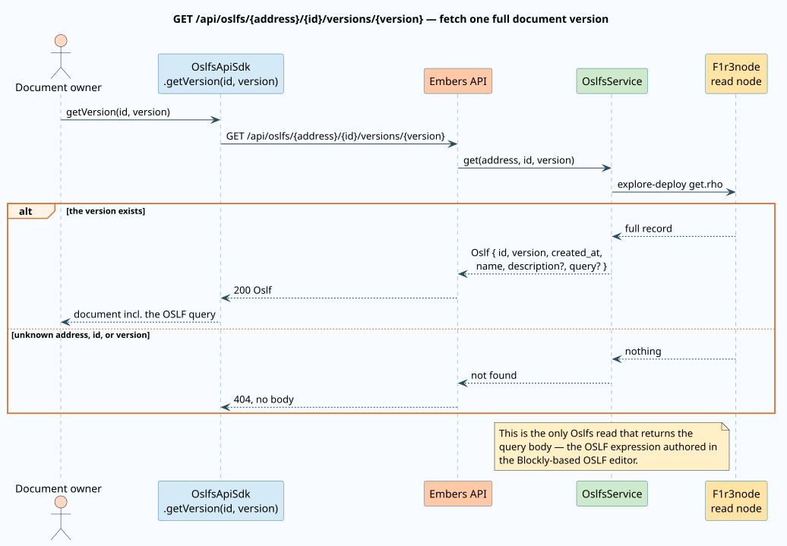

# Fetch an OSLF document version

Fetches one full version of an OSLF document, including its query body.

| | |
| --- | --- |
| Operation | `GET /api/oslfs/{address}/{id}/versions/{version}` (tag: Oslfs) |
| Generated client | `OslfsApi.oslfsGetVersion` |
| SDK wrapper | `OslfsApiSdk.getVersion` (`sdk.oslfs.getVersion(id, version)`) |
| Backend | `packages/embers/src/api/oslfs/endpoints.rs` → `domain/oslfs/get.rs` |
| Schema pin | `packages/client/schema.json` @ `01e8ea0` (Embers API 0.1.0) |

## Semantics

This is the only Oslfs read that returns the `query` field — the OSLF expression authored
in the [OSLF editor](../../../../../embers-frontend/packages/oslf-editor/README.md). The header reads
([list](list.md), [versions](versions.md)) deliberately omit it, so a browsing UI pays for
document bodies only when one is opened. The read is an explore-deploy against the read
node, addressed by owner, document identity, and exact version.

Version pinning is what makes stored OSLF expressions safely referenceable from elsewhere:
a consumer that records `(id, version)` will always read back exactly the expression it
validated, regardless of later [saves](save.md).

## Request

| Parameter | In | Type | Required | Meaning |
| --- | --- | --- | --- | --- |
| `address` | path | `string` (`blockchain-address`) | yes | The owning wallet address. |
| `id` | path | `string` (UUIDv4) | yes | The document identity. |
| `version` | path | `string` (UUIDv7) | yes | The exact version to fetch. |

## Responses

| Status | Body | Meaning |
| --- | --- | --- |
| 200 | `Oslf` | The full version record. |
| 404 | none | No such address, document, or version. |
| 500 | `InternalError` | Readback failure. |

`Oslf` is `OslfHeader` ([fields](list.md#responses)) plus this version's `query`; every field is documented on the declaration below.

### Response types (TypeScript)

Generated declarations from `packages/client/src/api-client/models/`, doc comments included — the comments are generated from the backend models' Rust `///` doc comments (property names are the SDK's camelCase; the wire JSON uses snake_case where they differ):

```typescript
export interface Oslf {
  /** When this version was prepared. */
  createdAt: TimestampMillis;
  /** Document description. */
  description?: string;
  /** Document identity (`UUIDv4`), stable across versions. */
  id: string;
  /** Document name. */
  name: string;
  /**
   * The OSLF expression body; absent when the version was written without
   * one.
   */
  query?: string;
  /** This version's identifier (`UUIDv7`). */
  version: string;
}
```

## Retry semantics

Idempotent read; safe to retry. A version, once written, never changes — responses for the
same `(address, id, version)` are stable forever.

## Sequence



## Worked example

```bash
curl -s http://localhost:8080/api/oslfs/1111LAdaDDGGVKgwBRPGeR2v9uHvsxFcqogtC2Xbmbo81zpxV1U9M/9f4a1c2e-7d3b-4e8a-9c1d-2f6b8a0e4d71/versions/0198a7f2-3c41-7de2-b1a4-8c92e5d10f36
```

```json
{
  "id": "9f4a1c2e-7d3b-4e8a-9c1d-2f6b8a0e4d71",
  "version": "0198a7f2-3c41-7de2-b1a4-8c92e5d10f36",
  "created_at": "1754241793120",
  "name": "reachability-query",
  "description": "Reachable-configuration filter for the review team",
  "query": "(and (diamond completed true) (not (box failed false)))"
}
```

The `query` value is illustrative of shape; real bodies are whatever the OSLF editor
serializes.

## SDK usage

```typescript
const oslf = await sdk.oslfs.getVersion(documentId, versionId);
console.log(oslf.query);
```

## Related

- [Versions](versions.md) — discovering which versions exist.
- [Create](create.md), [Save](save.md) — the writes that mint versions.
