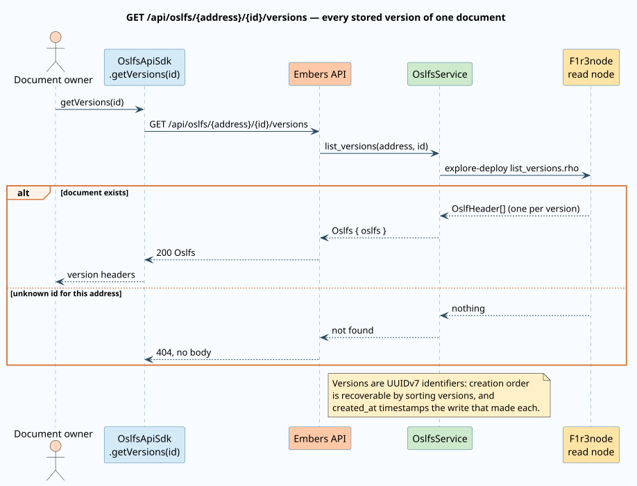

# List OSLF document versions

Lists every stored version of one OSLF document.

| | |
| --- | --- |
| Operation | `GET /api/oslfs/{address}/{id}/versions` (tag: Oslfs) |
| Generated client | `OslfsApi.oslfsListVersions` |
| SDK wrapper | `OslfsApiSdk.getVersions` (`sdk.oslfs.getVersions(id)`) |
| Backend | `packages/embers/src/api/oslfs/endpoints.rs` → `domain/oslfs/list_versions.rs` |
| Schema pin | `packages/client/schema.json` @ `69012a4` (Embers API 0.1.0) |

## Semantics

OSLF documents are append-only: [create](create.md) writes the first version and every
[save](save.md) appends another, each identified by a UUIDv7 minted at prepare time. This
read returns the headers of **all** versions of one document, executed as an explore-deploy
against the read node. Because UUIDv7 identifiers are time-ordered by construction, sorting
versions lexicographically recovers creation order; `created_at` timestamps each version
independently.

An unknown `id` for the address is a 404 (unlike the [collection listing](list.md), which
answers an empty list for a wallet with no documents — absence of a *named* thing is an
error, absence of *any* thing is an empty collection).

## Request

| Parameter | In | Type | Required | Meaning |
| --- | --- | --- | --- | --- |
| `address` | path | `string` (`blockchain-address`) | yes | The owning wallet address. |
| `id` | path | `string` (UUIDv4) | yes | The document identity. |

## Responses

| Status | Body | Meaning |
| --- | --- | --- |
| 200 | `Oslfs` | `{ oslfs: OslfHeader[] }` — one header per version. |
| 404 | none | No such document for this address. |
| 500 | `InternalError` | Readback failure. |

`OslfHeader` fields are specified in the [collection listing](list.md#responses).

### Response types (TypeScript)

Generated declarations from `packages/client/src/api-client/models/`, doc comments included — the comments are generated from the backend models' Rust `///` doc comments (property names are the SDK's camelCase; the wire JSON uses snake_case where they differ):

```typescript
export interface Oslfs {
  /** The wallet's OSLF documents, latest version each. */
  oslfs: Array<OslfHeader>;
}

export interface OslfHeader {
  /** When this version was prepared. */
  createdAt: TimestampMillis;
  /** Document description. */
  description?: string;
  /** Document identity (`UUIDv4`), stable across versions. */
  id: string;
  /** Document name. */
  name: string;
  /** Latest version identifier (`UUIDv7`); creation-ordered by construction. */
  version: string;
}
```

## Retry semantics

Idempotent read; safe to retry.

## Sequence



## Worked example

```bash
curl -s http://localhost:8080/api/oslfs/1111LAdaDDGGVKgwBRPGeR2v9uHvsxFcqogtC2Xbmbo81zpxV1U9M/9f4a1c2e-7d3b-4e8a-9c1d-2f6b8a0e4d71/versions
```

```json
{
  "oslfs": [
    { "id": "9f4a1c2e-7d3b-4e8a-9c1d-2f6b8a0e4d71",
      "version": "0198a7f2-3c41-7de2-b1a4-8c92e5d10f36",
      "created_at": "1754241793120", "name": "reachability-query" },
    { "id": "9f4a1c2e-7d3b-4e8a-9c1d-2f6b8a0e4d71",
      "version": "0198b013-98aa-7c11-a5e2-4d18f2c7b904",
      "created_at": "1754328212843", "name": "reachability-query",
      "description": "Tightened the guard condition" }
  ]
}
```

## SDK usage

```typescript
const { oslfs } = await sdk.oslfs.getVersions(documentId);
const latest = oslfs.at(-1);
```

## Related

- [Version](version.md) — fetch one full version including the query body.
- [Save](save.md) — how new versions come to exist.
