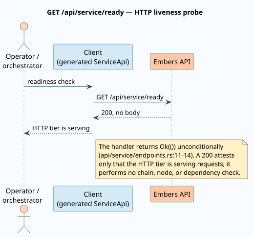

# Service readiness

Reports that the Embers HTTP tier is up and serving requests.

| | |
| --- | --- |
| Operation | `GET /api/service/ready` (tag: Service) |
| Generated client | `ServiceApi.serviceReady` |
| SDK wrapper | none — generated client only |
| Backend | `packages/embers/src/api/service/endpoints.rs:11` |
| Schema pin | `packages/client/schema.json` @ `69012a4` (Embers API 0.1.0) |

## Semantics

This is a liveness probe for the HTTP process, in the orchestration sense: a load balancer,
container orchestrator, or monitor calls it to decide whether the service instance should
receive traffic. The handler body is `Ok(())` — it returns HTTP 200 with no body
unconditionally, as soon as the web framework can route the request.

The consequence to rely on, stated precisely: **a 200 attests that the HTTP tier is serving;
it does not attest that the blockchain node is reachable, that deploys will finalize, or that
any downstream dependency is healthy.** The endpoint performs no dependency checks at all. A
deployment that needs chain-aware health must observe the chain through the operations that
actually touch it (for example, a [wallet state read](../wallets/state.md) or the
finalization events on the [deploys WebSocket](../wallets/deploys-websocket.md)).

The operation requires no authentication: it is public by design, as probes run before any
wallet exists.

## Request

No path parameters, no query parameters, no request body.

## Responses

| Status | Body | Meaning |
| --- | --- | --- |
| 200 | none | The HTTP tier is serving requests. |

There are no other documented responses; failure to reach the endpoint at all (connection
refused, timeout) is the negative signal a prober acts on.

## Retry semantics

Idempotent and side-effect free; safe to call at any frequency. Probing intervals are an
operational choice, not an API constraint (the service imposes no per-route throttling — see
[security notes](../../http-api.md#security-notes)).

## Sequence



## Worked example

```bash
curl -i http://localhost:8080/api/service/ready
```

```http
HTTP/1.1 200 OK
content-length: 0
```

## SDK usage

The umbrella `EmbersApiSdk` does not wrap this operation; call the generated client
directly:

```typescript
import { Configuration, ServiceApi } from "@f1r3fly-io/embers-client-sdk";

const service = new ServiceApi(new Configuration({ basePath: "http://localhost:8080" }));
await service.serviceReady(); // resolves on 200, throws on transport failure
```

## Related

- [HTTP API and OpenAPI surface](../../http-api.md) — the served surface this probe fronts.
- [Wallet state](../wallets/state.md) — a chain-touching read, for chain-aware health.
- [Deploys WebSocket](../wallets/deploys-websocket.md) — live finalization events.
