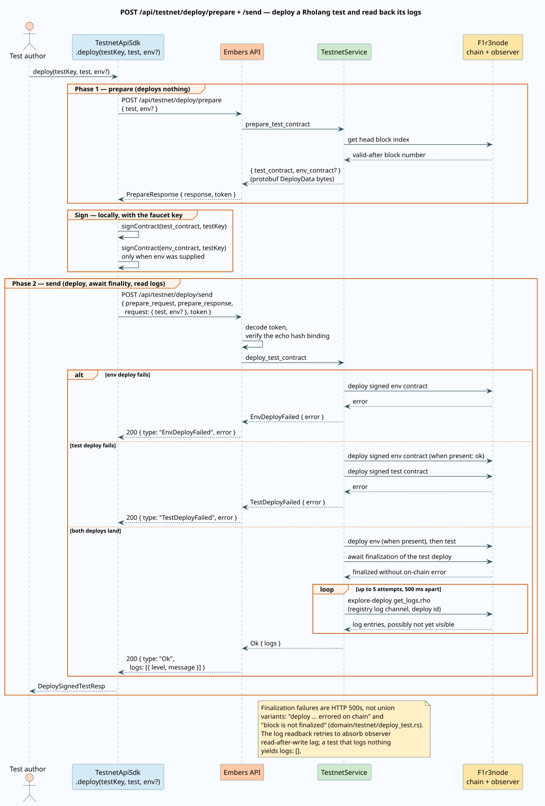

# Testnet deploy

Deploys a Rholang test — optionally together with the environment it exercises — to the test
network, awaits finality, and returns the log entries the test produced.

| | |
| --- | --- |
| Operation | `POST /api/testnet/deploy/prepare` + `POST /api/testnet/deploy/send` (tag: Testnet) |
| Generated client | `TestnetApi.testnetPrepareDeploy`, `TestnetApi.testnetSendDeploy` |
| SDK wrapper | `TestnetApiSdk.deploy(testKey, test, env?)` (`sdk.testnet.deploy(...)`) |
| Backend | `packages/embers/src/api/testnet/endpoints.rs:29` → `domain/testnet/deploy_test.rs` |
| Schema pin | `packages/client/schema.json` @ `69012a4` (Embers API 0.1.0) |

## Semantics

This is the test harness of the platform: a way to run a Rholang test contract against a
freshly deployed environment and read back structured verdict logs, all in one protocol
transaction. It follows the universal
[two-phase prepare, sign, send protocol](../../http-api.md#the-two-phase-prepare-sign-send-protocol)
with one intentional difference from the wallet-facing mutations: **the send call itself
awaits chain finality and performs the readback**, so there is no finalization WebSocket to
watch and no deploy identifier in the response — the response *is* the outcome.

- **Prepare** accepts the test source and the optional environment source and returns, for
  each, unsigned contract bytes: a protobuf-encoded `DeployData` carrying the Rholang term,
  a server-side timestamp, the current head block as its valid-after block number, and the
  shard identifier (`domain/common.rs:37-55`). Nothing is deployed.
- **Sign** happens locally, with the **testnet key** — the key returned by the
  [faucet](wallet.md), passed to the wrapper as a parameter. `TestnetApiSdk` holds no key of
  its own. When an environment contract is present, **both** contracts are signed with the
  same testnet key (`signContract`: secp256k1, DER, low-S, over the blake2b-256 digest of
  the contract bytes).
- **Send** echoes the prepare exchange with the token, then the backend deploys in order:
  the environment contract first (when present), then the test contract. It waits for the
  test deploy to finalize, then reads the test's log entries back from the chain: the
  `get_logs.rho` explore-deploy looks up the service's registry log channel and fetches the
  entries recorded under the test's deploy identifier. Because an observer node exhibits a
  brief read-after-write lag after finalization, the readback retries up to 5 times at
  500 ms intervals; a test that logs nothing simply yields an empty list.

The environment/test split mirrors the arrangement in the agent editor: `env` is the code
under test (deployed so the test can look it up), `test` is the assertion contract that
writes `debug` / `info` / `error` log entries as it runs.

## Request

### `POST /api/testnet/deploy/prepare`

Body `DeployTestReq` — fields documented on the declaration below.

### `POST /api/testnet/deploy/send`

Body `SendRequestBody_DeploySignedTestReq_DeployTestReq_DeployTestResp` — the standard
echo envelope ([binding rules](../../http-api.md#the-two-phase-prepare-sign-send-protocol))
whose `request` is `DeploySignedTestReq`; fields documented on the declarations below.

### Request types (TypeScript)

Generated declarations from `packages/client/src/api-client/models/`, doc comments included — the comments are generated from the backend models' Rust `///` doc comments (property names are the SDK's camelCase; the wire JSON uses snake_case where they differ):

```typescript
export interface DeployTestReq {
  /** Rholang source of the environment (code under test). */
  env?: string;
  /** Rholang source of the test contract. */
  test: string;
}

export interface SendRequestBodyDeploySignedTestReqDeployTestReqDeployTestResp {
  /** Byte-identical echo of the prepare request. */
  prepareRequest: DeployTestReq;
  /** Byte-identical echo of the prepare response body. */
  prepareResponse: DeployTestResp;
  /** The signed contract(s) for this operation. */
  request: DeploySignedTestReq;
  /** The JWT issued by prepare; binds this send to that exchange. */
  token: string;
}

export interface DeploySignedTestReq {
  /**
   * The signed environment contract; present exactly when prepare
   * returned `env_contract`.
   */
  env?: SignedContract;
  /** The signed test contract. */
  test: SignedContract;
}

/**
 * A client-signed contract, ready to deploy: the send phase of the two-phase
 * protocol carries it, and the chain is the verifier of record.
 */
export interface SignedContract {
  /** The exact prepared contract bytes that were signed. */
  contract: Base64;
  /** The signing wallet's public key. */
  deployer: Base64;
  /** Signature over the contract's blake2b digest, per `sig_algorithm`. */
  sig: Base64;
  /** The signature algorithm; the platform signs with `secp256k1`. */
  sigAlgorithm: string;
}
```

## Responses

### Prepare

| Status | Body | Meaning |
| --- | --- | --- |
| 200 | `PrepareResponse_DeployTestResp` | Contracts prepared; nothing deployed. |

`DeployTestResp` (the `response` field) — documented on the declaration below.

### Send

| Status | Body | Meaning |
| --- | --- | --- |
| 200 | `DeploySignedTestResp` | The outcome — a discriminated union; domain failures are variants, not HTTP errors. |
| 500 | `InternalError` | Finalization failures: the test deploy errored on chain, or the block did not finalize within the backend's timeout. Also token/echo mismatches rejected by the extractor. |

`DeploySignedTestResp` — a discriminated union on `type`; each variant, its
fields, and `Log` are documented on the declarations below.

This is the API's only errors-as-200-variants response: a deploy *rejection* is a domain
outcome the caller is expected to branch on, while a *finalization* failure is a server
fault (500).

### Response types (TypeScript)

Generated declarations from `packages/client/src/api-client/models/`, doc comments included — the comments are generated from the backend models' Rust `///` doc comments (property names are the SDK's camelCase; the wire JSON uses snake_case where they differ):

```typescript
export interface PrepareResponseDeployTestResp {
  /**
   * The operation-specific prepare payload, carrying the unsigned
   * contract(s) to sign.
   */
  response: DeployTestResp;
  /**
   * JWT binding the send to exactly this prepare exchange; expires after
   * one day.
   */
  token: string;
}

export interface DeployTestResp {
  /**
   * Unsigned environment contract bytes; present only when `env` was
   * supplied.
   */
  envContract?: Base64;
  /** Unsigned test contract bytes to sign. */
  testContract: Base64;
}

export type DeploySignedTestResp =
  | ({ type: "EnvDeployFailed" } & DeploySignedTestRespEnvDeployFailed)
  | ({ type: "Ok" } & DeploySignedTestRespSignedTestDeployLogs)
  | ({ type: "TestDeployFailed" } & DeploySignedTestRespTestDeployFailed);

export interface DeploySignedTestRespEnvDeployFailed {
  /** The rejection reported for the environment deploy. */
  error: string;
  type: DeploySignedTestRespEnvDeployFailedTypeEnum;
}

export interface DeploySignedTestRespTestDeployFailed {
  /** The rejection reported for the test deploy. */
  error: string;
  type: DeploySignedTestRespTestDeployFailedTypeEnum;
}

export interface DeploySignedTestRespSignedTestDeployLogs {
  /** The messages the test sent to the on-chain log contract, in order. */
  logs: Array<Log>;
  type: DeploySignedTestRespSignedTestDeployLogsTypeEnum;
}

export interface Log {
  /** Severity recorded by the test. */
  level: LogLevel;
  /** The log line. */
  message: string;
}

/** Severity a test records on the on-chain log contract. */
export const LogLevel = {
  Debug: "debug",
  Error: "error",
  Info: "info",
} as const;

export type LogLevel = (typeof LogLevel)[keyof typeof LogLevel];
```

## Signing and binding

| Property | Value |
| --- | --- |
| Token | Present — standard hash-bound exchange ([binding rules](../../http-api.md#the-two-phase-prepare-sign-send-protocol)). |
| Signing key | The testnet key from the [faucet](wallet.md), supplied by the caller. |
| Contracts signed | `test_contract`, and `env_contract` when present — both by the same key. |
| Deploy identifier | Not returned; the send response is the final outcome, produced after finality. |

## Retry semantics

Prepare is always safe to retry. For send, prepare again and re-sign rather than re-posting
a failed send: the prepared contract embeds a server-side timestamp and a valid-after block
number, so a fresh prepare yields a distinct deploy, while re-posting the identical signed
bytes re-submits the identical deploy. On `EnvDeployFailed` or `TestDeployFailed`, fix the
source and start over from prepare — the union variant tells you which contract to fix.

## Sequence



## Worked example

Prepare request and response:

```json
{ "test": "new log in { log!((\"info\", \"test passed\")) }", "env": "new x in { Nil }" }
```

```json
{
  "response": {
    "test_contract": "CiZuZXcgbG9nIGluIHsgbG9nISgo...TRUNCATED...",
    "env_contract": "ChJuZXcgeCBpbiB7IE5pbCB9...TRUNCATED..."
  },
  "token": "eyJ0eXAiOiJKV1QiLCJhbGciOiJIUzI1NiJ9...TRUNCATED..."
}
```

Send response (success variant):

```json
{
  "type": "Ok",
  "logs": [
    { "level": "info", "message": "test passed" }
  ]
}
```

Byte fields and the token are truncated for legibility; real values are complete base64 and
JWT strings.

## SDK usage

```typescript
import { EmbersApiSdk } from "@f1r3fly-io/embers-client-sdk";

const sdk = new EmbersApiSdk({ basePath, privateKey });
const testKey = await sdk.testnet.getWallet();
const outcome = await sdk.testnet.deploy(testKey, testSource, envSource);
switch (outcome.type) {
  case "Ok":              /* inspect outcome.logs */ break;
  case "EnvDeployFailed": /* fix envSource: outcome.error */ break;
  case "TestDeployFailed":/* fix testSource: outcome.error */ break;
}
```

The wrapper performs prepare, both signatures, and send; it returns the send response
directly (there is no `waitForFinalization` handle, because finality already happened inside
send).

## Related

- [Testnet wallet faucet](wallet.md) — the source of the signing key.
- [Two-phase protocol](../../http-api.md#the-two-phase-prepare-sign-send-protocol) — the
  binding rules the send echo must satisfy.
- [Error semantics](../../http-api.md#error-semantics) — the failure taxonomy this pair
  specializes.
