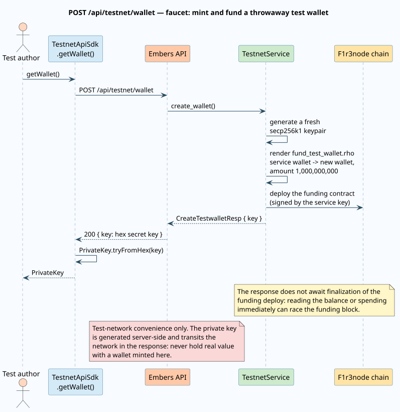

# Testnet wallet faucet

Mints a fresh, pre-funded wallet on the test network and returns its private key.

| | |
| --- | --- |
| Operation | `POST /api/testnet/wallet` (tag: Testnet) |
| Generated client | `TestnetApi.testnetCreateWallet` |
| SDK wrapper | `TestnetApiSdk.getWallet` (`sdk.testnet.getWallet()`) |
| Backend | `packages/embers/src/api/testnet/endpoints.rs:20` → `domain/testnet/create_test_wallet.rs` |
| Schema pin | `packages/client/schema.json` @ `69012a4` (Embers API 0.1.0) |

## Semantics

The faucet exists so a test author can obtain spendable funds without owning prior chain
state. One call performs three steps server-side:

1. **Key generation.** The service generates a fresh secp256k1 keypair. The wallet address
   is the standard address derivation of the public key (the SDK's `Address` entity performs
   the same derivation client-side).
2. **Funding.** The service renders the `fund_test_wallet.rho` contract — a RevVault
   `findOrCreate` for the service wallet and the new wallet followed by a vault `transfer` —
   and deploys it signed by the **service key**, moving `1,000,000,000` units
   (`TEST_WALLET_BALANCE`, `create_test_wallet.rs:9`) from the service wallet to the new
   wallet. A failed transfer aborts the deploy on chain.
3. **Return.** The response carries the new wallet's **private key** as a hex string. The
   SDK wrapper immediately parses it into a `PrivateKey` entity.

Two properties follow from the implementation and must shape how the operation is used:

- **The response does not await finalization of the funding deploy.** The deploy is
  submitted, then the key is returned. A balance read or a spend issued immediately after
  can observe the wallet before its funding block finalizes; retry after a short delay or
  watch the [deploys WebSocket](../wallets/deploys-websocket.md) of the **service** address
  if the test must not race the faucet.
- **The private key is server-generated and transits the network in a response body.** This
  is exactly what a faucet is for on a disposable test network and exactly what a real
  wallet must never do. Never hold real value with a wallet minted here; production wallets
  generate keys client-side and only ever transmit signatures.

The operation requires no authentication and no request body: the cost of abuse is bounded
by the service wallet's balance on the test network.

## Request

No path parameters, no query parameters, no request body.

## Responses

| Status | Body | Meaning |
| --- | --- | --- |
| 200 | `CreateTestwalletResp` | The wallet was minted and its funding deploy submitted. |

`CreateTestwalletResp` — documented on the declaration below.

### Response types (TypeScript)

Generated declarations from `packages/client/src/api-client/models/`, doc comments included — the comments are generated from the backend models' Rust `///` doc comments (property names are the SDK's camelCase; the wire JSON uses snake_case where they differ):

```typescript
export interface CreateTestwalletResp {
  /** The new wallet's secp256k1 private key, hex-encoded. */
  key: string;
}
```

## Retry semantics

Safe to retry, but not idempotent: every call mints an independent wallet and submits an
independent funding deploy. A timed-out call whose deploy landed anyway leaves an orphaned
funded wallet, which is harmless on the test network.

## Sequence



## Worked example

```bash
curl -s -X POST http://localhost:8080/api/testnet/wallet
```

```json
{
  "key": "a944ac9c1b5cd2a2eb5c4d6ac274cbcf1c2e58bcdb9cbb6c34d6e27a76a44fa1"
}
```

The value shown is format-valid but fabricated; a real response carries a freshly generated
key.

## SDK usage

```typescript
import { EmbersApiSdk } from "@f1r3fly-io/embers-client-sdk";

const sdk = new EmbersApiSdk({ basePath, privateKey: someKey });
const testKey = await sdk.testnet.getWallet(); // PrivateKey, already funded
```

`TestnetApiSdk` itself holds no private key; the returned `PrivateKey` is the input to
[testnet deploy](deploy.md).

## Related

- [Testnet deploy](deploy.md) — consumes the key this faucet returns.
- [Wallet state](../wallets/state.md) — read the new wallet's balance and history.
- [Two-phase protocol](../../http-api.md#the-two-phase-prepare-sign-send-protocol) — why
  production operations never move private keys.
