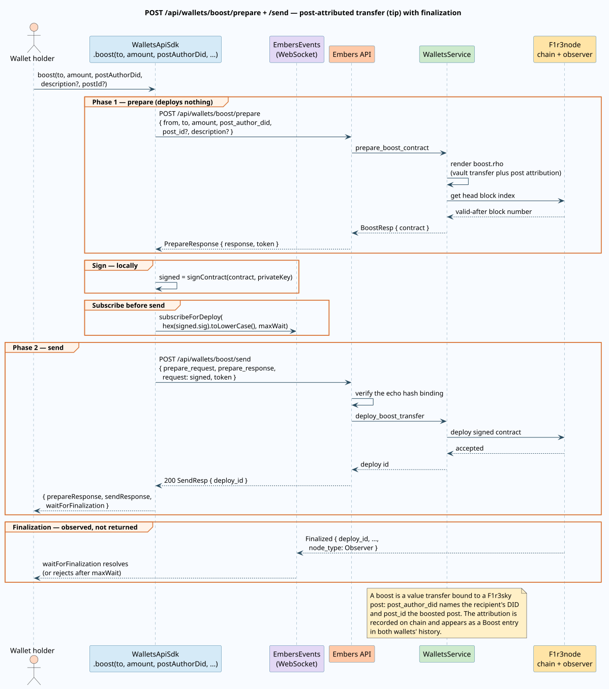

# Boost

Moves value from the caller's wallet to another wallet as a tip attributed to a F1r3sky
post.

| | |
| --- | --- |
| Operation | `POST /api/wallets/boost/prepare` + `POST /api/wallets/boost/send` (tag: Wallets) |
| Generated client | `WalletsApi.walletsPrepareBoost`, `WalletsApi.walletsSendBoost` |
| SDK wrapper | `WalletsApiSdk.boost` (`sdk.wallets.boost(to, amount, postAuthorDid, description?, postId?)`) |
| Backend | `packages/embers/src/api/wallets/endpoints.rs:74` → `domain/wallets/boost.rs` |
| Schema pin | `packages/client/schema.json` @ `69012a4` (Embers API 0.1.0) |

## Semantics

A boost is a [transfer](transfer.md) with social attribution: the same RevVault value
movement, plus two attribution fields that bind the payment to a F1r3sky post — the post
author's DID (decentralized identifier) and, optionally, the post's identifier. The backend
renders `boost.rho` (rather than `transfer.rho`) so the attribution is recorded **on
chain**; it then follows the identical two-phase, fire-and-forget protocol. Boosts appear in
both wallets' [history](state.md) as `Boost` entries carrying the attribution, which is what
distinguishes "tipped this post" from "sent money" in anything that renders wallet history.

Everything protocol-level — prepare/sign/send mechanics, deploy identifier, finalization via
the observer, the send-time/execution-time split for insufficient funds — is exactly as
specified for [transfer](transfer.md); this document states only the differences.

## Request

### `POST /api/wallets/boost/prepare`

Body `BoostReq` — `TransferReq` plus the attribution fields, documented on the declaration below.

### `POST /api/wallets/boost/send`

Body `SendRequestBody_SignedContract_BoostReq_BoostResp` — the standard echo envelope
(`prepare_request`, `prepare_response`, `request: SignedContract`, `token`) specialized to
the boost types.

### Request types (TypeScript)

Generated declarations from `packages/client/src/api-client/models/`, doc comments included — the comments are generated from the backend models' Rust `///` doc comments (property names are the SDK's camelCase; the wire JSON uses snake_case where they differ):

```typescript
export interface BoostReq {
  /** Amount in base units; must be positive. */
  amount: Int64;
  /** Free-text memo. */
  description?: string;
  /** Sender address; must be the signing wallet's address. */
  from: Address;
  /** DID of the boosted post's author. */
  postAuthorDid: string;
  /** Identifier of the boosted post. */
  postId?: string;
  /** Recipient address (the post author's wallet). */
  to: Address;
}
```

## Responses

| Phase | Status | Body | Meaning |
| --- | --- | --- | --- |
| prepare | 200 | `PrepareResponse_BoostResp` | `{ response: { contract }, token }`. |
| send | 200 | `SendResp` | `{ deploy_id }` — accepted; finalization pending. |
| send | 500 | `InternalError` | Token/echo mismatch, or deploy submission failure. |

### Response types (TypeScript)

Generated declarations from `packages/client/src/api-client/models/`, doc comments included — the comments are generated from the backend models' Rust `///` doc comments (property names are the SDK's camelCase; the wire JSON uses snake_case where they differ):

```typescript
export interface PrepareResponseBoostResp {
  /**
   * The operation-specific prepare payload, carrying the unsigned
   * contract(s) to sign.
   */
  response: BoostResp;
  /**
   * JWT binding the send to exactly this prepare exchange; expires after
   * one day.
   */
  token: string;
}

export interface BoostResp {
  /** The unsigned boost contract bytes to sign. */
  contract: Base64;
}

export interface SendResp {
  /**
   * The accepted deploy's identifier (lowercase hex of its signature);
   * finalization is still pending when this returns.
   */
  deployId: string;
}
```

## Signing and binding

Identical to [transfer](transfer.md#signing-and-binding): one contract, signed by the
caller's wallet key; token present; `deploy_id = hex(sig).toLowerCase()`.

## Retry semantics

Identical to [transfer](transfer.md#retry-semantics), with the same double-spend caution
after a finalization timeout: verify [wallet history](state.md) before re-preparing. A
duplicated boost duplicates both the payment and the attribution.

## Sequence



## Worked example

Prepare request:

```json
{
  "from": "1111LAdaDDGGVKgwBRPGeR2v9uHvsxFcqogtC2Xbmbo81zpxV1U9M",
  "to": "11112cCEwGV3iuGCJhjnUS2LTLTf9RMHUFtcS2BeQjqcCBRCyq6zdq",
  "amount": "1000",
  "post_author_did": "did:plc:ewvi7nxzyoun6zhxrhs64oiz",
  "post_id": "3kckmiwyvbk2u",
  "description": "great thread"
}
```

Prepare response and send follow the [transfer example](transfer.md#worked-example) shapes
with the boost models substituted.

## SDK usage

```typescript
const { waitForFinalization } = await sdk.wallets.boost(
  to,                                     // Address
  Amount.tryFrom(1000n),
  "did:plc:ewvi7nxzyoun6zhxrhs64oiz",     // post author DID
  "great thread",                         // description
  "3kckmiwyvbk2u",                        // post id
);
await waitForFinalization;
```

## Related

- [Transfer](transfer.md) — the protocol reference this operation specializes.
- [Wallet state](state.md) — `Boost` history entries with the attribution fields.
- [Publish to F1r3sky](../ai-agents-teams/publish-to-firesky.md) — how a team account joins
  the social graph boosts point into.
