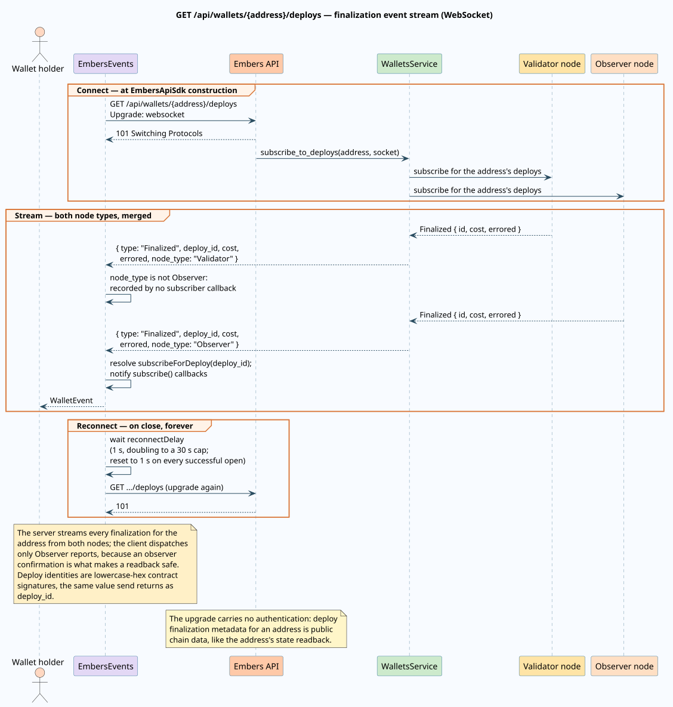

# Deploys WebSocket

Streams deploy-finalization events for a wallet address; the confirmation channel behind
every fire-and-forget mutation.

| | |
| --- | --- |
| Operation | `GET /api/wallets/{address}/deploys` — WebSocket upgrade (101) (tag: Wallets) |
| Generated client | `WalletsApi.walletsSubscribeDeploys` — **not usable**: the generated method is `fetch`-based and cannot perform a WebSocket upgrade. |
| SDK client | `EmbersEvents` — a raw `WebSocket` client, reachable as `sdk.events`. |
| Backend | `packages/embers/src/api/wallets/endpoints.rs:102` → `domain/wallets/subscribe_to_deploys.rs` |
| Schema pin | `packages/client/schema.json` @ `01e8ea0` (Embers API 0.1.0) |

## Semantics

The endpoint upgrades to a WebSocket and streams one JSON message per deploy-finalization
report for the address. Server-side, the stream is the **merge of two subscriptions** — the
validator node's and the observer node's — so every finalization is reported up to twice,
distinguished by `node_type`. This is deliberate: the validator's report arrives first and
signals consensus finality; the observer's report signals that the finalized state is
**readable** where readbacks execute. A client that acts on the validator report can still
observe stale reads; the SDK therefore dispatches **only** `Observer` events, for both
per-deploy waits and general subscribers.

Deploy identities on this stream are the same values mutations return as `deploy_id`: the
lowercase-hex secp256k1 signature of the deployed contract. This is what lets the SDK
subscribe for a specific deploy **before** posting send — it computes the identifier from
its own signature.

The upgrade carries no authentication: finalization metadata for an address is public chain
data, exactly like the address's [state readback](state.md).

## Messages

Every message is a JSON-serialized `WalletEvent`, a discriminated union with a single
variant today; its fields are documented on the declaration below.

There are no client-to-server messages; the socket is a one-way event stream.

### Message types (TypeScript)

Exported from the package root; at runtime these are Zod schemas
(`packages/client/src/services/EmbersEvents.ts`) — the inferred types, with
their field documentation, are:

```typescript
/** The node kinds that report finalization. */
export type NodeType = "Validator" | "Observer";

export type WalletEvent = {
  /** Execution cost charged to the deployer; coerced from the wire's string. */
  cost: bigint;
  /** The finalized deploy — equal to the `deploy_id` send returned. */
  deploy_id: string;
  /**
   * True when the deploy finalized but its execution failed on chain (for
   * example, insufficient funds at execution).
   */
  errored: boolean;
  /** Which node reports; the SDK acts only on `Observer`. */
  node_type: NodeType;
  /** Discriminator. */
  type: "Finalized";
};
```

## The finalization budget

`DEFAULT_MAX_WAIT_FOR_FINALISATION` is **120 000 ms** and deliberately equals the backend's
own deploy-finalization budget (`EMBERS__FINALIZATION__DEPLOY_TIMEOUT_MILLIS`, default
120000). The budget must absorb observer lag behind the validator, not just consensus
finality; a client that gives up sooner declares failure for deploys the server still
considers in progress — deploys that typically land anyway. On timeout the per-deploy wait
rejects with an error stating the deploy "was accepted but its observer finalization
confirmation timed out … the deploy may still finalize — verify the record before
retrying"; treat it as *unconfirmed*, never as *failed*.

## Client lifecycle

`EmbersEvents` implements the client side. Its behavior, in literate form — each numbered
paragraph explains the step the pseudocode beneath it performs:

1. **Connect at construction.** The umbrella `EmbersApiSdk` constructs `EmbersEvents` with
   the wallet address derived from the configured private key, and the socket connects
   immediately — subscriptions can therefore be registered before any mutation is sent.

```text
CONNECT(basePath, address):
  ws := WebSocket(basePath + "/api/wallets/" + address + "/deploys")
  on ws.open:    reconnectDelay := 1 s          # reset backoff
  on ws.message: HANDLE(parse WalletEvent)
  on ws.close:   RECONNECT()                    # onerror is followed by onclose
```

2. **Reconnect forever, with exponential backoff.** A closed socket schedules a reconnect
   after `reconnectDelay`, which doubles per attempt up to a 30 s cap and resets to 1 s on
   every successful open. Events finalized while disconnected are missed — the stream has
   no replay — which is why a per-deploy wait that spans a reconnect can only be resolved
   by its timeout path and a subsequent [history](state.md) check.

```text
RECONNECT():
  sleep(reconnectDelay)
  reconnectDelay := min(2 * reconnectDelay, 30 s)
  CONNECT(basePath, address)
```

3. **Dispatch observer reports only.** A message resolves the per-deploy wait registered
   under its `deploy_id`, then notifies every general subscriber — but only when the
   reporting node is the observer.

```text
HANDLE(event):
  if event.node_type = "Observer":
    resolve and remove deploySubscriptions[event.deploy_id], if present
    for each subscriber callback cb: cb(event)
```

4. **Per-deploy waits are promises with deadlines.** `subscribeForDeploy(deployId, maxWait)`
   returns a promise that resolves on the observer report or rejects with the
   unconfirmed-not-failed error after `maxWait`.

```text
SUBSCRIBE-FOR-DEPLOY(deployId, maxWait):
  return Promise((resolve, reject)):
    timer := after maxWait:
      remove deploySubscriptions[deployId]
      reject("accepted but confirmation timed out; may still finalize")
    deploySubscriptions[deployId] := () -> { cancel timer; resolve() }
```

## Retry semantics

Reconnection is automatic (above). Re-upgrading is always safe: the stream is stateless and
carries no replay, so a fresh connection simply reports finalizations from now on.

## Sequence



## Worked example

```bash
# websocat speaks the upgrade; messages arrive as JSON lines
websocat "ws://localhost:8080/api/wallets/1111LAdaDDGGVKgwBRPGeR2v9uHvsxFcqogtC2Xbmbo81zpxV1U9M/deploys"
```

```json
{"type":"Finalized","deploy_id":"3045022100e5be5a1e...TRUNCATED...","cost":"1287","errored":false,"node_type":"Validator"}
{"type":"Finalized","deploy_id":"3045022100e5be5a1e...TRUNCATED...","cost":"1287","errored":false,"node_type":"Observer"}
```

The same finalization, reported by both nodes; act on the second message.

## SDK usage

```typescript
const sdk = new EmbersApiSdk({ basePath, privateKey });

// General subscription (observer reports only):
const id = sdk.events.subscribe((e) => {
  console.log(e.deploy_id, e.cost, e.errored);
});
sdk.events.unsubscribe(id);

// Per-deploy waits are what mutation wrappers return:
const { waitForFinalization } = await sdk.wallets.transfer(to, amount);
await waitForFinalization;
```

`EmbersEvents`, `WalletEvent`, `NodeType`, and `DEFAULT_MAX_WAIT_FOR_FINALISATION` are
exported from the package root:

```typescript
import { EmbersEvents, NodeType, WalletEvent } from "@f1r3fly-io/embers-client-sdk";
```

The umbrella `sdk.events` instance remains the ordinary way to reach the running client;
the root exports exist for typing subscriber callbacks and constructing a standalone
events client.

## Related

- [Transfer](transfer.md), [Boost](boost.md) — mutations confirmed on this stream.
- [Wallet state](state.md) — the readback to consult when a wait times out.
- [Two-phase protocol](../../http-api.md#the-two-phase-prepare-sign-send-protocol) — where
  the deploy identifier originates.
