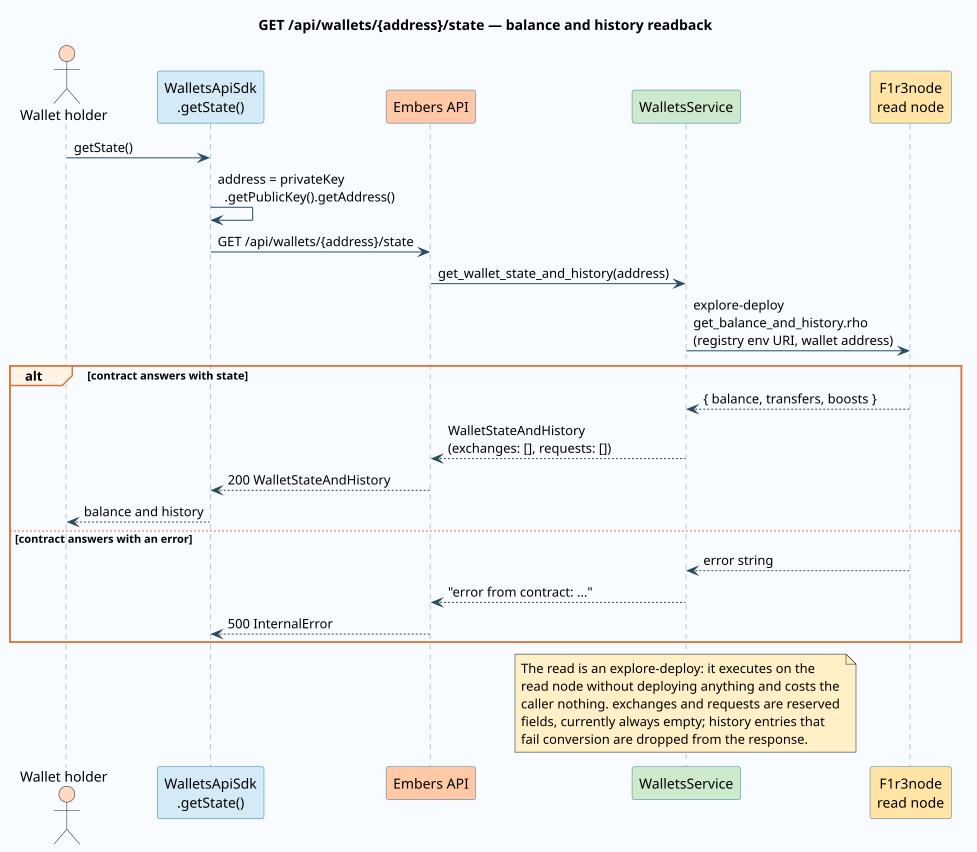

# Wallet state and history

Reads a wallet's balance and transaction history from the chain.

| | |
| --- | --- |
| Operation | `GET /api/wallets/{address}/state` (tag: Wallets) |
| Generated client | `WalletsApi.walletsStateAndHistory` |
| SDK wrapper | `WalletsApiSdk.getState` (`sdk.wallets.getState()`) |
| Backend | `packages/embers/src/api/wallets/endpoints.rs:33` → `domain/wallets/get_wallet_state_and_history.rs` |
| Schema pin | `packages/client/schema.json` @ `69012a4` (Embers API 0.1.0) |

## Semantics

The backend renders the `get_balance_and_history.rho` contract for the requested address and
executes it as an **explore-deploy** on the read node: the contract runs against current
chain state without being deployed, costs nothing, and mutates nothing. The contract answers
with either the wallet's state or an error string; an error string surfaces as an HTTP 500
(`error from contract: ...`).

The state is assembled from the chain's vault and history records:

- `balance` — the current vault balance.
- `transfers` — value transfers in which the address participated, both directions.
- `boosts` — [post-attributed transfers](boost.md) in which the address participated.
- `exchanges`, `requests` — **reserved fields, currently always empty lists**: the backend
  populates them with `vec![]` unconditionally, and the `Exchange` schema is an empty
  object. They exist in the contract for forward compatibility.

History entries that fail conversion into the response model are dropped rather than
failing the read, so the history is best-effort complete.

Reads are public: any address's state is readable by anyone, because the underlying chain
data is public. The SDK wrapper always reads its **own** address (derived from the
configured private key); use the generated client directly to read another address.

## Request

| Parameter | In | Type | Required | Meaning |
| --- | --- | --- | --- | --- |
| `address` | path | `string` (`blockchain-address`) | yes | The wallet address to read. |

No query parameters, no body.

## Responses

| Status | Body | Meaning |
| --- | --- | --- |
| 200 | `WalletStateAndHistory` | The wallet's current state and history. |
| 500 | `InternalError` | The read contract answered with an error, or the read node was unreachable. |

`WalletStateAndHistory` — documented on the declaration below.

`Transfer` — documented on the declaration below.

`Boost` extends `Transfer`'s shape with post attribution (`post_author_did`, `post_id`); every field is documented on the declaration below.

### Response types (TypeScript)

Generated declarations from `packages/client/src/api-client/models/`, doc comments included — the comments are generated from the backend models' Rust `///` doc comments (property names are the SDK's camelCase; the wire JSON uses snake_case where they differ):

```typescript
export interface WalletStateAndHistory {
  /** Current balance in base units. */
  balance: UInt64;
  /** Boost history (both directions). */
  boosts: Array<Boost>;
  /** Reserved; always `[]`. */
  exchanges: Array<object>;
  /** Reserved; always `[]`. */
  requests: Array<Request>;
  /** Transfer history (both directions). */
  transfers: Array<Transfer>;
}

export interface Transfer {
  /** Transferred amount in base units. */
  amount: Int64;
  /** Free-text memo carried by the transfer. */
  description?: string;
  /** Sender address. */
  from: Address;
  /** Deploy identifier of the transfer. */
  id: string;
  /** When the transfer contract was prepared. */
  timestamp: TimestampMillis;
  /** Recipient address. */
  to: Address;
}

export interface Boost {
  /** Transferred amount in base units. */
  amount: Int64;
  /** Free-text memo carried by the boost. */
  description?: string;
  /** Sender address. */
  from: Address;
  /** Deploy identifier of the boost. */
  id: string;
  /** DID of the boosted post's author. */
  postAuthorDid: string;
  /** Identifier of the boosted post. */
  postId?: string;
  /** When the boost contract was prepared. */
  timestamp: TimestampMillis;
  /** Recipient address (the post author's wallet). */
  to: Address;
}
```

## Retry semantics

Idempotent read; safe to retry at any time. Note that a read racing a just-sent deploy can
predate the deploy's finalization: confirm finalization first via the
[deploys WebSocket](deploys-websocket.md) when sequencing matters.

## Sequence



## Worked example

```bash
curl -s http://localhost:8080/api/wallets/1111LAdaDDGGVKgwBRPGeR2v9uHvsxFcqogtC2Xbmbo81zpxV1U9M/state
```

```json
{
  "balance": "999999500",
  "requests": [],
  "exchanges": [],
  "boosts": [],
  "transfers": [
    {
      "id": "3045022100e5be5a1e...TRUNCATED...",
      "timestamp": "1754241793120",
      "from": "1111LAdaDDGGVKgwBRPGeR2v9uHvsxFcqogtC2Xbmbo81zpxV1U9M",
      "to": "11112cCEwGV3iuGCJhjnUS2LTLTf9RMHUFtcS2BeQjqcCBRCyq6zdq",
      "amount": "500",
      "description": "coffee"
    }
  ]
}
```

Addresses are format-valid examples; the deploy identifier is truncated.

## SDK usage

```typescript
const state = await sdk.wallets.getState();
console.log(state.balance);            // UInt64 (bigint)
for (const t of state.transfers) { /* Transfer entries */ }
```

## Related

- [Transfer](transfer.md) and [Boost](boost.md) — the mutations whose history this read
  returns.
- [Deploys WebSocket](deploys-websocket.md) — finalization events for this address.
- [Testnet wallet faucet](../testnet/wallet.md) — obtaining a funded wallet to read.
