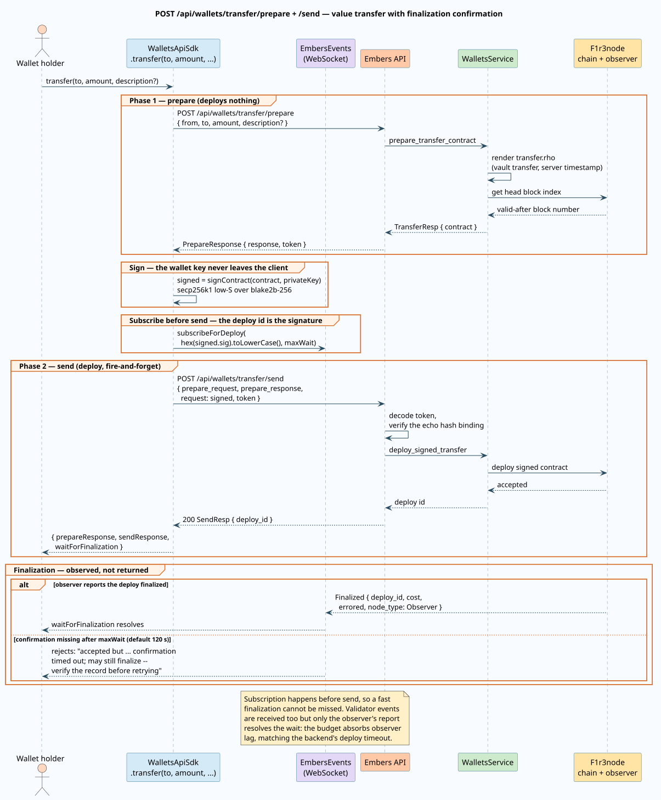

# Transfer

Moves value from the caller's wallet to another wallet, with client-side signing and
observer-confirmed finalization.

| | |
| --- | --- |
| Operation | `POST /api/wallets/transfer/prepare` + `POST /api/wallets/transfer/send` (tag: Wallets) |
| Generated client | `WalletsApi.walletsPrepareTransfer`, `WalletsApi.walletsSendTransfer` |
| SDK wrapper | `WalletsApiSdk.transfer` (`sdk.wallets.transfer(to, amount, description?)`) |
| Backend | `packages/embers/src/api/wallets/endpoints.rs:47` → `domain/wallets/transfer.rs` |
| Schema pin | `packages/client/schema.json` @ `01e8ea0` (Embers API 0.1.0) |

## Semantics

A transfer is the canonical instance of the
[two-phase prepare, sign, send protocol](../../http-api.md#the-two-phase-prepare-sign-send-protocol)
in its fire-and-forget form: send returns a deploy identifier as soon as the chain accepts
the deploy, and finalization is observed separately on the
[deploys WebSocket](deploys-websocket.md).

- **Prepare** renders the `transfer.rho` contract — a RevVault transfer from `from` to `to`
  for `amount`, stamped with a server-side timestamp and the optional description — and
  wraps it into unsigned `DeployData` bytes valid after the current head block. Nothing is
  deployed and no balance check happens at prepare time.
- **Sign** happens locally (`signContract`): secp256k1 (DER, low-S) over the blake2b-256
  digest of the contract bytes. The chain authorizes the vault withdrawal against the
  **deployer identity**, so the deploy must be signed by the key whose address is `from`; a
  signature by any other key deploys a contract whose withdrawal fails on chain.
- **Send** echoes the prepare exchange with the token, deploys the signed contract, and
  answers immediately with `SendResp { deploy_id }`. Insufficient funds are discovered at
  execution on chain, not at send: such a deploy finalizes with `errored: true`.
- **Finalization** is confirmed when the **observer** node reports the deploy finalized on
  the WebSocket. The SDK subscribes **before** posting send — keyed by the lowercase-hex
  contract signature, which is exactly the deploy identifier — so even an instant
  finalization cannot be missed.

The SDK wrapper returns `{ prepareResponse, sendResponse, waitForFinalization }`: the caller
decides whether to await confirmation or proceed optimistically.

## Request

### `POST /api/wallets/transfer/prepare`

Body `TransferReq` — fields documented on the declaration below.

### `POST /api/wallets/transfer/send`

Body `SendRequestBody_SignedContract_TransferReq_TransferResp` — the standard echo
envelope ([binding rules](../../http-api.md#the-two-phase-prepare-sign-send-protocol));
fields documented on the declarations below.

### Request types (TypeScript)

Generated declarations from `packages/client/src/api-client/models/`, doc comments included — the comments are generated from the backend models' Rust `///` doc comments (property names are the SDK's camelCase; the wire JSON uses snake_case where they differ):

```typescript
export interface TransferReq {
  /** Amount in base units; must be positive. */
  amount: Int64;
  /** Free-text memo, recorded on chain in the transfer history. */
  description?: string;
  /** Sender address; must be the signing wallet's address. */
  from: Address;
  /** Recipient address. */
  to: Address;
}

export interface SendRequestBodySignedContractTransferReqTransferResp {
  /** Byte-identical echo of the prepare request. */
  prepareRequest: TransferReq;
  /** Byte-identical echo of the prepare response body. */
  prepareResponse: TransferResp;
  /** The signed contract(s) for this operation. */
  request: SignedContract;
  /** The JWT issued by prepare; binds this send to that exchange. */
  token: string;
}

/**
 * A client-signed contract, ready to deploy: the send phase of the two-phase
 * protocol carries it, and the chain is the verifier of record.
 */
export interface SignedContract {
  /** The exact prepared contract bytes that were signed. */
  contract: Base64;
  /** The signing wallet's public key. */
  deployer: Base64;
  /** Signature over the contract's blake2b digest, per `sig_algorithm`. */
  sig: Base64;
  /** The signature algorithm; the platform signs with `secp256k1`. */
  sigAlgorithm: string;
}
```

## Responses

### Prepare

| Status | Body | Meaning |
| --- | --- | --- |
| 200 | `PrepareResponse_TransferResp` | `{ response: { contract }, token }` — unsigned contract bytes to sign. |

### Send

| Status | Body | Meaning |
| --- | --- | --- |
| 200 | `SendResp` | `{ deploy_id }` — the chain accepted the deploy; finalization pending. |
| 500 | `InternalError` | Token/echo mismatch rejected by the extractor, or the deploy submission failed. |

A `deploy_id` is the lowercase-hex signature of the contract — the same value the
`Finalized` WebSocket event carries and the same value that appears as `id` in
[wallet history](state.md).

### Response types (TypeScript)

Generated declarations from `packages/client/src/api-client/models/`, doc comments included — the comments are generated from the backend models' Rust `///` doc comments (property names are the SDK's camelCase; the wire JSON uses snake_case where they differ):

```typescript
export interface PrepareResponseTransferResp {
  /**
   * The operation-specific prepare payload, carrying the unsigned
   * contract(s) to sign.
   */
  response: TransferResp;
  /**
   * JWT binding the send to exactly this prepare exchange; expires after
   * one day.
   */
  token: string;
}

export interface TransferResp {
  /** The unsigned transfer contract bytes to sign. */
  contract: Base64;
}

export interface SendResp {
  /**
   * The accepted deploy's identifier (lowercase hex of its signature);
   * finalization is still pending when this returns.
   */
  deployId: string;
}
```

## Signing and binding

| Property | Value |
| --- | --- |
| Token | Present — standard hash-bound exchange ([binding rules](../../http-api.md#the-two-phase-prepare-sign-send-protocol)). |
| Signing key | The caller's wallet key (the SDK's configured `privateKey`). |
| Contracts signed | One: the transfer contract. |
| Deploy identifier | `hex(sig).toLowerCase()` — subscribe with it before send. |

## Retry semantics

Prepare is always safe to retry. **A retried send after a finalization timeout can
double-spend**: the timeout message says, verbatim, that the deploy "was accepted but its
observer finalization confirmation timed out … the deploy may still finalize — verify the
record before retrying". Check [wallet history](state.md) for the transfer's `deploy_id`
before re-preparing. Re-posting the identical signed send re-submits the identical deploy;
a clean retry starts from prepare, which mints fresh bytes (new timestamp, new valid-after
block).

## Sequence



## Worked example

Prepare request and response:

```json
{ "from": "1111LAdaDDGGVKgwBRPGeR2v9uHvsxFcqogtC2Xbmbo81zpxV1U9M",
  "to": "11112cCEwGV3iuGCJhjnUS2LTLTf9RMHUFtcS2BeQjqcCBRCyq6zdq",
  "amount": "500", "description": "coffee" }
```

```json
{ "response": { "contract": "CtQBbmV3IHJsKGByaG86cmVn...TRUNCATED..." },
  "token": "eyJ0eXAiOiJKV1QiLCJhbGciOiJIUzI1NiJ9...TRUNCATED..." }
```

Send response:

```json
{ "deploy_id": "3045022100e5be5a1e4f2a...TRUNCATED..." }
```

Byte fields, the token, and the deploy identifier are truncated; real values are complete
base64, JWT, and hex strings.

## SDK usage

```typescript
import { Address, Amount } from "@f1r3fly-io/embers-client-sdk";

const to = Address.tryFrom("11112cCEwGV3iuGCJhjnUS2LTLTf9RMHUFtcS2BeQjqcCBRCyq6zdq");
const { sendResponse, waitForFinalization } =
  await sdk.wallets.transfer(to, Amount.tryFrom(500n), "coffee");

console.log(sendResponse.deploy_id);
await waitForFinalization; // resolves on observer confirmation, rejects after maxWait
```

`maxWaitForFinalisation` defaults to 120 000 ms
([why that number](deploys-websocket.md#the-finalization-budget)) and is configurable per
call via `ContractCallConfig`.

## Related

- [Boost](boost.md) — the post-attributed variant of this operation.
- [Wallet state](state.md) — where the transfer appears after finalization.
- [Deploys WebSocket](deploys-websocket.md) — the finalization confirmation channel.
- [Error semantics](../../http-api.md#error-semantics) — the shared failure taxonomy.
