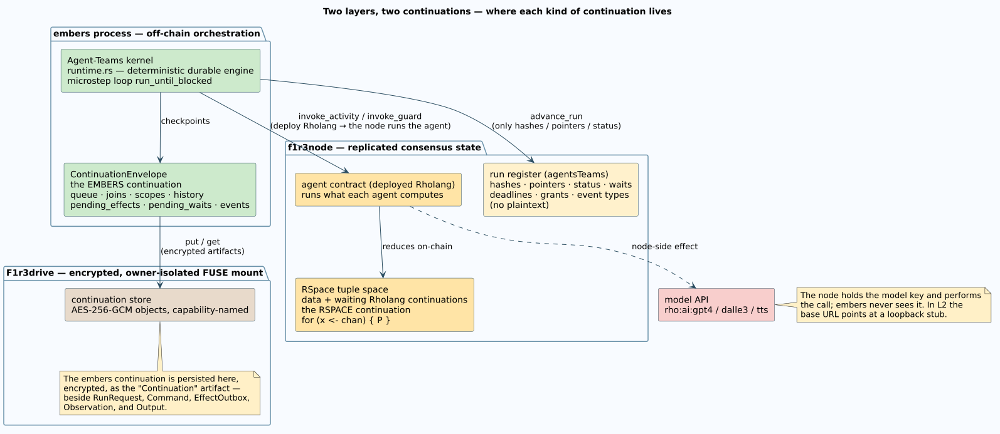
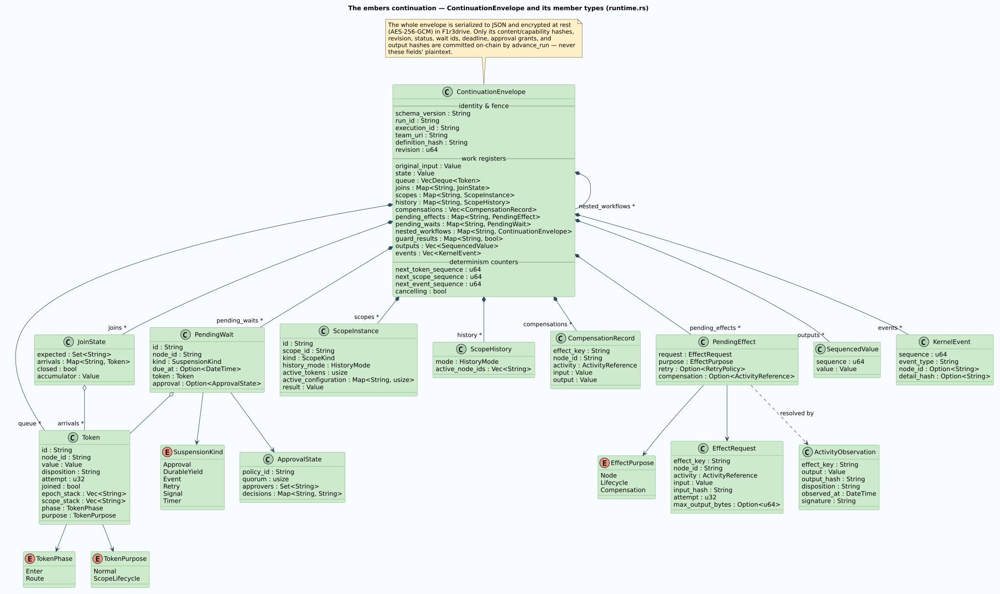
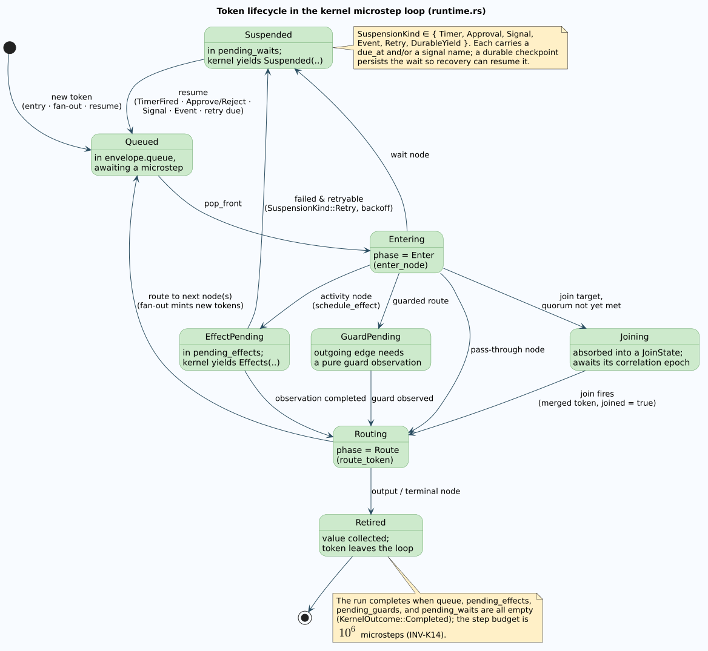
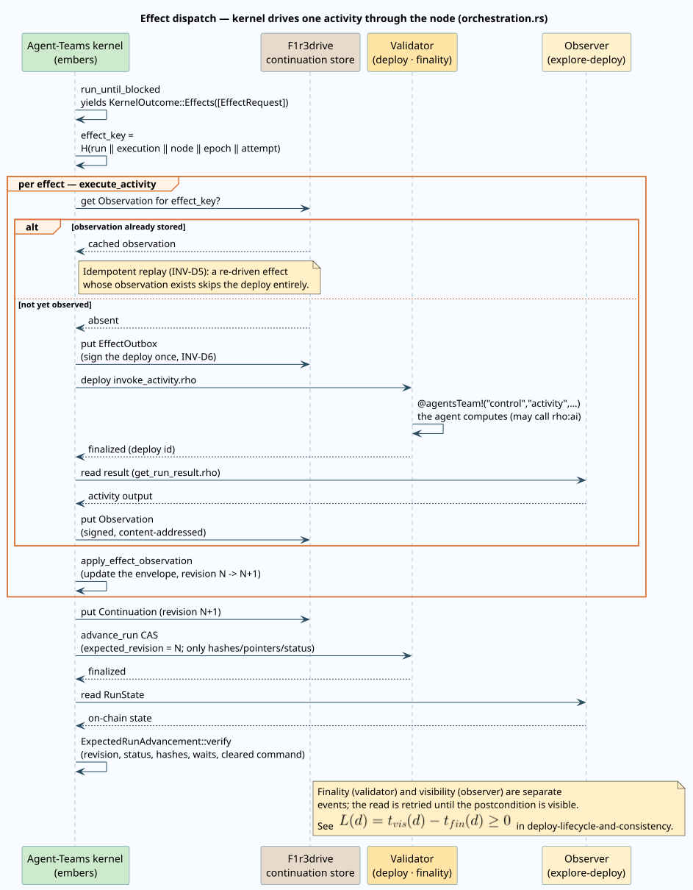
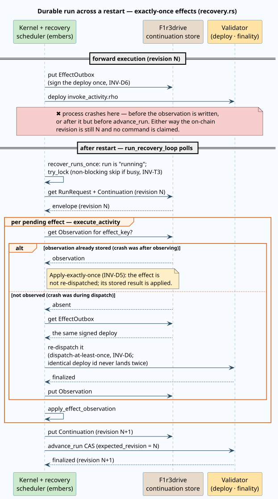

# The Agent-Teams durable kernel

The **kernel** is the deterministic, durable orchestration engine that runs an
Agent-Teams *workflow v2* run inside the embers process. It is the code in
[`packages/embers/src/domain/agents_teams/runtime.rs`](../../packages/embers/src/domain/agents_teams/runtime.rs)
(`runtime.rs`), driven by
[`orchestration.rs`](../../packages/embers/src/domain/agents_teams/orchestration.rs)
and [`recovery.rs`](../../packages/embers/src/domain/agents_teams/recovery.rs).
Its serializable checkpoint is the `ContinuationEnvelope`. The engine, the
continuation store, and the recovery scheduler all arrived together in commit
`67003ed` ("feat(agent-teams): add durable workflow v2 runtime").

This document grounds the abstract Agent-Teams model in the backend
implementation — the Rust types, the microstep loop, the on-chain protocol, and
the recovery scheduler, cited to `file:line`. It **does not restate** the
canonical semantics, which live in the sibling repository and are authoritative:

- [Agent Teams Workflow v2](../../../embers-frontend/docs/agent-teams/README.md) — the portable model.
- [Durable and hierarchical execution](../../../embers-frontend/docs/agent-teams/architecture/durable-execution.md) — the storage split, the commit protocol, recovery classification.
- [Hierarchical continuations](../../../embers-frontend/docs/agent-teams/theory/hierarchical-continuations.md) — checkpoint trees, execution paths, the effect-key algebra.
- [Statechart semantics of the durable kernel](../../../embers-frontend/docs/agent-teams/theory/statechart-semantics.md) and [operational semantics](../../../embers-frontend/docs/agent-teams/theory/operational-semantics.md) — the abstract state machine.

Where a guarantee has a stable identifier (`INV-K*`, `INV-D*`, `INV-T*`,
`INV-S*`, `INV-A*`), this document cites it and defers the proof obligation to
the [invariant registry](../formal/INVARIANTS.md).

## Two layers: Rholang-on-node vs kernel-in-embers

An Agent Team is *not* run on-chain as a single program. Two layers cooperate:

| Layer | Runs | Where its state lives | Trust domain |
| ----- | ---- | --------------------- | ------------ |
| **f1r3node / RSpace** | *what each agent computes* — one Rholang deploy per activity or guard | the RSpace tuple space (data + waiting continuations); the public run register | replicated consensus |
| **embers kernel** | *how the agents are coordinated over time* — scheduling, joins, waits, recovery | the `ContinuationEnvelope`, encrypted in F1r3drive | one off-chain service instance |

The kernel dispatches each activity by rendering Rholang and deploying it: the
templates
[`invoke_activity.rho`](../../packages/embers/templates/agents_teams/invoke_activity.rho)
and `invoke_guard.rho` call the deployed team contract's `"control"` interface
(`orchestration.rs:36-52`), and the node reduces that deploy to completion —
including any `rho:ai:{gpt4,dalle3,textToAudio}` system-channel call the agent
makes. The kernel then reads the result back and decides what runs next. So the
node is the *activity executor*; the kernel is the *workflow orchestrator*.



The direct compile-a-graph-to-Rholang path (workflow *v1*) still exists —
`deploy.rs` renders either a whole GraphL graph (`render(graph_code…)`,
`deploy.rs:202`) or a typed definition for the durable kernel
(`render_workflow(&definition…)`, `deploy.rs:212`). The rest of this document is
about the v2 durable path.

## Two notions of "continuation"

The word *continuation* names two different things here, at two different
layers. Distinguishing them is the whole point of this section.

**The RSpace (Rholang) continuation** is the consumer half of a communication
event in the reflective higher-order calculus that Rholang implements
([Meredith & Radestock 2005](https://doi.org/10.1016/j.entcs.2005.05.016)): in
`for (x <- chan) { P }`, the body `P` is the continuation that fires when a
matching send arrives on `chan`. RSpace — f1r3node's tuple space — persists
*unmatched data and unmatched continuations* as part of the chain state, and
checkpoints them into its history and cold stores. It is replicated consensus
state, reduced to completion within a deploy.

**The embers continuation** is the `ContinuationEnvelope` (`runtime.rs:40-66`):
the durable, resumable checkpoint of a whole workflow *kernel* — its token
queue, joins, scope instances and history, pending effects and waits,
compensations, event log, and nested child continuations. It is serialized to
JSON and encrypted (AES-256-GCM) at rest in F1r3drive. RSpace never holds it.

This second sense is exactly what the canonical theory calls, simply, *the
continuation*: "the complete private state required to resume a workflow"
([durable-execution.md](../../../embers-frontend/docs/agent-teams/architecture/durable-execution.md)),
with a root-vs-child split (a *checkpoint tree*). So "the embers continuation"
in this document is the theory's *continuation*; the contrast we are drawing is
with the lower-level *RSpace/Rholang* continuation, which the theory does not
call by that name. Both differ, in turn, from the theory's **two token
notions** (control-marker tokens vs conserved-value tokens,
[rho-life-correspondence.md](../../../embers-frontend/docs/agent-teams/theory/rho-life-correspondence.md)):
that is a distinction between *kinds of tokens*, not *kinds of continuations*.
Three distinct axes; do not conflate them.

| Dimension | RSpace / Rholang continuation | Embers continuation (`ContinuationEnvelope`) |
| --------- | ----------------------------- | -------------------------------------------- |
| What it is | Consumer half of a comm event, `for(x<-chan){P}` | Whole-workflow durable checkpoint |
| Formal basis | Reflective higher-order (ρ) calculus | Durable-execution / event-sourced state machine |
| Persistence | Tuple space; history / cold stores | Encrypted object in a F1r3drive FUSE mount |
| Visibility | Replicated consensus state | Off-chain, owner-isolated, encrypted; chain sees only hashes |
| Determinism scope | Confluent reduction within one deploy | Deterministic microstep replay across restarts and days |
| Wall-clock / timers | None (consensus determinism forbids it) | First-class `due_at` timers and deadlines |
| Human-in-the-loop | Not expressible as a held execution | Approvals held open for hours |
| External-effect once-ness | Not provided at the application level | Apply-exactly-once per effect key (INV-D5) |
| Addressed by | Channel name in the tuple space | HMAC-SHA256 capability + content hash (INV-S4) |

## Why an additional off-chain layer was necessary

Because the v1 path already compiles a team to Rholang and runs it on-chain, the
kernel is *not* evidence that "Rholang is insufficient." It is that a
deterministic, replicated, run-to-completion virtual machine **structurally
cannot** provide the following five things — so a durable orchestrator was added
off-chain, on top of Rholang rather than instead of it.

1. **Wall-clock time, timers, deadlines.** Consensus determinism forbids reading
   a clock: every validator must reduce a deploy identically, so "wait 30
   minutes, then fire" has no on-chain meaning. The kernel threads a logical
   `now` through `run_until_blocked` and carries `pending_waits` with `due_at`
   deadlines; `earliest_due_timer` (`runtime.rs:515-549`) selects the next
   fireable wait, and a timer resume is rejected unless `now ≥ deadline`
   (`runtime.rs:420-421`, INV-T1, INV-T2). A timer whose deadline expression
   cannot be computed routes a structured `failed` disposition rather than
   parking forever (`runtime.rs:843-920`).

2. **Human-in-the-loop approvals.** A deploy runs to completion inside a block;
   it cannot park an execution awaiting a person. The kernel's `Approval` wait
   (`runtime.rs:921-951`) records an approver set, a `quorum`, and per-approver
   decision de-duplication (`runtime.rs:439-456`), and fires only when the k-th
   distinct decision arrives. A non-listed actor's decision is rejected
   (INV-S7); a reused decision id or an approver re-vote is rejected (INV-S8).
   The wait is durable, so a run can be suspended for hours and resumed by the
   recovery scheduler when its deadline passes (`recovery.rs:134-176`, INV-T3,
   INV-T4).

3. **Durable, resumable execution with exactly-once external effects.** This is
   the durable-execution pattern
   ([Burckhardt et al. 2021](https://doi.org/10.1145/3485510); cf. the
   transactional [outbox](https://microservices.io/patterns/data/transactional-outbox.html)
   and [event sourcing](https://martinfowler.com/eaaDev/EventSourcing.html)).
   Each effect has a stable **effect key** — a hash, with NUL bytes as domain
   separators, of the run `$`r`$`, execution `$`x`$`, node `$`n`$`, correlation
   epoch `$`e`$`, and attempt `$`a`$`, namely
   `$`k = H(r \,\Vert\, \texttt{0} \,\Vert\, x \,\Vert\, \texttt{0} \,\Vert\, n \,\Vert\, \texttt{0} \,\Vert\, e \,\Vert\, \texttt{0} \,\Vert\, a)`$`
   ([hierarchical-continuations.md](../../../embers-frontend/docs/agent-teams/theory/hierarchical-continuations.md)).
   The observation store is a function `effect_key ↦ observation`: a re-driven
   effect whose observation already exists applies its stored result and does
   **not** re-dispatch (`orchestration.rs:728-737`, apply-exactly-once, INV-D5),
   while an outboxed-but-unobserved effect is re-dispatched under the same signed
   deploy — whose identical deploy id can never land twice — giving
   dispatch-at-least-once (INV-D6). RSpace persists on-chain state; it does not
   give an orchestrator that survives an embers crash and re-drives *external*
   effects without duplicating them.

4. **Rich coordination as one verifiable state machine.** Joins
   (`all`/`each`/`quorum`/`race`/`reduce` + late-arrival policy,
   `runtime.rs:1156-1264`, INV-K9…K11), bounded cycles (`runtime.rs:1397-1399`,
   INV-K5), routing (first-match/all-match, INV-K7/K8), scoped entry/exit and
   shallow/deep history (`runtime.rs:624-709`, INV-K1…K4), reverse-order Saga
   [compensation](https://doi.org/10.1145/38713.38742) (`runtime.rs:581-622`,
   INV-K12), and nested workflows (depth-capped at 32, `orchestration.rs:34`).
   Encoding all of that as on-chain contracts would make every microstep a
   consensus event; as an off-chain state machine it is compact and
   model-checked (see the [spec ↔ runtime bridge](#spec--runtime-bridge)).

5. **Confidentiality and a thin consensus boundary.** The whole envelope, and
   every activity payload, is AES-256-GCM-encrypted and owner-isolated in the
   [continuation store](./continuation-store.md); the public register holds only
   hashes, pointers, status, waits, deadlines, approval grants, and event types.
   The `advance_run` template
   ([`advance_run.rho`](../../packages/embers/templates/agents_teams/advance_run.rho))
   enumerates exactly what crosses the boundary, and
   `ExpectedRunAdvancement::verify` (`orchestration.rs:118-180`) checks the
   finalized ledger state against it — never a plaintext field (INV-D1, INV-D2,
   INV-S4…S6). Running the orchestration on-chain would publish private
   intermediate state to every validator and cost phlo for every scheduler
   microstep.

## The continuation envelope

The `ContinuationEnvelope` (`runtime.rs:40-66`) is the embers continuation. Its
fields fall into three groups.



- **Identity and fence** — `schema_version`, `run_id`, `execution_id`,
  `team_uri`, `definition_hash`, and the `revision`. Loading an envelope
  re-checks the first four against the run record (`validate_identity`,
  `runtime.rs:181-202`); the `revision` is the monotone checkpoint number that
  fences every on-chain advance.
- **Work registers** — `original_input`, `state`, the ready `queue` of `Token`s,
  the `joins`, `scopes`, and per-scope `history`, the `compensations` stack, the
  `pending_effects` and `pending_waits` maps, the `nested_workflows` (child
  continuations, keyed by execution id), `guard_results`, the accumulated
  `outputs`, and the `events` journal.
- **Determinism counters** — `next_token_sequence`, `next_scope_sequence`,
  `next_event_sequence`, and the `cancelling` flag. Every identifier the kernel
  mints is a function of a counter, and every collection is a `BTreeMap`/
  `BTreeSet`, so an envelope replays to a byte-identical successor (INV-D8).

The member types (`Token`, `JoinState`, `ScopeInstance`, `ScopeHistory`,
`CompensationRecord`, `PendingEffect`, `PendingWait`, `KernelEvent`, and their
enums) are defined in `runtime.rs:1516-1735` and shown in full in diagram 51
above, so the sections below can use them by name.

## The microstep loop

`run_until_blocked` (`runtime.rs:711-766`) is the kernel's entire forward step.
It drains the ready queue, one token per microstep, until the run can make no
progress without the outside world; then it returns a `KernelOutcome` describing
*why* it stopped. In literate form:

```text
run_until_blocked(definition, now):
    steps := 0
    while token := queue.pop_front():
        steps += 1
        require steps <= 1_000_000                      # INV-K14 step budget
        match token.phase:
            Enter -> enter_node(definition, token, now) # schedule effect / guard / wait, or absorb into a join
            Route -> if not route_token(token):         # needs a guard first
                         queue.push_front(token); break

    if pending_effects nonempty:  return Effects(all pending requests)
    if pending_guards nonempty:   return Guards(all pending requests)
    if queue nonempty:            bail  # blocked with no effect/guard/wait — impossible for a valid definition
    if pending_waits nonempty:    return Suspended(all pending waits)
    if cancelling:                return Cancelled
    return Completed(outputs sorted by sequence)         # Null if none; a single value or an array
```

The outcome ordering is deliberate: **effects and guards come first** (the run
still has synchronous work the node can do now), **waits next** (it is parked on
time or a human), and **completion last** (nothing is left). A token's journey
through this loop — queued, entering a node, absorbed into a join, pending on an
effect or guard, suspended on a wait, routing onward, or retired — is the
subject of diagram 47.



Determinism is structural: identifiers come from the monotone counters
(`new_token`, `event`, `runtime.rs:131-169`), ordering comes from the sorted
maps, and the step budget of `$`10^6`$` microsteps guarantees a valid run either
completes or stops with an error — it never diverges and never panics (INV-K14,
mechanized in Rocq `KernelTermination.v`).

## Coordination semantics

Each mechanism below is implemented in the kernel and upholds a named invariant;
the abstract statements and proofs are in the frontend theory, cross-linked per
row rather than restated.

- **Tokens and epochs.** A `Token` (`runtime.rs:1516-1532`) is one pending unit
  of control plus its data, its scope and epoch stacks, and its `phase`
  (`Enter`/`Route`). Fan-out at a route group mints a fork epoch that
  distinguishes concurrent generations for correlation
  ([statechart-semantics.md](../../../embers-frontend/docs/agent-teams/theory/statechart-semantics.md)).
- **Joins.** `accept_join` (`runtime.rs:1156-1264`) absorbs an arriving token
  into a `JoinState` keyed by its correlation epoch and fires the merged token
  when the policy is satisfied: `all` on the full producer set, `each` per
  arrival, `quorum(k)` at the k-th distinct decision, `race` on the first (then
  its late-arrival policy), `reduce` by the declared combinator. A join fires
  from a single epoch (INV-K9), rejects duplicate arrivals (INV-K10), and a
  `quorum(k)` fires exactly at `k` and never re-fires (INV-K11).
- **Routing and cycles.** `route_token` (`runtime.rs:1266-1460`) evaluates
  outgoing transitions: first-match fires the highest-priority true edge
  (INV-K7), all-match fires every true edge and applies the `noMatch`
  disposition otherwise (INV-K8). Per-transition traversal counters bound cycles
  (INV-K5); a hot cycle (no wait/bound/yield on it) is rejected at validation
  (INV-K6, Rocq `ProgressBoundary.v`).
- **Scopes and history.** Entering a scope node instantiates a `ScopeInstance`
  and runs its entry activities before any token proceeds; a scope completes
  exactly when it drains (INV-K2), and completion may capture shallow or deep
  history for later restoration (INV-K4). Token conservation holds at every
  quiescent point: the stored count equals the live population,
  `$`\alpha(s) = \lvert \mathrm{live}(s) \rvert`$` (INV-K1).
- **Compensation.** On cancellation the kernel dispatches only compensations, in
  reverse completion order, each at most once (`schedule_next_compensation`,
  `begin_cancellation`, `runtime.rs:581-622`, INV-K12). A compensation is a new
  forward effect, not a rollback.

## Time, waits, and approvals

A `PendingWait` (`runtime.rs:1691-1699`) carries a `SuspensionKind` — `Timer`,
`Approval`, `Signal`, `Event`, `Retry`, or `DurableYield` — an optional
`due_at`, the parked `Token`, and, for approvals, an `ApprovalState` (policy,
quorum, approver set, decisions). A run yields `KernelOutcome::Suspended` when
its queue is drained but waits remain; the checkpoint persists them so recovery
can resume. `apply_command` (`runtime.rs:353-464`) applies a resume — a
`TimerFired` (validated `now ≥ deadline` and `deadline == due_at`), an
`Approve`/`Reject`, or a `Signal`/`Event` — and re-queues the parked token. The
abstract wait/approval lifecycle is frontend diagram 10.

## The driver and the on-chain protocol

`drive_continuation` (`orchestration.rs`) turns kernel outcomes into node work
and back. For a `KernelOutcome::Effects` batch it calls `execute_activity` per
effect; for `Guards` it invokes the pure guard; for `Suspended`/`Completed`/
`Cancelled` it checkpoints and advances. One effect, end to end:



```text
execute_activity(effect):
    if observation for effect.key already in store:      # INV-D5 apply-exactly-once
        return stored observation
    outbox := sign(deploy of invoke_activity.rho(effect))
    store.put(EffectOutbox, effect.key, outbox)          # INV-D6 dispatch-at-least-once
    deploy_id := node.deploy(outbox); await finality
    output := node.read(get_run_result.rho(deploy_id))
    observation := ActivityObservation{ effect.key, output, hashes, signature }
    store.put(Observation, effect.key, observation)
    return observation

checkpoint_and_advance(continuation, status, waits, output?):
    continuation.revision += 1
    ptr := store.put(Continuation, "revision-N", continuation)
    deploy advance_run.rho(expected_revision = N-1, status, hashes(ptr), waits, grants, output_hashes)
    await finality
    ExpectedRunAdvancement::verify(on-chain RunState)     # revision, status, hashes, cleared command
```

`advance_run` is a compare-and-swap fenced by `expected_revision`: it lands only
if the ledger is still at the revision the kernel read, increments it by exactly
one, and clears any claimed command (INV-D2, INV-D4). What crosses the boundary
is only the content/capability **hashes** of the encrypted continuation and
output, plus status, wait ids, the deadline, approval grants, and the event type
— enumerated in `advance_run.rho` and re-checked field-by-field by
`ExpectedRunAdvancement::verify` (`orchestration.rs:118-180`). Finality
(validator) and visibility (observer) are separate events; the read that
verifies the postcondition is retried until visible — see
[deploy lifecycle and consistency](./deploy-lifecycle-and-consistency.md).

## Durability and recovery

`run_recovery_loop` (`recovery.rs:17-25`) polls at `recovery_poll_millis`;
`recover_runs_once` (`recovery.rs:27-63`) scans the runs and, for each,
non-blockingly `try_lock`s the per-run mutex (a busy run is skipped, not queued,
INV-T3). A **suspended** run whose `due_at` has passed has its earliest timer
fired (`fire_due_timer`, `recovery.rs:134-176`, which re-checks that the public
deadline equals the encrypted continuation's before acting); a **running** run
is re-driven from its pinned `revision-N` checkpoint (`resume_running_run`,
`recovery.rs:65-115`); a **resuming** run replays its claimed command
(`resume_recoverable_command`). Because dispatch is at-least-once and application
is exactly-once (§3, item 3), replay after a crash is safe.



The signed run-command protocol that clients use to steer a run — `signal`,
`event`, `timerFired`, `approve`, `reject`, `cancel`, `retry`, `migrate` — is in
[`run_commands.rs`](../../packages/embers/src/domain/agents_teams/run_commands.rs):
at most one command is claimed per run, only from status `{running, suspended}`
(INV-D3), and a claimed or applied command is fenced to the revision it claimed
(INV-D4).

## Run creation and the environment registry

A durable run is created by `run_agents_team.rs`
(`prepare_run_agents_team_contract` → `deploy_signed_run_agents_team` →
`resume_durable_run`), which deploys
[`begin_durable_run.rho`](../../packages/embers/templates/agents_teams/begin_durable_run.rho)
and then drives the fresh continuation. The public state lives in the
environment-registry contract
[`init.rho`](../../packages/embers/templates/agents_teams/init.rho): a single
persistent map token holds every run's `RunState`, and a receive-validate-send
critical section serializes the verbs `beginDurableRun`, `claimCommand`,
`advanceRun`, `clearCommand`, `claimOutputReveal`, `getRun`, and `listRuns`.
This registry contract (`agentsTeams`) is distinct from a **team** contract
(`agentsTeam`), whose `"control"` interface exposes the manifest and the
activity/guard implementations the kernel invokes.

## Spec ↔ runtime bridge

Each kernel guarantee maps to a row in the
[invariant registry](../formal/INVARIANTS.md), which names the runtime anchor,
the property-based test (`fv_inv_*`), and the formal model. The kernel's own
model-based property tests live in
[`runtime.rs`'s `testing` module](../../packages/embers/src/domain/agents_teams/testing.rs);
the three frozen TLA⁺ specs
([`StatechartScopes.tla`](../../../embers-frontend/docs/agent-teams/formal/StatechartScopes.tla),
[`AgentTeamsWorkflow.tla`](../../../embers-frontend/docs/agent-teams/formal/AgentTeamsWorkflow.tla),
[`DurableHierarchy.tla`](../../../embers-frontend/docs/agent-teams/formal/DurableHierarchy.tla))
are validated in the frontend repository. In short: **INV-K1…K14** cover the
kernel state machine (conservation, termination, joins, routing, scopes,
compensation), **INV-D1…D8** the durable commit protocol (revision fencing,
exactly-once, the event journal), **INV-T1…T4** the timers, and **INV-S2…S8**
the reveal and capability boundaries.

## Related

- [The continuation store](./continuation-store.md) — the encrypted F1r3drive artifact format and capability scheme.
- [The event journal](./event-journal.md) — the order-preserving merge of the durable journal and the RSpace sequence (INV-D8).
- [Deploy lifecycle and consistency](./deploy-lifecycle-and-consistency.md) — finality vs visibility, retry budgets.
- [Boot and runtime](./boot-and-runtime.md) — where the recovery scheduler is started.
- [Resource accounting](../design/resource-accounting.md) — phlo, output-byte limits, the step budget.
- [F1r3sky and ATProto](../integrations/f1r3sky-and-atproto.md) — how a run's Output reaches a publication.
- [Agent Teams Workflow v2 backend](../agent-team-workflows.md) — the backend boundary index.
- Canonical model: [durable-execution.md](../../../embers-frontend/docs/agent-teams/architecture/durable-execution.md), [hierarchical-continuations.md](../../../embers-frontend/docs/agent-teams/theory/hierarchical-continuations.md), [statechart-semantics.md](../../../embers-frontend/docs/agent-teams/theory/statechart-semantics.md).
