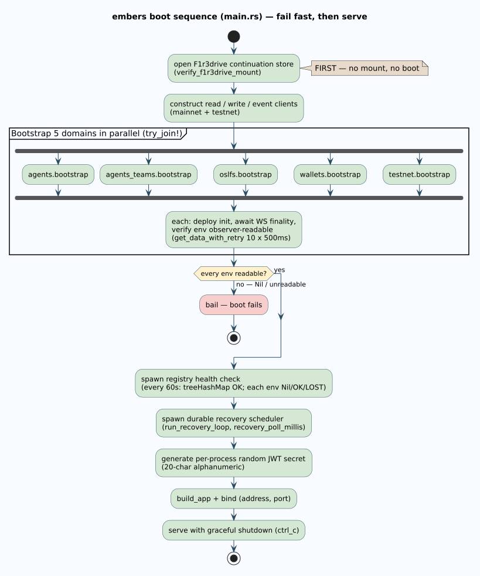

# Boot and runtime

embers boots in a deliberate, fail-fast order: it refuses to serve until its durable
store is on the right filesystem and all five domains are live and observer-readable
on chain. This document walks the boot sequence and the two background tasks that
run for the process's lifetime.

Implementation: `packages/embers/src/main.rs` and `packages/embers/src/app.rs`
(`build_app`).

## Boot sequence

1. **Open the continuation store — first.** `F1r3driveContinuationStore::open` runs
   `verify_f1r3drive_mount` before anything else. If the configured mount path is not
   inside a F1r3drive FUSE mount, boot fails here — embers never proceeds to serve
   traffic it could not durably recover. See
   [F1r3drive integration](../integrations/f1r3drive.md).
2. **Construct the node clients** for both networks (mainnet and testnet): the
   validator write client, the observer read client, and the event (WebSocket)
   source. See [crate architecture](crate-architecture.md) for the trait seams.
3. **Bootstrap all five domains in parallel** (`try_join!` over agents,
   agents_teams, oslfs, wallets, testnet). Each domain's `bootstrap`:
   - deploys its `init` contract (the version-gated
     [environment registry](../design/environment-registry.md) insert),
   - awaits **finality** on the validator WebSocket, then
   - **verifies the environment is observer-readable** with
     `get_data_with_retry(code, 10, 500ms)` — up to ten 500 ms-spaced attempts,
     because finality precedes observer visibility (see
     [deploy lifecycle and consistency](deploy-lifecycle-and-consistency.md)).
   Because it is a `try_join!`, any domain failing — including an environment that
   comes back `Nil` (its init did not register) — aborts the whole boot. This is the
   same fail-fast posture as step 1: a half-initialized backend never serves.
4. **Spawn the registry health check** (background, every 60 s): it reads the system
   `treeHashMap` URI and each domain's environment, logging each as **OK**, **Nil**
   (registered as Nil), or **LOST** (was present, now unreadable) — an operational
   signal that the on-chain registry is intact.
5. **Spawn the durable recovery scheduler** (background): `run_recovery_loop` polls
   every `recovery_poll_millis` (default 1000 ms) for durable runs that need to be
   advanced or resumed. This is the task that makes agent-team runs survive restarts;
   its timing invariants are formalized in
   [TimersRecovery](../formal/tla/TimersRecovery.tla).
6. **Generate the per-process JWT secret** — a fresh random 20-character alphanumeric
   string, used as both the encoding and decoding key. It is **not** persisted, so a
   restart invalidates every outstanding `prepare` token (a client must re-`prepare`;
   this is harmless — see below). This restart-invalidation property is machine-checked
   in [two_phase_jwt.pv](../formal/proverif/two_phase_jwt.pv).
7. **Build and serve.** `build_app` assembles the OpenAPI routes, injects the five
   services and the JWT keys, and applies the middleware chain (CORS, request-id,
   tracing, compression, trailing-slash normalization). The server binds
   `(address, port)` and runs with graceful shutdown on Ctrl-C.

## The two background tasks

| Task | Cadence | Purpose |
| ---- | ------- | ------- |
| Registry health check | 60 s | Log the reachability of the system URI and each domain env (OK / Nil / LOST). Observability only — it does not mutate state. |
| Durable recovery scheduler | `recovery_poll_millis` (default 1 s) | Advance/resume durable agent-team runs; the mechanism behind restart survival. |

## Restart semantics

Because the JWT secret is per-process, restarting embers invalidates every
in-flight `prepare`. This is safe: a `send` carrying a stale token is simply
rejected, and the client re-runs the two-phase flow. What must persist across a
restart is the F1r3drive mount and the continuation-store cipher key (so previously
written continuations stay readable) — see
[deployment](../operations/deployment.md). Durable runs themselves are recovered
from the continuation store by the recovery scheduler, independent of any client
token.
