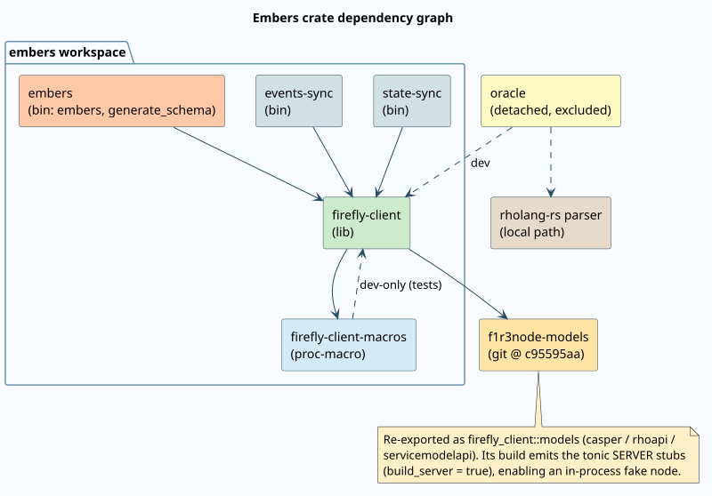

# Crate architecture

The Embers repository is a Cargo workspace of five crates plus one deliberately
detached test crate. This document maps them, their dependency direction, and
the two external pins that matter (the f1r3node protobuf models and the target
features gxhash needs).

## The five workspace members

| Crate | Kind | Role |
| ----- | ---- | ---- |
| `packages/embers` | binary (2 bins) | The HTTP backend. `embers` serves the API (`src/main.rs`); `generate_schema` writes the OpenAPI snapshot (`src/generate_schema.rs`). Binary-only — it has no library target, so its types are private to the crate and its tests are inline `#[cfg(test)]`. |
| `packages/firefly-client` | library | The f1r3node ("Firefly") client: gRPC deploys, HTTP observer reads, WebSocket finality events, and the Rholang value/render machinery. |
| `packages/firefly-client-macros` | proc-macro | The `IntoValue` and `Render` derives that turn Rust structs into Rholang. |
| `packages/events-sync` | binary | A CLI bridge between the AT Protocol firehose and Firefly (see [events-sync](../integrations/events-sync.md)). |
| `packages/state-sync` | binary | A CLI that checkpoints a PostgreSQL dump onto Firefly and restores it (see [state-sync](../integrations/state-sync.md)). |

Dependency direction is acyclic in the normal graph: `embers`, `events-sync`, and
`state-sync` depend on `firefly-client`, which depends on
`firefly-client-macros`. (The one cycle is dev-only: `firefly-client-macros`'
tests depend on `firefly-client` to compile the code its derives expand to, which
Cargo permits because dev-dependencies do not enter the normal build graph.)

## The firefly-client surface

`firefly-client` is the crate every binary builds on. Its public exports
(`src/lib.rs`) are the three node clients and the three trait seams:

- **`WriteNodeClient`** — gRPC `casper.v1.DeployService`: submit deploys, read
  the head block, read a channel value. Signs with secp256k1 over a BLAKE2b-256
  digest (`helpers.rs`).
- **`ReadNodeClient`** — HTTP `POST /api/explore-deploy` against the observer,
  with the retry-on-empty helpers (see
  [Deploy lifecycle and consistency](deploy-lifecycle-and-consistency.md)).
- **`NodeEvents`** — the WebSocket `/ws/events` fan-out backing `wait_for_deploy`
  and per-wallet deploy subscriptions.
- **`CommunicationService`** — the reverse gRPC server half (a node-to-client
  notifier), used by `events-sync`, not by the `embers` binary.
- **Traits `ReadNode` / `WriteNode` / `NodeEventSource`** — the mock seams. Every
  `embers` domain service and API struct is generic over this triple with the
  real clients as defaults, which is what lets the whole HTTP app be built with
  mock-typed services in the in-process test harness
  ([test architecture](../testing/test-architecture.md)).

## The two external pins

- **f1r3node protobuf models.** `firefly-client` depends on the `f1r3node-models`
  crate (package `models` at `github.com/F1R3FLY-io/f1r3node-rust`) pinned to a
  specific revision, re-exported through `firefly_client::models` as the
  `casper`, `rhoapi`, and `servicemodelapi` types. That crate's build generates
  the tonic **server** stubs too (`build_server(true)`), which is what makes an
  in-process fake node possible. Bumping the node's wire protocol means bumping
  this revision.
- **gxhash target features.** A transitive dependency of the model crates,
  `gxhash`, hard-requires the `aes` and `sse2` CPU features on `x86_64` and fails
  to compile without them. `.cargo/config.toml` declares them target-scoped, so
  every build — local, CI, and nested (including trybuild's inner compilation) —
  gets them without an explicit `RUSTFLAGS`. The toolchain is pinned by
  `rust-toolchain.toml` (`nightly-2026-02-09`).

## The detached oracle

`oracle/` is a crate that is **excluded** from this workspace (`exclude =
["oracle"]`, and its own empty `[workspace]` table). It depends on a local
`rholang-rs` checkout — a parser whose git remote is an SSH fork that CI runners
do not have — so folding it into the workspace would break dependency-metadata
resolution everywhere that checkout is absent. It is run explicitly via
`cargo make oracle-test`, which parses everything `embers` renders under the real
Rholang grammar (see [test architecture](../testing/test-architecture.md)).

## Build and test entry points

The `cargo make` tasks (root and `packages/embers/Makefile.toml`) are the
canonical entry points: `test`, `check`, `clippy`, `format`, `audit`,
`generate-schema`, the `docker-*` compose helpers, `oracle-test`, and the
formal-verification runners (`fv-smt`, `fv-tlc`, and the `fv` aggregate). See
[CI and tooling](../operations/ci-and-tooling.md) for the full catalog and how
CI wires them.
