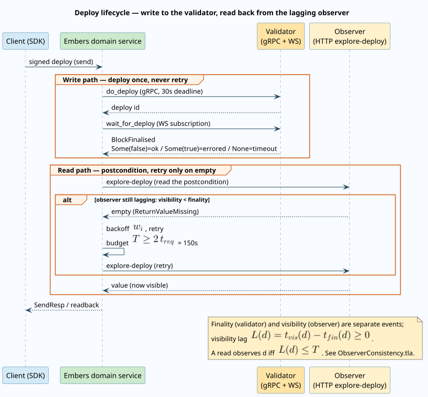

# Deploy lifecycle and the consistency model

This document explains the single most surprising property of the Embers
backend: a value it just wrote can be briefly unreadable, and the design turns
that into a correctness guarantee rather than a bug. If you have ever asked "I
deployed it and the read came back empty — why?", the answer is here.

## Vocabulary

Defined before use, because the whole model turns on distinguishing two events
most systems conflate.

- **Deploy** — submitting a signed Rholang contract to a **validator** node over
  gRPC. Embers does this through `WriteNodeClient`
  (`packages/firefly-client/src/write_node_client.rs`).
- **Propose / block** — the validator packages deploys into a block.
- **Finalization** — the block is committed by consensus. Embers learns of it
  over the validator's WebSocket as a `BlockFinalised` event, matched to a deploy
  by `NodeEvents::wait_for_deploy` (`node_events.rs`).
- **Observer (read) node** — a *separate*, non-proposing node that answers reads
  via HTTP `explore-deploy`. Embers reads through `ReadNodeClient`
  (`read_node_client.rs`). The Rust type is `ReadNodeClient`; in prose we call it
  the *observer*.
- **Finality** — the validator-side event that a deploy's block is committed.
  **Visibility** — the observer's state reflecting that block. These are distinct
  events, and **visibility lags finality**. We never say "confirmed" unqualified.

## The lifecycle

A mutation travels validator → consensus → observer, and the client's read
follows behind the write:



Embers writes to the validator and awaits finality on the validator WebSocket;
it then reads the *postcondition* from the observer. `wait_for_deploy` returns a
three-valued result the caller must respect: `Some(false)` — finalized without
error; `Some(true)` — finalized but the deploy errored; `None` — the finality
wait timed out (an ambiguous outcome, see below).

## Finality and visibility are separate — the lag

The read path hits the observer, whose state trails the validator by a brief
window after finality. Define the **visibility lag** of a deploy $`d`$ as the
delay between its finalization and its readability on the observer:

```math
L(d) \;=\; t_{\mathrm{vis}}(d) - t_{\mathrm{fin}}(d) \;\ge\; 0 .
```

During $`[t_{\mathrm{fin}}(d),\, t_{\mathrm{vis}}(d))`$ a read that logically must
observe $`d`$ (because the client just finalized it) returns *empty*. A
single-shot read-after-write therefore fails intermittently — worse under load,
when the observer trails further. This is exactly the failure the project's
"read-after-write retry" note records.

## Retry-on-empty, and why only some reads retry

The fix is a bounded **retry-on-empty** on postcondition reads
(`get_data_with_retry` / `get_data_or_none_with_retry`, `read_node_client.rs`).
Its shape:

- **Retry only on empty** (INV-C1): a retry fires only on the `ReturnValueMissing`
  (empty) result — never on any other error, which would be a genuine failure to
  surface immediately.
- **Exponential backoff with jitter**: attempt $`i`$ waits

  ```math
  w_i \;=\; \min\!\bigl(2^{i}\,\delta,\; 5\delta\bigr)\,(1 + J_i),
  ```

  where $`\delta`$ is the base delay, the term is capped at $`5\delta`$, and
  $`J_i`$ is per-attempt jitter.
- **A total budget** $`T`$ = `TOTAL_READ_BUDGET` = 150 s, with the tested
  side-condition (INV-C5)

  ```math
  T \;\ge\; 2\,t_{\mathrm{req}}
  ```

  (`read_node_client.rs:30, :658`; $`t_{\mathrm{req}}`$ is `request_timeout`,
  60 s), so the budget always covers at least two full request attempts. The
  historical 45 s budget was too small — a real read once took 34 s — which is
  why it is 150 s today.
- **No premature `None`** (INV-C2): `Ok(None)` is returned only after the budget
  is spent. So a genuinely-absent value still resolves to empty; a lagging value
  is waited out.

The correctness condition follows: a read issued after $`d`$'s finality is
guaranteed to observe $`d`$ iff the lag fits the budget,

```math
L(d) \;\le\; T .
```

This is the exact property the TLA⁺ model
[`ObserverConsistency.tla`](../formal/tla/ObserverConsistency.tla) checks: when
the budget covers the lag the read never gives up (`BudgetCoversLag`), and a
give-up is always honest (`NoPrematureGiveUp`, `NoFalseRead`); the under-budgeted
configuration reproduces the intermittent-empty flake as a counterexample.

**Not every read retries** (INV-C3). Only a read that reads back the effect of a
write *in the same request* uses the retry helpers — those are the paths where a
finalized write precedes the read. A plain collection or version GET performs
exactly one attempt: no write precedes it in the handler, so an empty answer *is*
the answer, and retrying would only add latency to a legitimate 404.

## Deploy-once: the write side of ambiguity

The write path makes the opposite choice, for the opposite reason. A deploy is
submitted **exactly once and never retried** on an ambiguous outcome
(`write_node_client.rs:179-180`). The reason is that a lost response is
ambiguous: the deploy may have landed on chain anyway. Resubmitting could land a
*second* copy.

The TLA⁺ model [`DeployOnce.tla`](../formal/tla/DeployOnce.tla) makes this
precise. Under the no-retry policy at most one copy of a deploy intent ever lands
(`AtMostOnceLanding` holds); under a hypothetical retry policy a
timed-out-but-landed submission followed by a resubmission lands two copies —
TLC reports the violation with the duplicate trace. The model also encodes the
honest non-guarantee: a client error does **not** imply the deploy did not land
(the `TimedOutButLanded` outcome). The contract is **at-most-once, not
exactly-once**. Resilience is provided by the transport instead of by retries: a
30 s gRPC deadline sized from the measured cold path, TCP keepalive, and h2 PING
tuning (`write_node_client.rs:20-89`).

## The rule of thumb

Deploy, await finality, then poll for the *exact* postcondition with
retry-on-empty — never assume a write is immediately readable, and never retry an
ambiguous write. Finality tells you the deploy committed; visibility tells you
you can read it; they are not the same moment.

## Related

- [Configuration](../operations/configuration.md) — the node URLs and the
  finalization timeout.
- [Invariant registry](../formal/INVARIANTS.md) — INV-C1…C5 and their tests.
- Frontend transport-policy note in `../agent-team-workflows.md`.
