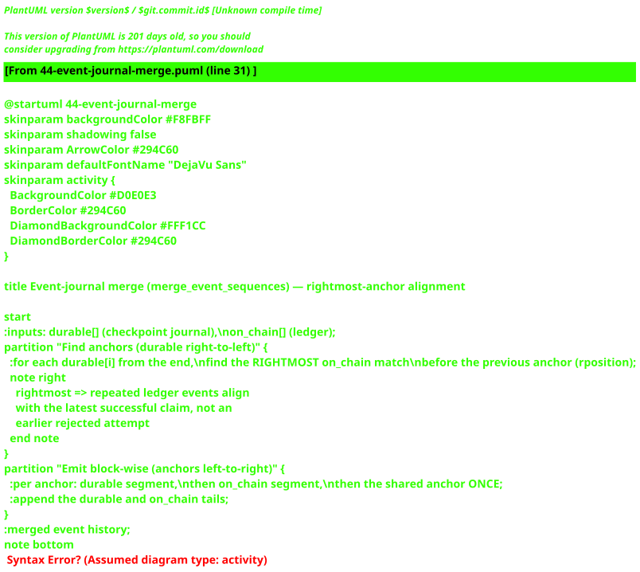

# Event journal

A durable agent-team run has **two** ordered audit trails: the durable checkpoint
journal embers keeps as it drives the run, and the on-chain ledger the run's
contracts append to. When a run is read back, embers reconciles them into one event
history with an order-preserving merge. This document explains that merge and the
invariant it guarantees.

Implementation: `packages/embers/src/domain/agents_teams/get_run.rs`
(`merge_event_sequences`). The invariant is mechanized in
[MergeJournal.v](../formal/rocq/MergeJournal.v).

## Why two sequences

The two trails record the same run from different vantage points and at different
granularities: the durable journal captures embers' own coordination steps between
checkpoints, and the on-chain ledger captures what actually committed. Neither is a
prefix of the other — durable coordination events interleave with later
coordination-only ledger events — so the reconciliation must **interleave** them
while preserving each one's internal order.

## The rightmost-anchor merge

`merge_event_sequences(durable, on_chain)` proceeds in two passes:

1. **Find anchors.** Walking `durable` from the end, for each event it finds the
   **rightmost** matching occurrence in `on_chain` that lies before the previous
   anchor (`rposition`). Anchoring on the rightmost match is deliberate: a repeated
   ledger event — e.g. a command claim that was attempted, rejected, then re-attempted
   — aligns with the **latest, successful** occurrence rather than an earlier rejected
   one.
2. **Emit block-wise.** Walking the anchors left-to-right, it emits, per anchor, the
   `durable` segment since the previous anchor, then the `on_chain` segment since the
   previous anchor, then the shared anchor **once**; after the last anchor it appends
   both remaining tails.

Because the shared anchor is emitted a single time, the merge is a true reconciliation
rather than a concatenation with duplicates.

## The invariant (INV-D8)

The merge preserves both inputs:

> Both `durable` and `on_chain` are **subsequences** of the merged result.

No event from either trail is dropped, and no event is reordered relative to its own
trail. This is exactly the property proved (with no axioms) in
[MergeJournal.v](../formal/rocq/MergeJournal.v): the merge is modeled as its block
structure, and `durable_is_subseq` / `on_chain_is_subseq` show each input embeds into
the merge — the on-chain side embeds precisely because the single emitted anchor
equals the on-chain element it matched. The doc comment's guarantee ("Both inputs
remain subsequences of the result even if a legacy record lacks an expected common
anchor") is therefore machine-checked, not merely asserted.

Read as a monotone injection: the merge maps each trail's positions into the merged
sequence order-preservingly, which is the formal shape of "reconcile two views
without losing or reordering either."
