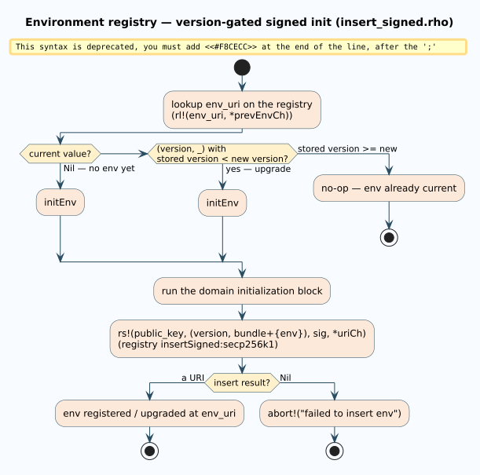

# Environment registry

Every embers domain — wallets, agents, agent-teams, OSLFs, testnet — owns an
on-chain **environment**: a signed, versioned namespace on the F1r3fly registry
under which all of that domain's contracts and data live. Each domain stands its
environment up (or upgrades it) with the shared `common/insert_signed.rho` template,
and every subsequent operation addresses the environment by a URI derived from the
domain's environment key. This document explains that init protocol and the URI
derivation.

Implementations: `packages/embers/templates/common/insert_signed.rho` (the
template), `firefly_client::helpers::insert_signed_signature` (the signature), and
each domain's init (`domain/{wallets,agents,agents_teams,oslfs,testnet}.rs`). The
templating pipeline is in [Rholang templating](rholang-templating.md).

## The environment URI

A domain's environment is keyed by an **environment key** — a secp256k1 keypair the
service holds (per network; see [configuration](../operations/configuration.md)).
The environment's address is derived deterministically from the environment
**public** key:

```text
env_uri = Uri::from(env_public_key)
```

Because the URI is a pure function of the public key, every operation in the domain
can compute the same stable `env_uri` and look the environment up on the registry
without any shared mutable pointer — the key *is* the address. Every template in the
domain takes `env_uri` as a field (see [the template catalog](../../packages/embers/templates/README.md)).

## The init protocol

`insert_signed.rho` is idempotent and upgrade-aware. Rendered for a domain at a
given `version`, it runs:



1. **Look up** the current environment: `rl!(env_uri, *prevEnvCh)` against
   `rho:registry:lookup`.
2. **Absent** (`@Nil`) → initialize: the environment has never been created.
3. **Present but older** (`@(version, _)` with stored `version < new`) → initialize:
   this is an upgrade to a newer contract version.
4. **Present and current** (stored `version >= new`) → neither branch fires, so init
   is a **no-op** — re-running the same or an older init changes nothing.
5. On initialize, run the domain's **initialization block** (the `` each domain fills in), then insert the signed environment:

   ```text
   rs!(public_key, (version, bundle+{*env}), sig, *uriCh)   // rho:registry:insertSigned:secp256k1
   ```

   The value stored is the pair `(version, bundle+{env})` — the version tag that
   drives the upgrade gate above, and a read-only `bundle+` of the environment
   process.
6. **Fail closed**: if the signed insert returns `@Nil`, `abort!("failed to insert
   env")` aborts the whole deploy (`rho:execution:abort`) — a partial environment is
   never left behind.

## The signature

The insert is authorized by a secp256k1 signature the backend computes off-chain:

```text
sig = insert_signed_signature(env_key, timestamp, deployer_public_key, version)
```

Only a holder of the domain's environment secret key can produce a valid `sig`, so
only the service can create or upgrade the environment; the registry's
`insertSigned:secp256k1` clause verifies it on chain. This makes the environment key
an identity: see the rotation warning in [key inventory](../security/key-inventory.md)
— rotating an environment key changes `env_uri` and therefore the domain's address.

## Why versioned + idempotent

The five domains' inits run on every boot (see [boot and runtime](../architecture/boot-and-runtime.md)).
The version gate makes that safe: a boot against an already-current chain does
nothing, a boot with newer contract code upgrades in place, and a signed-insert
failure aborts rather than half-applying. The result is that bringing embers up
against a fresh chain and against an established one are the same operation.
