# Diagram conventions and palette

This directory holds the architecture, operations, integration, and testing
diagrams for the Embers backend. It defines — **once, here** — the palette,
numbering, tooling, and per-concept color assignments that every diagram in the
`embers` repository reuses, so that a validator node is the same color in the
boot-sequence diagram, the deploy-lifecycle diagram, and the deployment-topology
diagram. A reader who learns the palette once can read every diagram without a
per-figure legend.

These conventions **extend** the palette already established by the API
reference diagrams under [`../api/diagrams/`](../api/diagrams/) (for example
[`20-api-two-phase.puml`](../api/diagrams/20-api-two-phase.puml)); they do not
replace it. Colors already assigned there keep their meaning.

## Tooling: PlantUML, committed as source **and** rendered SVG

- **PlantUML is the default.** It is preferred over Mermaid for every diagram
  type both support, because PlantUML output is byte-reproducible (the same
  `.puml` renders to the same `.svg` on every machine) and it typesets LaTeX in
  labels. Mermaid is used only where PlantUML has no equivalent construct.
- **Every diagram is committed twice**: the `.puml` source and the rendered
  `.svg` beside it, sharing a basename (`27-dev-net-topology.puml` and
  `27-dev-net-topology.svg`). Markdown embeds the `.svg`; the `.puml` is the
  editable source of truth. This matches the existing `../api/diagrams/`
  convention.
- **Render command** (PlantUML and a JRE are installed on the workstation):

  ```bash
  plantuml -tsvg docs/diagrams/27-dev-net-topology.puml
  ```

  Rendering is deterministic, so a committed `.svg` that differs from a fresh
  render of its `.puml` is a staleness bug; the `docs-check` task (added in
  documentation phase C6) re-renders and byte-compares to catch it.

## Numbering: one shared cross-repo sequence

Diagrams are numbered in a **single sequence shared across the Embers repos** so
that a cross-reference like "diagram 14" is unambiguous no matter which repo it
lives in:

| Range | Location | Contents |
| ----- | -------- | -------- |
| 01–26 | `embers-frontend/docs/agent-teams/diagrams/` | Agent-teams theory, kernel, security, durable-execution set (the canonical semantics diagrams). |
| 20    | `embers/docs/api/diagrams/20-api-two-phase.*` | The two-phase protocol overview (shared number; the API method diagrams are foldered, not numbered). |
| 27+   | `embers/docs/diagrams/` (this directory) | Backend architecture, operations, integrations, testing, and formal-verification-traceability diagrams. |

New diagrams in this directory **continue at 27** and increment monotonically.
Never reuse or renumber an existing figure — cross-references are by number.

## Mathematical notation in labels and prose

- **In diagram labels**, render mathematics with PlantUML's LaTeX support:
  `<latex>…</latex>` inline and `<math>…</math>` for display, typeset by the
  bundled JLaTeXMath into embedded vector SVG. For example, the retry-budget
  bound is written `<latex>T \geq 2\,t_{req}</latex>` in a note, not as a Unicode
  approximation. This keeps formulae crisp and selectable rather than rasterized.
- **In the surrounding Markdown prose**, use GitHub-flavored-Markdown-safe
  MathJax delimiters: inline math is a backtick-wrapped dollar span, and display
  math is a fenced block whose info string is `math`. Never write bare
  `$…$` or `$…$…$` — GitHub's CommonMark pass strips backslash escapes before
  MathJax parses them. A literal dollar sign in prose is written as inline code.
- Unicode remains correct for **non-mathematical** text: box-drawing, arrows in
  sentences, enumerations, and severity glyphs.

## The palette

Every actor or concept has one fill color and one border color, used
consistently across all diagrams. The **fill** identifies the concept; the
**border** is a darker shade of the same hue. Rows marked *existing* are
inherited from `../api/diagrams/`; rows marked *new* are introduced here for the
backend diagrams.

### Frame and connector defaults (copy into every diagram header)

| Element | Color | Meaning |
| ------- | ----- | ------- |
| Background | `#F8FBFF` | Page background (near-white blue). |
| Arrows / connectors | `#294C60` | Default relationship line. |
| Group / frame background | `#FFF3E8` | `group`/`alt`/`opt` frame fill. |
| Group / frame border | `#D97638` | `group`/`alt`/`opt` frame edge. |
| Emphasis note | `#FFF0C7` | `note` callouts that carry a formula or caveat. |
| Shadowing | *off* | `skinparam shadowing false` everywhere. |

### Actors and components

| Concept | Fill | Border | Status |
| ------- | ---- | ------ | ------ |
| Wallet holder (human) | `#FFD8C2` | `#B85C38` | existing |
| Client / SDK / editor | `#D5EAF7` | `#38789E` | existing |
| Embers API layer | `#FFC9A8` | `#D97638` | existing |
| Embers domain service | `#CDEACC` | `#5B9E5B` | existing |
| WebSocket / event stream | `#E3D8F5` | `#8465B0` | existing |
| Validator node (deploy / propose / finality) | `#FFE4A6` | `#B98A2F` | existing |
| Observer / read node (explore-deploy) | `#FFF1CC` | `#C9A94E` | new — lighter same-family hue signals the weaker (read-only) authority |
| F1r3drive / FUSE continuation store | `#E8DACB` | `#A67C52` | new |
| PDS / ATProto / F1r3sky | `#E1D5E7` | `#9673A6` | new |
| events-sync / state-sync bridge | `#D0E0E3` | `#45818E` | new |
| PostgreSQL | `#CFE2F3` | `#3D85C6` | new |
| External model API / OpenAI stub | `#F8CECC` | `#B85450` | new — red marks an external/untrusted boundary |
| Test harness (pytest / CI) | `#FFF9C4` | `#BFA640` | new |
| Secrets / keys | `#F4CCCC` | `#990000` | new |
| Configuration surface | `#FDE9D9` | `#C55A11` | new |

Rationale for the two deliberate hue choices: the observer/read node shares the
validator's amber family but lighter, because it is the same kind of actor (an
f1r3node) with strictly weaker authority (it serves reads, never proposes);
external/untrusted actors (the real model API, or the loopback stub standing in
for it) are the only red fills, so an untrusted boundary is visible at a glance.

## Choosing a diagram type

Pick the diagram type from what the figure must *show*, not by habit. The
backend diagram set uses:

| The figure shows… | Use | Why |
| ----------------- | --- | --- |
| A deployment/topology of hosts, containers, ports, volumes | **Deployment** | Nodes and links are the subject. |
| An ordered protocol/interaction across participants over time | **Sequence** | Message order and `alt`/`opt` branches are the subject. |
| Concurrent state of independent actors against a time axis (observer lag, retry windows, scheduler cadence) | **Timing** | Only a timing diagram shows overlapping state-vs-time. |
| A lifecycle with states and guarded transitions (run status, publication, reveal-output) | **State machine** | States and transitions are the subject. |
| An algorithm with steps, branches, and lanes (kernel microstep loop, journal merge) | **Activity** | It is control flow, not an interaction. |
| Modules/crates and their dependencies | **Component** | Typed nodes and edges. |
| A typed data/config structure | **Class** | It is a typed hierarchy. |

## Standard header

Copy this header into each new diagram and add only the participants and colors
it needs from the palette above:

```plantuml
@startuml
title <Concise, descriptive title>
skinparam backgroundColor #F8FBFF
skinparam shadowing false
skinparam ArrowColor #294C60
skinparam sequence {
  ParticipantBackgroundColor #EAF5FF
  ParticipantBorderColor #38789E
  LifeLineBorderColor #6A92AA
  GroupBackgroundColor #FFF3E8
  GroupBorderColor #D97638
}
' … participants coloured from the palette table, e.g.:
' participant "Validator" as Val #FFE4A6
' participant "Observer" as Obs #FFF1CC
@enduml
```



## Index of diagrams in this directory

This table is filled in as diagrams land (documentation phases C1–C6). Each row
names the figure, its type, and the document(s) that embed it.

| # | File | Type | Embedded in |
| - | ---- | ---- | ----------- |
| 30 | `30-deploy-lifecycle.puml` | Sequence | [architecture/deploy-lifecycle-and-consistency.md](../architecture/deploy-lifecycle-and-consistency.md) |
