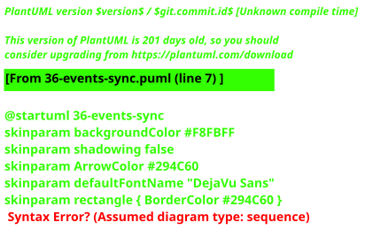

# events-sync integration

`events-sync` bridges the AT Protocol firehose and F1r3fly in both directions: it
serves on-chain activity as an ATProto sync stream, and records an external ATProto
firehose on chain. This document covers the on-chain contract and the two data
paths; the CLI surface is in the [crate README](../../packages/events-sync/README.md).

Implementation: `packages/events-sync/`. It is configured by CLI flags (not the
`EMBERS__…` environment) — the three globals `--wallet-key`, `--deploy-service-url`,
`--service-id` identify the signer, the target validator, and this service's on-chain
channels.



## `init` — the registry contract

`events-sync init` deploys this service's listener/notifier **registry contract** to
the chain, once per `--service-id`. It is the coordination point the `listen` and
`push` paths share: `listen` registers to be notified of on-chain updates, and
`push` records events against the same service identity. Running `init` is
idempotent per service id in the same spirit as the domain
[environment registry](../design/environment-registry.md).

## `listen` — serve Firefly outward as ATProto

`events-sync listen` runs two servers so on-chain activity appears as an ATProto
sync stream:

- a **gRPC communication service** the node calls to notify events-sync of updates
  (the reverse of the normal client direction — this is the
  `CommunicationService` server half from `firefly-client`), and
- an **ATProto sync API** implementing `com.atproto.sync.subscribeRepos`, so ATProto
  consumers subscribe to the chain-sourced repo stream.

`--extra-sources` merges additional upstream `subscribeRepos` firehoses into the
served stream, so a single endpoint can fan in the chain plus other relays.

## `push` — record an external firehose on chain

`events-sync push` subscribes to an ATProto `subscribeRepos` URL and deploys the
events to Firefly in **windows**, flushing a window when *either* bound is reached:

```math
\text{flush} \iff (\text{now} - t_{\text{start}} \ge \Theta_t) \;\lor\; (|W| \ge \Theta_n)
```

where `$\Theta_t$` is the time threshold and `$\Theta_n$` the size threshold. The
Docker `multiple-networks` profile runs it with `$\Theta_t = 3\text{ s}$` and
`$\Theta_n = 16$` events. Windowing amortizes deploy cost: rather than one deploy per
firehose event, events-sync batches up to a bounded size or a bounded latency,
whichever comes first — so a burst flushes on size and a trickle still flushes within
`$\Theta_t$`.

## Deployment

The Docker `multiple-networks` compose profile wires `events-init`,
`events-listen`, and `events-push` together against the local node and a host PDS
(see the [Docker guide](../operations/docker.md)). events-sync is a **read-mostly
consumer** of the node from embers' perspective — it shares no state with the embers
binary and is deployed independently.
