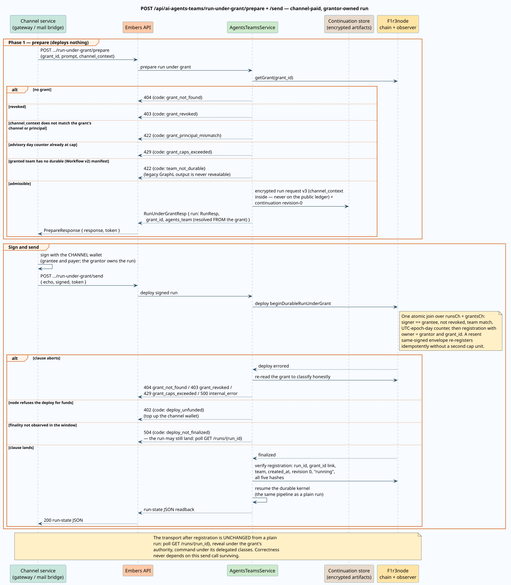

# F1R3BotGateway and chat channels

F1R3BotGateway is the multi-platform chat-bot workspace (`f1r3fly-bots/`): one
daemon, `botd`, fronts Discord, Slack, Mattermost, and Telegram behind a shared
verb grammar. embers integrates with it through the **grant-based
channel-connector layer**: the gateway is an embers API **client** whose wallet
is **grantee and payer** under users' on-chain grants, while every run it starts
is **owned by the granting user**. This document is the chat-channel primer; the
canonical architecture is
[external interfaces](../../../embers-frontend/docs/agent-teams/architecture/external-interfaces.md)
and the delegation model is
[channel grants](../../../embers-frontend/docs/agent-teams/architecture/channel-grants.md).

## F1R3BotGateway in one screen

The workspace's crates, as the integration meets them:

- **`bot-proto`** — the platform-neutral vocabulary: the verb grammar
  (`Verb::Team` with actions `link`, `unlink`, `list`, `run`, `status`,
  `approve`, `reject`, `cancel`, `output`, `whoami`; `#N` run handles; a
  2048-character prompt cap), reply payloads
  (`TeamRunStarted/Waiting/Output/Failed/OutputWithheld`), and origin identity.
- **`gateway`** — the engine. `teams.rs` hosts the `TeamsRuntime`: grant cache,
  run tracker, the 5-second sweeper, and the command path. Durability is SQLite
  (`F1R3FLY_STATE_DB`, mode 0600 — a run id is a capability URL): the teams
  surface adds `team_aliases` and `team_runs`, whose rows carry the platform
  message's idempotency key (indexed) so a redelivery after a restart finds the
  run the original message started; the grant cache and in-flight idempotency
  claims are deliberately in-memory routing state, rebuilt from the chain and
  the store.
- **`embers-client`** — the typed embers API client: an `EmbersApi` trait
  (grants-by-grantee, run-under-grant prepare/send, run state, reveal, commands)
  with a reqwest implementation, local signing
  (secp256k1 over blake2b-256 of the contract bytes, DER, low-S, RFC 6979,
  [doi:10.17487/RFC6979](https://doi.org/10.17487/RFC6979)), byte-stable
  prepare-response echoes (the JWT binds the exact exchange), and an in-process
  mock behind the `mock` feature.
  `tests/fixtures/grants/MOCK_CONTRACT.md` pins the whole assumed
  endpoint-by-request-by-response matrix **as built** — the one file where a
  divergence from the embers surface shows up as a reviewable diff.
- **Adapters** — the four platform crates plus `adapter-local`, a loopback HTTP
  adapter (`127.0.0.1:4855`, `BOT_LOCAL_ADAPTER=1`) that lets smoke tests and
  the local stack drive the full engine path — verbs, grants, deploys, replies —
  without a single SaaS credential.

## How a chat message becomes a grantor-owned run

A user types `team run <alias> <prompt>`. The gateway resolves the
workspace-local **alias** to a `rho:id:` team URI, derives the caller's
**principal** — `custody::author_hash(identity_key)`, workspace-scoped on
Discord/Slack/Mattermost and platform-global on Telegram (two guilds are two
principals; `team whoami` prints yours) — and looks up a live grant for
`(principal, team URI)` in its cache, refreshing **chain-read-first** from the
observer-readable `listGrantsByGrantee` clause (60 s periodic sync, on-miss
refresh rate-limited to 5 s). No grant answers with the grant-management URL and
the principal to paste there.

With a grant in hand: **Ack within 3 seconds, before any embers HTTP** — then
`run-under-grant/prepare`, local signing with the gateway wallet, and a bounded
send (130 s). The chain adjudicates the grant **atomically with run
registration** (`beginDurableRunUnderGrant`: signer is the grantee, not revoked,
team matches, UTC-day counter) and registers `owner = grantor` with the
`grant_id` link.

The blocking send is an optimization, never the correctness path: every send
failure is treated as **indeterminate**, the run record stays active, and the
sweeper polls `GET /runs/{run_id}` home — announcing suspended waits once per
revision, revealing on completion under the grant's `authority.reveal`, and
posting the rendered output with a `Run: <url>` backlink (platform caps: Discord
1900, Slack 3900, Mattermost 16000, Telegram 4000 characters; truncation is
stated, never silent). Revoked mid-run, the reveal answers 403 and the gateway
posts "output withheld" with the backlink — an expected path, not a failure; the
run still completes for its owner. The end-to-end sequences are
[diagram 53](../../../embers-frontend/docs/agent-teams/diagrams/53-chat-run-under-grant.svg)
(happy path) and
[diagram 54](../../../embers-frontend/docs/agent-teams/diagrams/54-slow-run-poll-and-reveal.svg)
(recovery loop); the tracker's state machine is
[diagram 57](../../../embers-frontend/docs/agent-teams/diagrams/57-chat-correlation-fsm.svg).

## Commands from chat

`team approve | reject | cancel` ride the ordinary command envelope under the
grant's delegated classes, restricted to the **run's initiator** — accepting a
bystander's approval would launder their intent through the initiator's grant
authority; non-initiators are pointed at the wait-level delegated-approver path
in the embers UI, where they decide with their own wallet. The decision identity
is deterministic per platform message
(`author_hash + ":" + message_id`), so a platform redelivery replays the same
decision and the ledger treats it idempotently. A stale revision fence is not an
HTTP error — the command deploys and does not apply — so the gateway re-reads
the run state and re-issues once with the **same** decision id.

## Failure vocabulary the gateway branches on

The connector operations answer machine-readable `{code, description}` bodies;
the gateway maps each to user-actionable chat text: `grant_not_found` (404),
`grant_revoked` (403), `grant_caps_exceeded` (429, "resets at midnight UTC"),
`grant_principal_mismatch` and `team_not_durable` (422), `deploy_unfunded`
(402, an operator alert — the *gateway's* wallet needs topping up), and
`deploy_not_finalized` (504, poll — the run may still land). Reveal refusals are
bare statuses from the pre-grant surface: 409 means not-ready, 403 means
withheld. The full taxonomy is in the
[HTTP API](../api/http-api.md#channel-connectors-and-grants).

## Operating it

The Agent-Teams surface activates exactly when `EMBERS_API_URL` is set. The
wallet is `EMBERS_WALLET_KEY_HEX` — an ordinary funded wallet, **never** the
embers service key; fund it at genesis on local stacks — with its REV address
supplied explicitly as `EMBERS_WALLET_ADDRESS`: grant reads are keyed by
address, and this workspace deliberately carries no REV-address derivation to
drift from the SDK's (the same pattern as the mail bridge's
`BRIDGE__WALLET_ADDRESS`). Supporting knobs:
`EMBERS_GRANT_URL` (where the no-grant message sends users),
`EMBERS_PUBLIC_RUN_URL` (backlinks), `EMBERS_GRANTS_REFRESH_MS` /
`EMBERS_GRANTS_ONMISS_MIN_INTERVAL_MS` (cache cadence),
`EMBERS_RUN_SEND_TIMEOUT_MS` / `EMBERS_RUN_POLL_INTERVAL_MS` /
`EMBERS_RUN_BUDGET_MS` (send bound, sweep cadence, 15-minute budget),
`EMBERS_MAX_ACTIVE_RUNS_PER_CHANNEL`, `EMBERS_RUN_PHLO_ESTIMATE` (the
fixed-charge spend admit), and the per-platform `EMBERS_OUTPUT_MAX_CHARS_*`
caps. Restart is cheap by design: the tracker rehydrates from
`RunStore::active_runs()` and the grant cache from the chain.

## Related

- [F1R3Mail integration](f1r3mail.md) — the sibling channel on the same grant
  model.
- [Channel grants](../../../embers-frontend/docs/agent-teams/architecture/channel-grants.md)
  — record schema, atomic adjudication, revocation semantics.
- [Channel-grant trust model](../../../embers-frontend/docs/agent-teams/security/channel-grant-trust.md)
  — what a compromised gateway can and cannot reach.
- API reference:
  [run under grant](../api/methods/ai-agents-teams/run-under-grant.md),
  [grants list](../api/methods/ai-agents-teams/grants-list.md),
  [reveal output](../api/methods/ai-agents-teams/reveal-output.md),
  [run commands](../api/methods/ai-agents-teams/run-commands.md).
