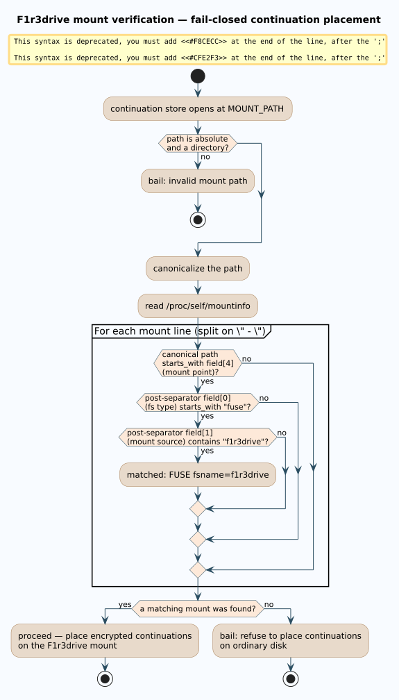

# F1r3drive integration

Embers refuses to start unless its **continuation store** — the encrypted, durable
home of every in-flight agent-team run — sits inside a **F1r3drive** FUSE mount.
This document explains that mount contract: what F1r3drive provides, exactly how
embers verifies the mount, and why the check fails closed.

Implementation: `packages/embers/src/domain/agents_teams/continuation_store.rs`
(`verify_f1r3drive_mount`, called from `ContinuationStore::open`). The store's
on-disk format and capability model are in
[continuation store](../architecture/continuation-store.md); this document is only
about the *placement* requirement.

## Why the mount is mandatory

The continuation store holds the resumable state of durable runs — encrypted with
AES-256-GCM and addressed by HMAC-derived capabilities (see
[continuation store](../architecture/continuation-store.md)). That state is the
single source of truth a crashed or restarted embers process recovers from, so it
must be **durable** and **isolated** rather than living on whatever ordinary disk
the mount path happens to resolve to. F1r3drive is the FUSE filesystem that
provides those guarantees. Rather than trust configuration to point at the right
place, embers **verifies at open time** that the configured `MOUNT_PATH` really is
inside a F1r3drive FUSE mount, and refuses to run otherwise.

## The mount check, step by step

`verify_f1r3drive_mount(path)` performs a fail-closed sequence:

1. **Shape.** The path must be **absolute** and an existing **directory** — two
   `ensure!` guards, each with a specific error.
2. **Canonicalize.** `path.canonicalize()` resolves symlinks and `..` so the
   comparison below is against the real location, not an alias that could point
   outside the mount.
3. **Consult the kernel mount table.** It reads `/proc/self/mountinfo`, the Linux
   per-process mount table — the authoritative record of what is mounted where, not
   a guess from the path string.
4. **Match a F1r3drive FUSE line.** A mount is accepted only if some line satisfies
   **all three** conditions below.

Each `mountinfo` line has a fixed shape, split by the literal `" - "` separator:

```text
36 35 98:0 /root /mount/point rw,noatime shared:1 - fuse f1r3drive rw,...
└id ┘ └parent┘ └dev┘ └root┘ └ field[4] ┘ └opts┘  └opt┘   └[0]┘  └[1]┘  └super opts┘
                              mount point                   fs     source
```

| Check | Field | Condition | Meaning |
| ----- | ----- | --------- | ------- |
| Under the mount | pre-separator field index **4** (mount point) | `canonical.starts_with(mount_point)` | the store path lives inside this mount |
| Is FUSE | post-separator field index **0** (filesystem type) | `starts_with("fuse")` | it is a FUSE filesystem, not ext4/tmpfs/etc. |
| Is F1r3drive | post-separator field index **1** (mount source) | lowercased `contains("f1r3drive")` | the FUSE `fsname` identifies F1r3drive |

If no line satisfies all three, the check **bails**:

```text
<path> is not inside the fsname=f1r3drive FUSE mount;
refusing to place continuations on ordinary disk
```



## Fail-closed, by design

Every branch that is not a positive match ends in refusal — an unreadable mount
table, a non-FUSE filesystem, a FUSE mount that is not F1r3drive, or a path outside
every mount. This is the same fail-closed posture the rest of the security model
takes (see [security model](../security/security-model.md)): the store would rather
not open at all than silently write recoverable, security-bearing state onto
ordinary disk where the F1r3drive durability and capability guarantees do not hold.

## The test bypass

Hermetic tests cannot mount a FUSE filesystem, so the store exposes a
`#[cfg(test)] open_for_test` constructor that calls `open_at_path` directly,
skipping `verify_f1r3drive_mount`. It exists **only** under `cfg(test)` and takes an
explicit caller-provided directory (a `tempfile`), so it cannot be reached from the
production binary. This is what lets the AES-GCM/capability property tests
(campaign step A2) and the kernel tests run entirely on loopback and ordinary temp
storage while the production path keeps the mount requirement.

## Operational consequences

- The [configuration](../operations/configuration.md) `CONTINUATION_STORE__MOUNT_PATH`
  must point at a directory inside a running F1r3drive mount before embers will
  boot; boot opens the store first, so a missing or wrong mount is a startup
  failure, not a lazy runtime error.
- On a restart, the cipher key file and the F1r3drive mount must both persist and
  be the same as before, or previously-written continuations become unreadable.
  See [deployment](../operations/deployment.md).
- In Docker, the F1r3drive mount is provided to the embers container as described in
  the [Docker guide](../operations/docker.md); the local dev-net mounts it via
  `stack.sh drive` (see [local stack](../operations/local-stack.md)).
