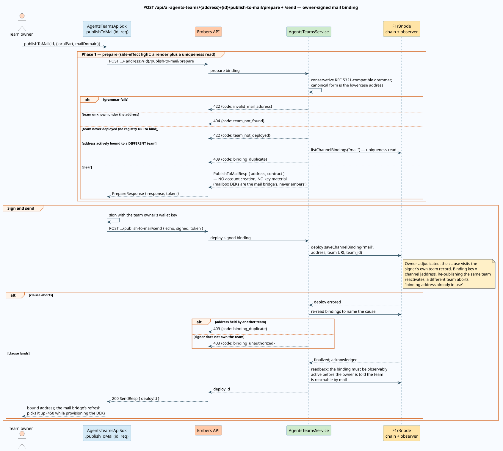

# F1R3Mail and the mail channel

F1R3Mail is the chain-backed mail transfer agent: a dependency-free MTA core
(`mta-branches/`) whose queue is a replicated Rholang contract, plus a
`teams-bridge/` workspace that connects it to embers. The integration gives an
Agent Team a real mail address: **publish-to-mail** binds `local@domain` to the
team on chain, the SMTP frontend recognizes bound addresses at RCPT time, and
the bridge turns inbound messages into **grantor-owned, bridge-paid** runs whose
answers come back as sealed replies. The canonical architecture is
[external interfaces](../../../embers-frontend/docs/agent-teams/architecture/external-interfaces.md);
the delegation model is
[channel grants](../../../embers-frontend/docs/agent-teams/architecture/channel-grants.md).

## F1R3Mail in one screen

- **`mail_queue.rho`** — the replicated MailQueue: one entry per *recipient*,
  enqueue **idempotent on the content fingerprint** (the only place the
  duplicate-delivery race can actually close), and a **lease** giving
  exactly-one-sender-at-a-time per delivery attempt without a lock server. An
  expired lease still in `leased` is the known unknown Postfix cannot name —
  here it is queryable (`leased-ambiguous`), so retry is policy, not a guess.
  The contract is valid, node-checked Rholang: map lookups answer `Nil` for a
  missing key, so every match puts the `Nil` arm first, and the claimable
  filter is a recursive walker contract (the grammar has no lambda).
- **`f1r3mta-shard/src/rho.rs`** — Rholang term construction under one rule:
  **user data never becomes syntax** (base64-only interpolation, re-checked at
  the point of use). Mutations forward their acknowledgment to the deploy id
  (readable after finality); reads answer on a `ret` channel for observer
  exploratory readback. Template-to-contract arity is pinned by
  `MAIL_QUEUE_ARITIES` and conformance-tested against both the contract source
  and the emitted terms — the lease template once dropped the contract's `now`
  parameter and could never match, which is exactly the drift the pin makes
  loud. The same module carries the embers-env probes the bridge lives on:
  `grants_by_grantee` and `mail_bindings`.
- **`f1r3mta-smtpd`** — the SMTP frontend with swappable admission policy. The
  default `StaticPolicy` is not an open relay; `DirectoryPolicy` layers
  team-address recognition over it (below).
- **`teams-bridge`** — the embers-facing consumer: `prompt.rs` (RFC 5322
  parsing and the loop guards), `keystore.rs` (mailbox keys and the run/reply
  ledger), `cipher.rs` (the production body cipher), `shard_adapter.rs` (chain
  I/O over `firefly-client`), and `config.rs` (the `BRIDGE__*` surface). It
  reuses the gateway workspace's `embers-client` crate — one pinned contract,
  two channel consumers.

## How a team gets a mail address

Publishing is an owner-signed, two-phase, on-chain binding — **deliberately
lighter than the f1r3sky publish**: prepare is a pure render plus an
address-uniqueness read (no account creation, no key material), the binding
record is the publication, and unpublishing merely flips `active` off,
reversibly. One address serves one team (`binding_duplicate` otherwise);
re-publishing the same team reactivates the same address.

The SMTP frontend answers RCPT from a **bound-address set refreshed by observer
chain reads** of the embers binding records — the embers HTTP service is never
in the consume path, and the set is replaced wholesale each refresh so
deactivated bindings never resurrect. A bound address whose mailbox key is not
yet minted answers `450` (`Provisioning`) — SMTP's own retry semantics
([RFC 5321](https://doi.org/10.17487/RFC5321)) absorb the seconds that takes;
unknown addresses answer `550`.

**The keystore split is the integration's trust boundary.** Binding records
carry no keys. The bridge lazily mints a per-mailbox data-encryption key (DEK),
wraps it under the operator's key-encryption key (KEK,
`BRIDGE__AES_ENCRYPTION_KEY`), and stores only the wrapped form on chain in its
own `TeamsBridgeEnv` — never in the embers env. An embers-held DEK would let
embers read third-party mail sent to the team, which the posting-only f1r3sky
app-password precedent never allowed; destroying the wrapped key is the
crypto-shredding erasure for that mailbox.

## How inbound mail becomes a run and a reply

The bridge is a lease consumer over the MailQueue
([lease FSM, diagram 58](../../../embers-frontend/docs/agent-teams/diagrams/58-mail-lease-fsm.svg)):
claim a message, decrypt, parse
([RFC 5322](https://doi.org/10.17487/RFC5322); plain text only until the MIME
phase — anything else is consumed with an "unsupported format" notice), and
guard against loops: the null reverse-path never triggers a run, non-team
senders with `Auto-Submitted` other than `no` are refused
([RFC 3834](https://doi.org/10.17487/RFC3834)), and the `X-F1R3-Hops` chain has
a ceiling (default 5) so agent-to-agent mail chains stay a feature rather than
an outage.

Authorization is **chain-read-first**: the sender must hold a live, unrevoked
mail grant for the bound team, read from the observer. No grant is a **third
failure class** — an onboarding-notice reply and `delivered`, never a bounce
(backscatter-guarded). With a grant, the bridge claims the message fingerprint
in its run ledger (`claimRun`, a compare-and-set that makes "exactly one run per
message" survive crashes and lease takeovers), then drives the standard
connector transport: `run-under-grant` prepare, sign with the **bridge wallet**
(grantee and payer — never the embers service key), send, poll within the run
budget (default 30 minutes), reveal under the grant's authority. The reply is
rendered as plain text (64 KiB default cap) with a `Run: <url>` backlink,
`Auto-Submitted` and threading headers, an incremented hop count — then
`recordReply` (exactly one reply per run), sealing, and enqueue; inside the
closed federation, enqueue *is* delivery. Revoked mid-run, the reveal's 403 is
an expected outcome: the bridge sends "output withheld; reveal with your wallet
at Run: <url>" and marks the original delivered — the run still completes for
its owner. The full sequence is
[diagram 55](../../../embers-frontend/docs/agent-teams/diagrams/55-mail-inbound-run-reply.svg).

## Mail-grant hardening before sender authentication

A mail principal is a `MAIL FROM` address, which is an assertion until
SPF/DKIM/DMARC enforcement lands. The layered posture, all as-built: the
**closed-federation sender policy** default (`BRIDGE__SENDER_POLICY=local-only`;
`allowlist` narrows, `open` announces its widened surface at startup); the
**bridge MAC** (`X-F1R3-Bridge-MAC`, HMAC under the operator KEK over the
message fingerprint) closing intra-federation spoofing of team principals;
optional per-grant **`require_token`** (plaintext shown once at creation, only
its blake2b-256 digest on chain); and the grant's **`min_auth`** floor
(`none | spf | dkim | dmarc`), recorded in the schema now and enforceable
against the `AuthResults` the MailQueue already records per message
(spf, dkim, dmarc, remote IP, HELO, TLS) once real verifiers land. A spoofed
sender can never exfiltrate output — replies route to the *real* principal's
sealed mailbox — but does burn caps and bridge funds and can drive
victim-attributed side effects; the full analysis is in the
[channel-grant trust model](../../../embers-frontend/docs/agent-teams/security/channel-grant-trust.md#the-mail-specific-analysis-what-a-spoofed-sender-can-and-cannot-do).

## Operating it

The daemon is `f1r3mta-bridge`, one binary with the operator verbs:

- **`consume`** — the lease-consumer loop described above.
- **`serve-smtp`** — the production SMTP frontend the simulator workspace's
  serve gate refused to host: `Session` + `DirectoryPolicy`, the AES-256-GCM
  body cipher, durability mode A (WaitForBlock) over the real shard, and the
  chain-backed fingerprint index.
- **`deploy-contracts`** — deploys MailQueue, TeamsBridgeEnv, and ContentStore
  (sources compiled into the binary) and prints the three
  `BRIDGE__*_REGISTRY_URI` values to pin; each contract forwards its registry
  URI to the deploy id, so the readback is exact, not log-scraped.
- **`provision-keys`** / **`refresh`** — mint wrapped DEKs for
  bound-but-unkeyed addresses; one discovery pass printing binding, grant, and
  key state.
- **`selfcheck`** — configuration, connectivity, and a wallet-address
  consistency check (the chain read and the embers HTTP mirror must answer the
  same grant set for `BRIDGE__WALLET_ADDRESS`).
- **`derive-env-uri`** — prints the `rho:id:` URI for an insert-signed env
  key using firefly-client's own derivation, so the agents-teams env URI is
  computed, never copied.

Configuration is entirely `BRIDGE__*` environment variables: the wallet
(`BRIDGE__WALLET_KEY` hex and its `BRIDGE__WALLET_ADDRESS`, an ordinary funded
wallet), `BRIDGE__EMBERS_API_URL`, validator and observer URLs, the four
registry URIs (MailQueue, bridge env, content store, and the embers
agents-teams env for grant/binding reads), `BRIDGE__AGENTS_DOMAIN`, the KEK,
and the loop's tuning: 5 s poll, 15 min lease TTL, 30 min run budget, 240 s
finality budget, 130 s send timeout, 5 attempts, 64 KiB replies, 5 hops. A
stable `BRIDGE__WORKER_ID` survives restarts so a recovering bridge recognizes
its own ambiguous leases. There is no custodial rehearsal mode: the grant
endpoints landed before the bridge, so it shipped grant-native.

The local stack wires all of this: `stack.sh mail` builds the bridge, deploys
the contracts once per chain, runs `selfcheck`, and manages the consumer as a
user service; `stack.sh bots` and `stack.sh grant-smoke` do the same for the
chat sibling.

## Related

- [F1R3BotGateway integration](f1r3botgateway.md) — the sibling channel on the
  same grant model and the shared `embers-client` contract.
- API reference:
  [publish to mail](../api/methods/ai-agents-teams/publish-to-mail.md),
  [unpublish mail](../api/methods/ai-agents-teams/unpublish-mail.md),
  [bindings](../api/methods/ai-agents-teams/bindings.md),
  [run under grant](../api/methods/ai-agents-teams/run-under-grant.md).
- [Channel grants](../../../embers-frontend/docs/agent-teams/architecture/channel-grants.md)
  — the delegation model, including the UTC-day cap the bridge's refusals cite.
